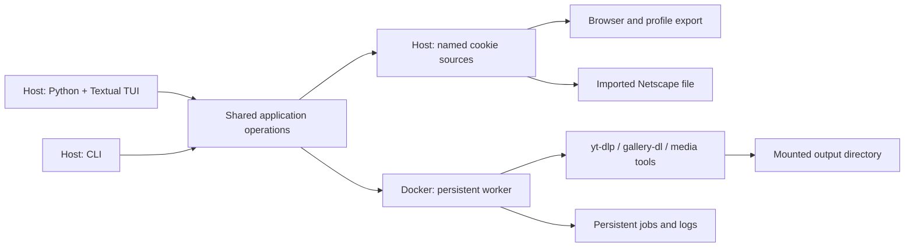

# Target design

Status: Stage 1 is implemented. P0002's portable writes and cookie/setup refresh
hardening and runtime-home ownership are implemented. Stage 2's named cookie
source contract is settled in P0003. P0003-C01 implements its internal parser,
safe summaries, immutable registry reader, and locked atomic host writer;
P0003-C02 implements locked legacy migration and public list/inspect/default
operations. PR #41 implements accepted browser/file registration and explicit refresh.
PR #49 ships the container runner for private execution, tested in the image;
no host route calls it yet.
Downloads/export/setup/doctor retain the Stage 1 shared jar until cutover.
Stages 3–4 remain proposed.

## Agreed decisions

These are recorded in the [decision log](decisions.md), with their reasons:

1. Support macOS and Linux hosts, keeping download execution in Docker (DEC-1).
2. Abstract host-specific setup and file locations out of operational logic
   (DEC-2).
3. Support named cookie sources backed by a browser/profile or imported Netscape
   file, selectable per job (DEC-3).
4. Remove tmux entirely; it is not part of the future worker or TUI architecture
   (DEC-4).
5. Build the TUI in **Python + Textual** (DEC-5).
6. Preserve useful existing download behavior through explicit presets (DEC-6).

Stage 1 (project P0001) added DEC-7 to DEC-23: the host application and its
installation, configuration and locations, the container contract, presets,
VPN mode, structured health checks, migration, and the implementation details
the delivery chunks settled. The sections below distinguish the implemented
Stage 1 contracts from the later proposals.

Project P0002 adds DEC-24 to DEC-27 for the remaining Stage 1 follow-ups:
portable no-clobber writes, cookie and user-agent refresh outcomes, and runtime
ownership of application directories in `dl`'s home. P0002-C01 implements the
portable writes (D1); P0002-C02 implements cookie and setup refresh (D2).
P0002-C03 implements runtime-home ownership (D3, DEC-26).

Project P0003 settles Stage 2 with DEC-28 to DEC-33: a managed source store,
browser/file operations, strict parsing, submission-pinned cookie revisions,
private startup jars, independent user-agent policy, and host-command migration.
DEC-34 pins snapshot metadata and interrupted staging details for the shared
producer/cleanup boundary. See *Named cookie sources*.

Native downloader execution and a remote-server control protocol are not required
by the agreed scope. The exact worker interface remains open; host packaging
for Stage 1 is settled (DEC-7).

## Proposed boundaries



The host owns browser access, user configuration, cookie export/import, and the
TUI. Docker owns download execution, media processing, and VPN integration.

The CLI and TUI call the same application operations. They should not depend on
interactive shell startup or scrape `just doctor` output. Existing `just` commands
can remain thin compatibility wrappers during migration.

The worker must outlive the TUI. Closing and reopening the UI reconnects to
existing work. Restart recovery comes from persisted job state, not a terminal
multiplexer. The transport between host and worker needs a separate decision;
this design does not require a network API merely to support local Docker.

## Host application

Settled for Stage 1 (DEC-7). The package, its entry points, and `init` and
the `config` commands except `user-agent` are implemented (P0001-C01).
Compose and the lifecycle commands are implemented (P0001-C02), and `shell`,
`vpn`, `servers`, and the login on `config set-token` (P0001-C03): every D2
command is implemented. `config user-agent`, `dl`, `batch`, and `watch` are
implemented (P0001-C04, D3); `doctor` is implemented (P0001-C05, D4).

The shared operations, the CLI, and later the TUI are one Python package,
`downloadinux`, under `src/downloadinux/`, managed with uv and installed with
`uv tool install --editable .` from the checkout. Two entry points,
`downloadinux` and `dlx`, run the same function. Subcommands are the CLI; bare
invocation is reserved for the TUI and prints help until Stage 4. The CLI is
built on `argparse`.

Install assets (Dockerfile, Compose files, presets, container scripts) are
read from the checkout that holds the installed package; the CLI fails with an
actionable error if they are missing. Every Docker interaction goes through
the CLI, which runs `docker compose` with an explicit project name, explicit
Compose files, and an environment it computes from the effective settings.
Downloader commands are passed as argument lists, never as shell strings, and
never through interactive shell startup.

Package details, pinned for P0001-C01:

- Python 3.11 or later (`requires-python = ">=3.11"`, for `tomllib`), with
  `.python-version` naming 3.13 and `uv.lock` committed. The one runtime
  dependency in Stage 1 was `tomlkit`, used only to write and edit settings
  and credentials so comments survive; reading uses `tomllib`. Stage 2 adds
  `yt-dlp==2026.8.19` for host-only direct browser cookie extraction
  (DEC-29, PR #41); its browser code is loaded only for browser operations.
  No host media dependency is added.
  pytest is a dev dependency. `python -m downloadinux` runs the same
  function as the entry points.
- The checkout root is the directory that holds `src/downloadinux/`. A
  command that needs an install asset fails, naming the missing path, if it
  is absent; a command that only reports a path (`config show`'s `/config`
  mapping) reports it whether or not it exists.
- `--config PATH` and `--set key=value` are accepted before or after the
  subcommand.
- Exit status: 0 on success, 1 when an operation fails (a refused overwrite,
  a malformed token, a failed health check), 2 for a usage error or invalid
  configuration. Errors go to stderr as `downloadinux: error: …`; a
  configuration error names the file (or `--set`) and the key.
- Writes to the settings and credentials files go through a temporary file in
  the same directory, created with the final mode and synced before it is
  published. Replacing an existing file uses an atomic rename; a no-clobber
  write never replaces a target that already exists.
- A failure the operating system reports (a directory that cannot be created,
  a file that cannot be written or read, a missing `docker` executable) is an
  operation failure: exit 1, reported as `downloadinux: error: <path>: <reason>`,
  never a traceback.

Portable no-clobber writes, pinned for P0002 (DEC-24):

Implemented in P0002-C01 (D1), including settings and credentials import
creation. DEC-27 clarifies cleanup when the OS cannot prove ownership or
remove an entry.

- A no-clobber write first tries to publish its synced same-directory
  temporary file by hard link, which atomically fails with `FileExistsError`
  when the target exists. Only `EPERM`, `EOPNOTSUPP`, or `ENOTSUP` from that
  link attempt select the fallback; every other error keeps its normal failure
  meaning.
- The fallback reserves the target with `O_CREAT | O_EXCL` at mode 000, records
  that reservation's device and inode, closes it, and atomically replaces that
  reservation with the temporary file. An existing target still produces
  `FileExistsError`. On a handled failure after reservation, cleanup removes
  the target only when it is still the reservation the operation created; it
  never removes a path another actor replaced.
- The fallback therefore supports exFAT and other filesystems without hard
  links while keeping the completed contents behind one replace and preserving
  the no-clobber boundary. A process killed between reservation and replacement
  may leave the mode-000 reservation; a later no-clobber write refuses it as an
  existing target rather than guessing that it is safe to delete.
- If `fstat` cannot record the reservation's identity, or cleanup cannot inspect
  the directory entry, that entry is preserved rather than guessed safe to
  remove (DEC-27). A failed unlink can also leave residue. Descriptor closure
  and temporary cleanup are attempted regardless; OS errors from publication
  or cleanup retain the path-bearing exit-1 contract. A cleanup error takes
  precedence over the original error.

Docker invocation, pinned for P0001-C02:

- Every command that runs Compose runs `docker compose --project-name
  <container.project> --project-directory <checkout root> --file
  compose/base.yaml`, adding `--file compose/vpn.yaml` when `vpn.enabled` is
  true, as an argument list. The Compose files are install assets (a missing
  one fails as above).
- Its environment is the CLI's own, with every inherited variable whose name
  starts `DOWNLOADINUX_` removed except `DOWNLOADINUX_CONFIG` and
  `DOWNLOADINUX_IMAGE`, and then the variables of *Container contract*'s
  table set from the effective settings. The `DOWNLOADINUX_NORDVPN_*`
  variables are set only when `vpn.enabled` is true; otherwise the token
  appears nowhere in the command or its environment.
- `compose -- <args>` appends `<args>` unchanged and exits with
  `docker compose`'s own status. It creates no directory and checks no path.
- `build` runs `build`; `up` runs `up -d`; `down` runs `down`; `restart` runs
  `up -d --force-recreate`; `update` runs `build --no-cache`, then `up -d`.
  `up`, `restart`, and `update` first refuse, exit 1, when `paths.downloads`
  does not exist (naming it), and create `paths.state` and `paths.cookies`
  (the cookies directory at mode 0700) when absent. A lifecycle command whose
  `docker compose` exits non-zero exits 1.
- Operations run `docker` through an injectable runner, so no test starts a
  process.

Commands in the container, pinned for P0001-C03:

- A command that runs a program inside the container runs Compose's
  `exec -u dl downloadinux <argv>` through the invocation above, the program
  and its arguments as a list. It adds `-T` whenever the CLI captures the
  output (`servers`, the login below), never for `shell`. "The container is
  running" means `ps --status running --quiet downloadinux` exits 0 with
  non-empty output; the injectable runner gains a way to capture a
  command's standard output for this and for `servers`. Standard error is
  never captured: Compose's own failures stay on the terminal (DEC-17).
- `shell` runs `zsh` that way and exits with its status. It checks no path.
- `vpn [args…]` runs the container's `vpn` helper (`scripts/vpn.sh`) with
  `args`, `status` when there are none, and exits with its status. With
  `vpn.enabled` false it runs nothing and exits 1 with an error naming
  `vpn.enabled` (DEC-16).
- `servers [city] [country]` (defaults `New_York` and `228`, the United
  States) runs `curl -sg --max-time 40
  'https://api.nordvpn.com/v1/servers/recommendations?filters[country_id]=<country>&limit=0'`
  in the container, which is the thing on the VPN (`-g`: the brackets are
  literal, not a curl glob), and ranks the captured JSON on the host. An
  underscore in `city` stands for a space. The output is the old script's,
  unchanged: up to eight servers in that city, least load first, or, when it
  has none, the wrapped list of cities, both exit 0. A fetch that exits
  non-zero or a body that is not JSON, or is JSON but not the server list
  (DEC-18), is an operation failure, exit 1: `could not reach the Nord API
  from the container (VPN down, or killswitch blocking?)`. It runs whether
  or not the VPN is enabled. The ranking lives in the package
  (`downloadinux.servers`); the old script and the gate step that compiled
  it are gone.
- `config set-token` stores the token as before, then, when `vpn.enabled` is
  true and the container is running, logs the daemon in:
  `exec -T -u dl -e NORDVPN_TOKEN downloadinux sh -c 'nordvpn login --token
  "$NORDVPN_TOKEN"'`, with `NORDVPN_TOKEN` set only in that `docker compose`
  process's environment, so the token is in no host argument list. The
  login's output is discarded. On success it prints `Logged in.` and, when
  `vpn.autoconnect` is true, runs `nordvpn connect` with `vpn.server` split
  on whitespace (no argument when empty), reporting whether it connected; a
  failed connect is a warning, exit 0. A failed login exits 1, saying the
  token is stored but the daemon refused it, and that a daemon already
  logged in needs `dlx vpn logout --persist-token` first (a plain `logout`
  revokes the daemon's token, DEC-19). When the container is not
  running, it says the login happens at the next `dlx up`; when the VPN is
  disabled, it says the token is stored for when it is enabled and runs
  nothing; both exit 0 (DEC-16).

Downloads, pinned for P0001-C04:

- `dl <preset> <url>…` takes at least one URL; `preset` is `video` (`v`)
  or `gallery` (`gal`, `g`), anything else a usage error, exit 2. It runs
  the preset's argument list (*Presets*) with the URLs appended, through
  `exec -u dl downloadinux` uncaptured (no `-T`: the downloaders draw
  progress on the terminal), and exits with its status. It needs neither
  the VPN nor a running check: Compose reports a stopped service itself.
- `batch <preset> [queue]`: the queue defaults to the preset's default
  queue file in `paths.downloads`. A given path expands a leading `~` and
  is made absolute against the working directory without resolving links
  (`os.path.abspath`). It must be an existing file, else exit 1,
  `no such queue file: <path>`, and lie under `paths.downloads` compared
  the same way, else exit 1, `<path> is outside paths.downloads (<dir>); the
  container cannot see it`. Its container path is `/downloads/` plus its
  path relative to `paths.downloads`. The command then runs, through
  `exec -u dl downloadinux` uncaptured, `tmux new-session -d -s <session>
  -c /downloads zsh -f -c <script> zsh <container queue> <log prefix>
  <title> <colour> <argv…>`, each a separate argument. `<script>` is
  `source /home/dl/.zsh-custom/batch.zsh && _batch_downloader_core "$@";
  echo; echo "[done — press a key]"; read -k1`; `zsh -f` reads none of
  `dl`'s startup files. `<argv…>` is the preset's argument list without URLs, and for
  `gallery` has `-q` right after `gallery-dl`, as `dlgal_batch` does today
  (DEC-6). tmux runs a command given as several arguments directly, without
  a shell, so every word arrives intact (checked against the image's tmux
  3.5a). On success it prints `Queue: <container queue>` and `Running
  detached in tmux session <session>. Watch it with: dlx watch <preset>`,
  exit 0. A non-zero status from Compose (a session of that name already
  running, a stopped container) exits 1: `could not start tmux session
  <session>; if one is already running, attach with dlx watch <preset>`.

  | Preset | Session | Default queue | Log prefix | Title | Colour |
  | --- | --- | --- | --- | --- | --- |
  | `video` | `batch-video` | `dlmp4_queue` | `dlmp4` | `Batch Download` | `blue` |
  | `gallery` | `batch-gallery` | `dlgal_queue` | `dlgal` | `Gallery Batch Download` | `magenta` |

- `watch [preset]` (default `video`) maps `video`/`v` to `batch-video` and
  `gallery`/`gal`/`g` to `batch-gallery`; any other word is taken as a tmux
  session name, as today. It runs `tmux attach -t <session>` through
  `exec -u dl downloadinux` uncaptured and exits with its status.
- `config user-agent` reads `CFBundleShortVersionString` from
  `/Applications/Google Chrome.app/Contents/Info.plist` with `plistlib`
  (no `defaults` subprocess). The major version is the text before the
  first `.` and must be all digits. It sets `downloads.user_agent` to
  `Mozilla/5.0 (Macintosh; Intel Mac OS X 10_15_7) AppleWebKit/537.36
  (KHTML, like Gecko) Chrome/<major>.0.0.0 Safari/537.36` (Chrome freezes
  the macOS version and zeroes everything after the major) and prints
  `User-agent pinned to Chrome <major> (host has <version>).`. An existing
  settings file is edited with `tomlkit`, so comments survive (adding a
  `[downloads]` table when it has none), written atomically with its
  current permission bits, and not written at all when it already holds
  that value. A missing settings file is written as the starter file `init`
  would write (`--set` values included), with the new value in place of
  `downloads.user_agent`. When the version cannot be read
  it prints `downloadinux: warning: cannot read Chrome's version from
  <plist path>; downloads.user_agent is unchanged`, writes nothing, and
  exits 0 (DEC-21). With a `VALUE` argument it writes that literal through
  the same edit instead and never reads the plist (*Named cookie sources*
  §4, DEC-37; implemented).

Stage 1 subcommands, each a thin front for an operation the TUI will call:

| Command | Operation |
| --- | --- |
| `init` | Write a starter config (VPN off) if none exists |
| `config show [--json]` | Effective settings, the source of each, and host→container mappings; secrets shown only as `set`/`unset` |
| `config import-env` | Migrate an existing `.env` (DEC-13) |
| `config set-token` | Validate and store the NordVPN token; log in if the container runs |
| `config user-agent [VALUE]` | Write an explicit user-agent literal, or refresh it from the host Chrome (DEC-10; *Named cookie sources* §4) |
| `build`, `up`, `down`, `restart`, `update` | Image and container lifecycle |
| `compose -- <args>` | Pass-through to `docker compose` with the computed project, files, and environment |
| `shell` | Interactive zsh in the container as `dl` (a convenience, not an execution path) |
| `dl <preset> <url>…` | Download with a preset |
| `batch <preset> [queue]`, `watch <preset>` | Stage 1 compatibility batch (DEC-13) |
| `vpn <args>`, `servers [city] [country]` | NordVPN helpers |
| `doctor [--json]` | Structured health check (DEC-12) |

`video` (alias `v`) and `gallery` (aliases `gal`, `g`) name the presets.

## Configuration and paths

Settled for Stage 1 (DEC-8). Implemented in P0001-C01: the settings and
credentials files, their locations, `config show`, `init`, and
`config set-token` (storing; its login on set is implemented in P0001-C03).

Separate installation files, user configuration, credentials, and mutable state.
Routine operation must not rewrite tracked files in the checkout.

| What | Default host location |
| --- | --- |
| Settings | `$XDG_CONFIG_HOME/downloadinux/config.toml` |
| Credentials (NordVPN token) | `credentials.toml` beside the settings file, mode 0600 |
| Managed cookies | `$XDG_DATA_HOME/downloadinux/cookies/` (directory 0700) |
| State | `$XDG_STATE_HOME/downloadinux/` |

Unset or empty `XDG_*` variables fall back to `~/.config`, `~/.local/share`,
and `~/.local/state` on both macOS and Linux. The settings file is chosen by
`--config PATH`, then `DOWNLOADINUX_CONFIG`, then the default. A missing
settings file is not an error: every setting has a default. The CLI creates
the cookies and state directories when it needs them; it never creates the
downloads directory, because a missing one usually means an unmounted drive.

Precedence, highest first: invocation overrides (`--set key=value`,
repeatable, on any command), the settings file, built-in defaults. No other
environment variable sets a setting.

Settings in Stage 1:

```toml
[paths]
downloads = "~/Downloads"   # host output root; must exist
# state   = default from XDG_STATE_HOME
# cookies = default from XDG_DATA_HOME

[container]
project  = "downloadinux"   # Compose project name
# uid, gid = the invoking host user's
# timezone = the host's zone (from /etc/localtime), else "UTC"

[downloads]
user_agent = "Mozilla/5.0 (Macintosh; Intel Mac OS X 10_15_7) AppleWebKit/537.36 (KHTML, like Gecko) Chrome/151.0.0.0 Safari/537.36"

[vpn]
enabled     = false
server      = ""          # passed to `nordvpn connect`; empty = fastest
technology  = "openvpn"   # or "nordlynx"
killswitch  = false
autoconnect = false
```

Validation: an unknown table or key, or a value of the wrong type, is an error
that names the key and the file. Paths expand a leading `~`; a path that is
still relative is an error. `technology` accepts only `openvpn` and
`nordlynx`. `--set` values are parsed as TOML values, falling back to a plain
string. The token, when set, must be 64 lowercase hex characters.

`config show` lists every effective setting with its source (`default`,
`file`, or `override`) and the host→container mapping of each mount, and
never prints the token or cookie contents.

Further rules, pinned for P0001-C01:

- An `XDG_*` variable that is relative is treated as unset, as the XDG
  specification requires. `--config` and `DOWNLOADINUX_CONFIG` expand `~` and
  resolve a relative path against the working directory; an empty
  `DOWNLOADINUX_CONFIG` is unset. A missing file named by either is not an
  error, the same as the default.
- `container.uid` and `container.gid` are non-negative integers defaulting
  to `os.getuid()` and `os.getgid()`. `container.timezone` defaults to the
  part of `/etc/localtime`'s symlink target after `zoneinfo/`, and to `UTC`
  when that is not a symlink or has no such part.
- `paths.state` defaults to `$XDG_STATE_HOME/downloadinux` and `paths.cookies`
  to `$XDG_DATA_HOME/downloadinux/cookies`. Paths are expanded (`~`) but not
  resolved, so a symlinked drive keeps the path the user wrote.
- `--set` takes `table.key=value`; a missing `=` or an unknown key is a
  configuration error naming `--set`. For a string or path setting, a value
  that is not a quoted TOML string is the plain text after `=` (so
  `--set vpn.server=123` is the string `123`); integer and boolean settings
  parse the value as TOML. A `--set` is validated like a file value.
- Loading settings never checks that `paths.downloads` exists: `config show`
  marks it missing, `up` refuses to start without it, and `doctor` reports
  it.
- The credentials file is TOML with one table, `[nordvpn]`, holding
  `token`. Unknown keys and wrong types are configuration errors, like the
  settings file's. A token that is not 64 lowercase hex characters is not a
  load error: `config show` reports it `malformed` and `doctor` fails it.
- `config show` prints one line per setting (`key = value  (source)`), then
  the settings and credentials file paths (each marked missing when absent),
  the token's state, and the four mounts. `config show --json` prints:

  ```json
  {"config_file": {"path": "/home/u/.config/downloadinux/config.toml", "exists": true},
   "credentials_file": {"path": "/home/u/.config/downloadinux/credentials.toml", "exists": false},
   "settings": [{"key": "paths.downloads", "value": "/home/u/Downloads", "source": "file"}],
   "token": "unset",
   "mounts": [{"container": "/downloads", "host": "/home/u/Downloads", "access": "rw", "exists": true}]}
  ```

  `settings` lists every setting in schema order (the order of the example
  above, with `paths.state` and `paths.cookies` after `paths.downloads` and
  `container.uid`, `container.gid`, `container.timezone` after
  `container.project`); `token` is `set`, `unset`, or `malformed`; `mounts`
  lists `/downloads`, `/config`, `/state`, `/cookies` in that order.
- `init` writes the starter file at the selected settings path: every
  setting of the example above with its default, the computed defaults
  (`paths.state`, `paths.cookies`, `container.uid`, `gid`, `timezone`) left
  commented out, and any `--set` values written in. It refuses, exit 1, if
  the file exists; it has no `--force`. It writes no credentials file.
- `config set-token [TOKEN]` takes the token as an argument, else prompts
  without echo on a terminal, else reads one line from standard input. A
  malformed token is refused, exit 1, with its length but never its value.
  It writes the credentials file at mode 0600, creating the directory.

## Container contract

Settled for Stage 1 (DEC-9). Implemented in P0001-C02: Compose files,
runtime identity, mount preparation, and transitional links (DEC-15).
Implemented in P0001-C04 (D3): `DL_USER_AGENT`, the shell helpers on the
presets, the batch loop's own file, and the end of DEC-15's interval (the
`/legacy/` binds and the links are gone).

| Container location | Host source | Access | Purpose |
| --- | --- | --- | --- |
| `/downloads` | `paths.downloads` | read-write | Download output, queues, batch logs, gallery archive |
| `/config` | the checkout's `presets/` | read-only | Shipped presets |
| `/state` | `paths.state` | read-write | Generated per-invocation files; later jobs and logs |
| `/cookies` | `paths.cookies` | read-write | Managed cookie jar (`cookies.txt` in Stage 1) |

Binds use Compose's long volume syntax, so host paths may contain spaces or
colons. The NordVPN login and shell history keep their named volumes.

The container user is always `dl`. The entrypoint, running as root, applies
the UID and GID the CLI passes (reusing an existing group with that GID),
creates the directories it needs under `/downloads`, `/state`, and `/cookies`
as that user, and drops to it. It never changes ownership recursively on a
mount. The worker never needs the host username or home directory (DEC-2).
Compose sets no `container_name`; `container.project` names the project, so
two configs with different project names run side by side.

Compose files and the entrypoint, pinned for P0001-C02:

- `compose/base.yaml` defines the one service, `downloadinux` (hostname
  `downloadinux`, image `${DOWNLOADINUX_IMAGE:-downloadinux:latest}`, build
  context the project directory, `stdin_open`, `tty`,
  `restart: unless-stopped`), the four binds above in long syntax, and the
  named volumes `nordvpn-data` (at `/var/lib/nordvpn`) and `zsh-history` (at
  `/home/dl/.local/share/downloadinux`). It has no `container_name`, no
  `env_file`, no build arguments, and apart from the image name interpolates
  only the variables below, each without a default. The default project
  name, `downloadinux`, is the one Compose derived from the checkout's
  directory before, so the existing named volumes and the NordVPN login carry
  over. `compose/vpn.yaml` is in
  *VPN mode*. `DOWNLOADINUX_IMAGE` is a test seam the gate's smoke test sets;
  the CLI never sets it.

  | Compose variable | From | Container environment |
  | --- | --- | --- |
  | `DOWNLOADINUX_DOWNLOADS` | `paths.downloads` | bind source of `/downloads` |
  | `DOWNLOADINUX_PRESETS` | the checkout's `presets/` | bind source of `/config` |
  | `DOWNLOADINUX_STATE` | `paths.state` | bind source of `/state` |
  | `DOWNLOADINUX_COOKIES` | `paths.cookies` | bind source of `/cookies` |
  | `DOWNLOADINUX_UID`, `DOWNLOADINUX_GID` | `container.uid`, `container.gid` | `DL_UID`, `DL_GID` |
  | `DOWNLOADINUX_TZ` | `container.timezone` | `TZ` |
  | `DOWNLOADINUX_USER_AGENT` | `downloads.user_agent` | `DL_USER_AGENT` (from P0001-C04, DEC-20) |

  The prefix keeps Compose's automatic read of a `.env` in the project
  directory from supplying any of them: the legacy `.env` names none.
- The image builds user `dl` as UID and GID 1000 with home `/home/dl`, and
  its working directory is `/downloads`. At start the entrypoint, as root,
  applies `DL_UID` and `DL_GID` (either unset keeps the image's value): a GID
  that already names a group makes that group `dl`'s primary group, else
  `dl`'s own group takes the GID; a UID already used by another account is an
  error that stops the container with a message naming it. Ownership changes
  stay inside the image's `/home/dl` and never follow a link. Then, as `dl`,
  it creates `/downloads/dlmp4` and `/downloads/dlgal`, and the placeholder
  `/cookies/cookies.txt` (mode 0600) when absent; a mount it cannot write is
  a warning, not a stop, so `doctor` can report it.
- The checkout's `presets/` exists from P0001-C02 (holding a README until D3
  moves the presets in), since a long-syntax bind fails on a missing source.
- Until D3 (done in P0001-C04, below) the entrypoint also kept the old
  in-container paths working (DEC-15): the base file binds the checkout's `config/yt-dlp` and
  `config/gallery-dl` read-only at `/legacy/yt-dlp` and `/legacy/gallery-dl`,
  and the entrypoint links `/home/dl/Downloads` → `/downloads`,
  `/home/dl/cookies` → `/cookies`, `/home/dl/.config/yt-dlp` →
  `/legacy/yt-dlp`, and `/home/dl/.config/gallery-dl` → `/legacy/gallery-dl`,
  after applying the IDs.

Pinned for P0001-C04, the end of DEC-15's interval:

- The base file's environment gains `DL_USER_AGENT` from
  `DOWNLOADINUX_USER_AGENT` (table above, DEC-20), in both VPN modes.
- The `/legacy/` binds, the four links, and the entrypoint loop that
  removes stale links before `usermod` are gone, and so is the checkout's
  `config/` directory (*Presets*). Nothing in the image, the entrypoint, or
  the `zsh/` files names `/home/dl/Downloads`, `~/cookies`,
  `~/.config/yt-dlp`, or `~/.config/gallery-dl`; the interactive shell
  starts in `/downloads`. The gate's smoke test asserts that the four old
  paths do not exist and that `/config/video/yt-dlp.conf` and
  `/config/gallery/config.json` are readable as `dl`.
- The container's `dlmp4`, `dlgal`, `dlmp4_batch`, and `dlgal_batch` keep
  their names and run the argument lists of *Presets* and of `batch`
  (*Host application*), with `$DL_USER_AGENT` as the user-agent. The batch
  loop, `_batch_downloader_core`, moves unchanged into its own file,
  `zsh/batch.zsh` (in the image `/home/dl/.zsh-custom/batch.zsh`), which
  `batch` sources and the interactive shell sources with the other `zsh/`
  files; `exifmod` stays in `functions.zsh`.
  These remain the implemented Stage 1 contracts. Stage 2's *Named cookie
  sources / Compatibility and migration* retires the four download shortcuts
  and their user-agent environment channel at cutover (DEC-33, amended
  2026-10-09); the non-interactive batch loop and `exifmod` remain.
- Entrypoint messages (issue #18): without a token, `NORDVPN_TOKEN not set.
  Store one on the host with: just token <token>`; the last line, `Ready.
  Shell in with: just shell (or dlx shell)`.

Runtime home ownership, pinned for P0002 (DEC-26):

Implemented in P0002-C03.

- After applying the configured UID and GID, the entrypoint ensures
  `/home/dl/.local`, `/home/dl/.local/share`,
  `/home/dl/.local/share/downloadinux`, and `/home/dl/.config` exist and makes
  each directory entry, but no descendant, owned by that runtime identity.
  Ownership changes are non-recursive and do not follow a final symlink.
- This includes the root of the existing `zsh-history` named volume, but does
  not change the volume target or rewrite history data. It makes the parents
  Docker creates for that nested mount writable, so `dl` can later create
  `~/.local/bin` or another application directory without running as root.

## Presets

Settled for Stage 1 (DEC-6, DEC-10). Implemented in P0001-C04 (D3): the
preset files, their argument lists, and `config user-agent`.

The checkout's `presets/` holds one directory per preset, `video/` (the
`dlmp4` yt-dlp config) and `gallery/` (the `dlgal` gallery-dl config). Preset
files carry media behavior only: naming, format selection, metadata and
embedding, SponsorBlock, throttling, and site-specific scoping such as
gallery-dl's Instagram block. They carry no output root, cookie path, or
user-agent.

At invocation the operations layer adds, from application configuration:

| Preset | Output root | Cookies | User-agent |
| --- | --- | --- | --- |
| `video` | `/downloads/dlmp4` | `/cookies/cookies.txt` | `downloads.user_agent` |
| `gallery` | `/downloads/dlgal` for Instagram | `/cookies/cookies.txt` for Instagram | `downloads.user_agent`, globally and for Instagram |

The gallery archive stays at `/downloads/dlgal/gallery-dl-archive.sqlite3`,
the same host file as today. Settings applied only to Instagram today stay
Instagram-only. The overrides go in as downloader arguments or as a generated
file under `/state`; shipped preset files are never written.

The Stage 2 *Named cookie sources / User-agent policy* contract replaces these
Stage 1 fixed-cookie arguments with private jars, and adds explicit literals;
it is not yet implemented.

`config user-agent` writes `downloads.user_agent` into the settings file. In
Stage 1 it keeps today's source, the host Chrome major version on macOS, and
reports when it cannot read one; Stage 2 removes it from the required workflow
and keeps the no-argument command as optional compatibility (DEC-32).

Pinned for P0001-C04:

- `presets/video/yt-dlp.conf` is today's `config/yt-dlp/dlmp4.conf` and
  `presets/gallery/config.json` is `config/gallery-dl/config.json`, moved
  with `git mv`; `config/` is then gone. (The strip removes over half of the
  gallery file's bytes, so git shows it as a rename, and `git log --follow`
  follows it, only with `-M40%`.) Stripped
  from the video preset: `--paths`, `--cookies`, and `--user-agent`, with
  the comments that describe only them, including a section header whose
  section held nothing else. Stripped from the gallery preset:
  `extractor.user-agent`, `extractor.archive`, and `extractor.instagram`'s
  `user-agent`, `base-directory`, and `cookies`. Every other line stays as
  it is and in order (the gallery file keeps its tabs and empty stub
  sections); `presets/README.md` describes the two.
- The operations layer builds these argument lists, each item one list
  element, `<ua>` being `downloads.user_agent`, with the URLs after them
  (DEC-20). `video`:

  ```
  yt-dlp --config-locations /config/video/yt-dlp.conf
    --paths /downloads/dlmp4 --cookies /cookies/cookies.txt
    --add-headers User-Agent:<ua>
  ```

  `gallery`:

  ```
  gallery-dl --config /config/gallery/config.json
    -o extractor.archive=/downloads/dlgal/gallery-dl-archive.sqlite3
    -o extractor.user-agent=<ua> -o extractor.instagram.user-agent=<ua>
    -o extractor.instagram.base-directory=/downloads/dlgal
    -o extractor.instagram.cookies=/cookies/cookies.txt
  ```

  The gallery overrides keep today's scoping: user-agent and archive for
  every extractor, output root and cookies for Instagram only. gallery-dl
  applies each dotted `-o` key inside the loaded configuration, after
  loading it (checked against the image's gallery-dl 1.32.15).
  `--add-headers User-Agent:<ua>` is the documented spelling of the
  preset's old `--user-agent`, which yt-dlp 2026.08.19 hides from `--help`
  and turns into the same header.

## VPN mode

Settled for Stage 1 (DEC-11). Implemented: base/overlay selection and the
entrypoint switch (P0001-C02), and the VPN helper commands and the login on
`config set-token` (P0001-C03), so every D2 command is implemented.

`vpn.enabled = false` starts Compose from the base file only: no added
capabilities, no `/dev/net/tun`, no `systempaths=unconfined`, and no NordVPN
variables, and the entrypoint does not start `nordvpnd`. `true` adds the VPN
overlay file, which carries those settings and the `vpn.*` values and token.
The token reaches Compose only through the environment of the CLI's
`docker compose` process; it is never written to a file in the checkout.
NordVPN remains the only provider. Whether VPN runs in the worker container or
a separate service remains open.

Pinned for P0001-C02: `compose/vpn.yaml` adds to the service `cap_add`
`NET_ADMIN` and `NET_RAW`, the device `/dev/net/tun`, the sysctl
`net.ipv4.conf.all.src_valid_mark: 1`, `security_opt`
`systempaths=unconfined`, and this environment, which the entrypoint reads:

| Compose variable | From | Container environment |
| --- | --- | --- |
| (none) | | `DL_VPN=on` |
| `DOWNLOADINUX_NORDVPN_TOKEN` | credentials `nordvpn.token` (empty when unset or malformed) | `NORDVPN_TOKEN` |
| `DOWNLOADINUX_NORDVPN_SERVER` | `vpn.server` | `NORDVPN_SERVER` |
| `DOWNLOADINUX_NORDVPN_TECHNOLOGY` | `vpn.technology` | `NORDVPN_TECHNOLOGY` |
| `DOWNLOADINUX_NORDVPN_KILLSWITCH` | `vpn.killswitch`: `on` or `off` | `NORDVPN_KILLSWITCH` |
| `DOWNLOADINUX_NORDVPN_AUTOCONNECT` | `vpn.autoconnect`: `true` or `false` | `NORDVPN_AUTOCONNECT` |

The entrypoint starts `nordvpnd` only when `DL_VPN` is `on`.

## Health checks

Settled for Stage 1 (DEC-12); implemented in P0001-C05 (D4).

`doctor` returns an ordered list of checks:

```json
{"ok": false, "checks": [
  {"id": "config.file", "status": "ok", "summary": "~/.config/downloadinux/config.toml"},
  {"id": "mount.downloads.mounted", "status": "ok", "summary": "/downloads is a mount point"},
  {"id": "mount.downloads.writable", "status": "fail", "summary": "dl (uid 1000) cannot write /downloads",
   "fix": "make the host directory writable by uid 1000"},
  {"id": "vpn.connected", "status": "skip", "summary": "VPN disabled in config"}
]}
```

`status` is `ok`, `warn`, `fail`, or `skip`; `fix`, when present, names the
command or change that resolves it. `ok` is false exactly when a check failed,
and the command exits 1 then, else 0. The human view renders the same list.

Stage 1 checks cover: the settings and credentials files (credentials mode
0600), token well-formedness, the cookie jar and which sites have a session
cookie present, the Docker daemon, the container running, each mount as a
mount point and (except `/config`) writable by `dl` via a create-and-remove
probe, `/config` read-only, tool versions, and, when the VPN is enabled, the
daemon's login, connection, killswitch state, and exit IP. When the VPN is
disabled, VPN checks are `skip`. Container checks are `skip` when the
container is not running. No check prints a secret or a cookie value, and none
claims a login is valid.

Pinned for P0001-C05 (DEC-22):

- `doctor [--json]` loads the settings and credentials like every command:
  an invalid file or a bad `--set` is a configuration error, exit 2, and an
  unreadable one an operation failure, exit 1, both with no check list.
  Otherwise it runs every check below, in the table's order, except that the
  `mount.*` checks go mount by mount in *Container contract*'s order
  (`downloads`, `config`, `state`, `cookies`), each mount's `mounted` check
  before its `writable` or `readonly` one. It exits 1 when any check is
  `fail`, else 0. `--json` prints the object
  above (`fix` present only when the table gives one) as one JSON document on
  standard output.
- The human view prints `downloadinux`, then one line per check: two spaces,
  a mark (`✓` ok, `!` warn, `✗` fail, `-` skip), a space, the summary; then,
  when there is a `fix`, a line of six spaces, `fix: `, and the fix. Marks
  are coloured (green, yellow, red, dim) only when standard output is a
  terminal and `NO_COLOR` is unset or empty.
- A fix names a `dlx` command where one does the job, else a `just` recipe
  (`just cookies` until Stage 2), else the change in words.
- Host checks read files on the host. The Netscape jar is read as lines: a
  line starting `#HttpOnly_` is a cookie line with that prefix removed (yt-dlp
  writes session cookies that way), any other line starting `#` and any
  blank line is not, and a cookie line is one with exactly seven
  tab-separated fields (domain, include-subdomains, path, secure, expiry,
  name, value). The file is decoded as UTF-8 with undecodable bytes replaced,
  so only an operating-system failure makes it unreadable. A cookie belongs
  to a site when its domain, less a leading `.`, is the site's domain or ends
  with `.` and the site's domain. Only domains and names are ever compared
  or reported.
- `docker.daemon` runs `docker info --format {{.ServerVersion}}` captured,
  with the CLI's own environment (no `DOWNLOADINUX_*` variables, so never the
  token). `container.running` is the running check of *Host application*
  ("Commands in the container"). Every container check runs `exec -T -u dl
  downloadinux <argv>` captured, one per check, through the invocation of
  *Host application*. A `docker` executable that cannot be started fails
  `docker.daemon` (summary `docker: <reason>`) instead of ending the command,
  and every check that would run Docker is then `skip`.
- Skips, first match wins: a VPN check (the four `vpn.*` checks) with
  `vpn.enabled` false is `skip`, `VPN disabled in config`; `container.running` is `skip`, `Docker daemon not
  reachable`, when `docker.daemon` is not `ok`; a container or VPN check is
  `skip`, `container not running`, when `container.running` is not `ok`; a
  `mount.<m>.writable` check, and `mount.config.readonly`, is `skip`,
  `<path> is not a mount point`, when that mount's `mounted` check failed
  (an absent `/config` is not writable either, so `test -w` would pass it
  for the wrong reason; DEC-22, amended 2026-10-07); `cookies.instagram` and
  `cookies.youtube` are `skip`, `no cookie jar`, when `cookies.jar` is not
  `ok`.

| `id` | Runs | `ok` when, with summary | Otherwise: status, summary, fix |
| --- | --- | --- | --- |
| `config.file` | the settings file exists | `<path>` | warn, `<path> missing; built-in defaults apply`, `dlx init` |
| `credentials.file` | the credentials file's mode | no group or other bits: `<path> (mode 0600)` (the actual mode, four octal digits) | missing: skip, `no credentials file`; else fail, `<path> is mode <mode>; it holds the NordVPN token`, `chmod 600 <path>` |
| `credentials.token` | the token's state | `set`: `NordVPN token well-formed` | `malformed`: fail, `NordVPN token is not 64 lowercase hex characters`, `dlx config set-token`; `unset`: warn, `no NordVPN token`, `dlx config set-token`, but skip, `VPN disabled in config`, when the VPN is disabled |
| `paths.downloads` | the host directory exists | `<path>` | fail, `<path> does not exist (an unmounted drive?)`, `create it, or set paths.downloads` |
| `cookies.jar` | `<paths.cookies>/cookies.txt` | at least one cookie line: `<path>: <n> cookies` | missing, or no cookie lines: warn, `no cookies yet; public downloads still work`, `just cookies`; unreadable: fail, `<path>: <reason>`, no fix |
| `cookies.instagram` | site `instagram.com`, name `sessionid` | `instagram: session cookie present` | warn, `instagram: no session cookie`, `log in to Instagram in Firefox, then: just cookies` |
| `cookies.youtube` | site `youtube.com`, name `__Secure-3PSID` or `SAPISID` | `youtube: session cookie present` | warn, `youtube: no session cookie (fine unless you need age-gated or members-only video)`, no fix |
| `downloads.user_agent` | the first `Chrome/<digits>` in the setting, and the host Chrome major (`config user-agent`'s lookup) | `Chrome <n>` (also when the host Chrome cannot be read) | none: warn, `user-agent is not Chrome's; Instagram caps video at 720p`, `dlx config user-agent`; host major differs: warn, `user-agent says Chrome <n>, host Chrome is <m>`, `dlx config user-agent` |
| `docker.daemon` | as above | exit 0: `Docker <server version>` | fail, `Docker daemon not reachable`, `start Docker` |
| `container.running` | as above | `container running (project <container.project>)` | fail, `container not running`, `dlx up` |
| `mount.downloads.mounted`, `mount.config.mounted`, `mount.state.mounted`, `mount.cookies.mounted` | `mountpoint -q <path>` | exit 0: `<path> is a mount point` | fail, `<path> is not a mount point`, `dlx restart` |
| `mount.downloads.writable`, `mount.state.writable`, `mount.cookies.writable` | `sh -c 'f=$(mktemp -p "$1" .downloadinux-doctor.XXXXXX 2>/dev/null) && rm -f "$f"' sh <path>` | exit 0: `dl (uid <container.uid>) can write <path>` | fail, `dl (uid <container.uid>) cannot write <path>`, `make <host path> writable by uid <container.uid>` |
| `mount.config.readonly` | `test -w /config` | exit non-zero: `/config is read-only` | fail, `/config is writable`, `dlx restart` |
| `tools.yt-dlp`, `tools.gallery-dl` | `<tool> --version` | exit 0, non-empty output: `<tool> <first line>` | fail, `<tool> did not run`, `dlx update` |
| `vpn.login` | `nordvpn account` (output discarded: it holds the account's email) | exit 0: `NordVPN daemon logged in` | fail, `NordVPN daemon not logged in (token missing, invalid, or revoked)`, `dlx config set-token` |
| `vpn.connected` | `nordvpn status` | a line `Status: Connected`: `connected: <country>, <server>` (from the `Country:` and `Server:` lines, each omitted when absent) | fail, `VPN not connected`, `dlx vpn on` |
| `vpn.killswitch` | `nordvpn settings` | the `Kill Switch:` line's `enabled` or `disabled` matches `vpn.killswitch`: `killswitch <state>, as configured` | differs: warn, `killswitch <state>, but vpn.killswitch is <true/false>`, `dlx restart`; no such line: warn, `killswitch state unknown`, no fix |
| `vpn.exit_ip` | `curl -s --max-time 8 https://ipinfo.io/json` | exit 0, a JSON object with a string `ip`: `exit IP <ip> (<city>, <country>)` (the parenthesis omitted when either is absent) | killswitch `enabled` and not connected: fail, `no internet: the killswitch is blocking traffic while the VPN is disconnected`, `dlx vpn on`; else fail, `no internet from the container`, no fix |

`nordvpn` output is read only from a run that exits 0 (a failed run counts as
no such line), split into lines on `\n` and `\r` (its spinner writes
carriage returns), and each line stripped; `Status:`, `Country:`, `Server:`,
and `Kill Switch:` match case-insensitively at the start of a line, and the
value is the rest of the line, stripped (`Connected` exactly, ignoring case,
so `Disconnected` never matches). With neither `Country:` nor `Server:`, the
summary is `connected` alone. A `Kill Switch:` line whose value is neither
`enabled` nor `disabled` (ignoring case) counts as no such line.
`vpn.exit_ip`'s killswitch arm uses the states `vpn.killswitch` and
`vpn.connected` read. Mount paths are the container locations of
*Container contract*; `<host path>` is the mount's host source.

## Migration

Settled for Stage 1 (DEC-13). `config import-env` is implemented (P0001-C01);
the lifecycle/token wrappers, computed Compose access, managed cookie export,
and setup's import step are implemented (P0001-C02); the `shell`, `vpn`,
`servers`, and `status` wrappers and `doctor`'s token line without `.env`
are implemented (P0001-C03), so every D2 command and wrapper is implemented.
The `dl`, `batch`, `watch`, and `useragent` wrappers are implemented
(P0001-C04, D3); the structured `doctor`, its wrapper, and the gate's
VPN-off health run are implemented (P0001-C05, D4). The setup rewrite
(DEC-23, "Pinned for P0001-C06" below) and the gate's fresh-`init` health run
are implemented (P0001-C06, D5), so Stage 1's migration is implemented.

`config import-env [--env PATH]` (default: `.env` in the checkout) writes the
settings and credentials files from `HOST_DOWNLOADS`, `PUID`, `PGID`, `TZ`,
and the `NORDVPN_*` values, with `vpn.enabled = true`, and copies
`cookies/cookies.txt` into the managed cookies directory (mode 0600) when the
destination has none. `USERNAME` is dropped (the container user is always
`dl`). It leaves `.env` and the old jar in place, refuses to overwrite an
existing settings file without `--force`, and prints which settings it
imported, never the token's value.

Import details, pinned for P0001-C01:

- `.env` is read as `KEY=VALUE` lines; blank lines and lines starting with
  `#` are skipped, an `export ` prefix is allowed, and one pair of matching
  surrounding single or double quotes is stripped. There is no variable
  interpolation. A key missing or empty is not imported, and its setting
  keeps its default. A line without `=` is a key with an empty value, a
  repeated key takes its later value, whitespace around key and value is
  trimmed, and an unquoted value runs to the end of the line (DEC-14).

  | `.env` key | Setting | Conversion |
  | --- | --- | --- |
  | `HOST_DOWNLOADS` | `paths.downloads` | path, validated as a setting |
  | `PUID`, `PGID` | `container.uid`, `container.gid` | integer |
  | `TZ` | `container.timezone` | as is |
  | `NORDVPN_SERVER` | `vpn.server` | as is |
  | `NORDVPN_TECHNOLOGY` | `vpn.technology` | validated as a setting |
  | `NORDVPN_AUTOCONNECT` | `vpn.autoconnect` | `true` → true, `false` → false |
  | `NORDVPN_KILLSWITCH` | `vpn.killswitch` | `on`/`true` → true, `off`/`false` → false |
  | `NORDVPN_TOKEN` | credentials `nordvpn.token` | must be 64 lowercase hex |

  Any other value for a converted key is a configuration error naming the
  `.env` file and key; nothing is written. A malformed `NORDVPN_TOKEN` is not
  imported: the command warns, naming the key and the length, and carries
  on. `USERNAME` and keys not in the table are listed by name as not
  imported.
- The settings file is the starter file `init` writes, with the imported
  values and `vpn.enabled = true` in place of the defaults (`--set` values
  are applied on top). The credentials file is written only when a token is
  imported.
- Without `--force`, the command refuses, exit 1, if the settings file, or
  the credentials file when a token would be written, already exists; it
  checks before writing anything.
- The jar copied is `cookies/cookies.txt` beside the imported `.env`, to
  `cookies.txt` in the effective `paths.cookies` (directory created 0700, jar
  0600). An existing destination jar is kept, even with `--force`; a missing
  source jar is reported, not an error.
- `--env PATH` resolves like `--config`; the default is `.env` in the
  checkout root.

The `just` recipes keep their names and run `uv run downloadinux …`. `just
batch` and `just watch` keep tmux until Stage 3: the CLI starts the existing
zsh loop non-interactively, sourcing only the loop's own file, with the
argument list the `dl` operation would use (plus gallery-dl's `-q`, as
today's gallery batch has). The queue file must still be under the
downloads root.

`just cookies` keeps its Firefox export through host yt-dlp until Stage 2
replaces it, but writes the managed jar (`paths.cookies`/`cookies.txt`) instead
of the checkout's `cookies/` directory.

Recipes when the Compose files change, pinned for P0001-C02 (the old
`docker-compose.yml` is removed then, so no recipe may call `docker compose`
directly from that point):

- The justfile's Compose access goes through the CLI: its `compose` variable
  becomes `uv run downloadinux compose --`, and `dex` that plus
  `exec -u dl downloadinux`, so recipes not yet converted (`dl`, `batch`,
  `watch`, `shell`, `vpn`, `servers`, `status`, `logs`, `nuke`, `doctor`)
  reach the container of the configured project.
- `build`, `up`, `down`, `restart`, and `update` run the CLI commands of the
  same names (`update` then runs `just doctor`, as before). `token` runs
  `config set-token`.
- Recipes that need a setting read it from `config show --json`: `batch`
  takes the downloads root from `paths.downloads` instead of
  `HOST_DOWNLOADS`, and `cookies`, `setup`, and `doctor` use the jar at
  `paths.cookies`/`cookies.txt` (`cookies` creating the directory at 0700 and
  writing the jar at 0600) instead of `cookies/cookies.txt`.
- `setup` runs `config import-env` right after writing `.env` when no
  settings file exists, so a cold start still produces a VPN-on config.

Pinned for P0001-C03, completing D2's wrappers:

- `shell`, `vpn`, and `servers` run the CLI commands of the same names;
  `status` runs `compose -- ps`, then `vpn status`, ignoring its failure;
  `logs` and `nuke` stay on `compose --` (`logs -f`, `down -v`).
- `doctor` no longer reads or requires `.env`: its token line reports the
  `token` state from `config show --json` (`set`, `unset`, or `malformed`).
  The rest of the recipe waits for D4.

Pinned for P0001-C04, D3's wrappers:

- `dl`, `batch`, and `watch` run the CLI commands of the same names
  (`batch` passes the queue only when one is given); `useragent` runs
  `config user-agent`, forwarding any arguments unchanged (*Named cookie
  sources* §4); `cookies` keeps its export and still ends with
  `just useragent`. No recipe names `/home/dl` any more, so the `chome`
  variable goes.
- `doctor` changes only where the retired paths reach it: its user-agent
  line reads `downloads.user_agent` through `scripts/config-value.sh` and
  compares its Chrome major with the host's as before (the "configs
  disagree" arm goes with the configs: there is one value now), and its
  mount line tests `/downloads` instead of `/home/dl/Downloads`. The rest
  waits for D4.

Pinned for P0001-C05, D4's wrapper:

- `doctor` runs `uv run downloadinux doctor`, passing its arguments (so
  `just doctor --json` works), and exits with its status; `setup` and
  `update` keep calling `just doctor`. `scripts/config-value.sh` stays for
  `setup` and `cookies`.
- The gate's smoke test brings up the check project's container (VPN off,
  its temporary mounts) with the CLI's `up`, runs `doctor --json`, and
  asserts exit 0, `ok` true, every `mount.*` and `tools.*` check `ok`,
  `docker.daemon` and `container.running` `ok`, and every `vpn.*` check
  `skip`. Its existing cleanup (`compose -- down -v`) removes the container.

Pinned for P0001-C06, D5's setup (DEC-23):

- `setup` runs five steps, each headed `==> <n>/5  <title>` as today:
  `Settings`, `NordVPN token`, `Exporting browser cookies`, `Building the
  image (first run takes a few minutes)`, `Starting up`. It no longer runs
  `just env` or writes `.env`.
- *Settings:* when the settings file exists (`config_file.exists` in
  `config show --json`), it prints that it is leaving it alone. Otherwise,
  when `.env` exists in the checkout, it runs `config import-env`. Otherwise
  it asks `Route downloads through NordVPN? [y/N] `: `y` or `yes`, in any
  case, runs `init --set vpn.enabled=true`; any other answer, an empty one
  or end of input included, runs `init`.
- *NordVPN token:* with `vpn.enabled` false it asks nothing and prints that
  the VPN is off, and how to turn it on later: set `enabled = true` under
  `[vpn]` in the settings file (naming its path), then `just token <token>`
  and `just restart`. With it true, a `set` token is left alone as today;
  otherwise it prompts as today, and an empty answer or end of input skips,
  pointing at `just token <token>`.
- *Exporting browser cookies*, *Building*, and *Starting up* are unchanged:
  the export is skipped when the jar already holds an Instagram `sessionid`
  line (Stage 2 replaces this step), a failed export is reported and setup
  carries on; then `build`, `up`, a ten-second pause, and `just doctor`,
  whose failure ends setup with its status before `Ready.`.
- Every prompt reads standard input; end of input is an empty answer, never
  an abort.
- `.env.example` stays, headed as the legacy format that only
  `config import-env` reads; `just env` keeps its name and still writes
  `.env` from it with the host UID/GID, its menu text saying it is for that
  import. A new setup needs neither.
- The gate's smoke test, after its `doctor --json` assertion, writes a
  settings file with `init` into its temporary directory (its `--set` values
  written in) and runs `doctor --json` again with only `--config <that
  file>`, asserting exit 0, `ok` true, and `config.file` `ok`. CI's Linux run
  of it is Stage 1's evidence that a fresh `init` config passes `doctor` with
  the VPN off.

Cookie and user-agent follow-ups, pinned for P0002 (DEC-25):

Implemented in P0002-C02 (D2), including the absent staging path required by
yt-dlp's input-before-output cookie lifecycle.

- Until Stage 2 replaces the Firefox recipe, `just cookies` exports into a
  mode-0600 temporary file in `paths.cookies`, never directly over the managed
  jar. It reserves a same-directory temporary name, installs cleanup, then
  removes that empty entry before invoking yt-dlp: an existing `--cookies`
  path is read as an input jar first. The file yt-dlp creates is set to mode
  0600 before validation and publication. A staged file is usable when its
  first line is the Netscape cookie-file header; zero cookie rows are allowed.
  Only a usable staged file is atomically moved to `cookies.txt`, so a failed
  or malformed export leaves the previous jar untouched.
- The fixed YouTube request remains only as the mechanism that makes host
  yt-dlp load and write the browser cookies. Its exit status is not the export
  result: when yt-dlp exits non-zero after writing a usable staged jar, the
  recipe prints a warning that the probe failed, publishes the jar, prints the
  site counts, refreshes the user-agent, and exits 0. When there is no usable
  staged jar, it exits non-zero after cleanup and does not report a refresh.
  yt-dlp's own diagnostics remain visible, and no cookie value is printed.
- `just setup` still skips the export when the managed jar already contains an
  Instagram `sessionid`, but that branch runs `just useragent` before the build.
  The export branch relies on `just cookies` to do the same after publication,
  so each successful cookie path attempts one refresh. An unusable export skips
  the refresh and setup carries on, as pinned above. DEC-21 still applies on a
  host without readable Chrome: the refresh warns, writes nothing, and succeeds.

## Named cookie sources

Settled for Stage 2, project P0003 ([issue #34](https://github.com/johnfoland/downloadinux/issues/34))
(DEC-28 to DEC-37). PR #39 implements §1's internal reader/publication
foundation and §2's parser, serializer, and safe metadata assembly. PR #40
implements §5's locked migration and §2's public list/inspect/default operations.
PR #41 implements accepted direct browser extraction, the support report, browser/file
registration with explicit replacement, and stored-origin refresh. PR #45 adds
§3's internal groundwork, unused by any public route: host submission pinning,
the settings-free reader of a pinned revision's exact bytes, and a
standard-library library that allocates private snapshots under a held lease,
tears them down, and cleans up abandoned ones, with credential-free Docker
Linux evidence. PR #49 ships §3's container runner ("Runner interface and
process lifetime") as `downloadinux-runner` in the image, with in-image evidence
from the gate's smoke test. No host route, public `cookies cleanup`, or download
calls it yet.
The new source commands are preparatory: downloads, export,
setup, and doctor retain the Stage 1 shared jar and ignore the registry default
until D4's coordinated cutover. These rules replace its
shared-jar execution and required Firefox/probe/user-agent recipe chain.

### 1. Source store and publication

A source's name is its stable ID and display name: 1–64 ASCII characters,
matching `[a-z0-9][a-z0-9_-]{0,63}`. There is no separate rename operation in
Stage 2. Sources belong to the effective `paths.cookies`, so configs sharing
that directory intentionally share sources and the application default.
Settings, credentials, mount locations, and the gallery archive do not move.

The host owns a version-1 JSON registry, `paths.cookies/sources.json` (DEC-28):

```json
{"version": 1, "default": "personal-firefox", "sources": {
  "personal-firefox": {"kind": "browser", "browser": "firefox",
    "profile": null, "keyring": null, "container": null,
    "revision": "0123456789abcdef0123456789abcdef",
    "refreshed_at": "2026-10-09T12:00:00Z"},
  "imported": {"kind": "file", "path": "/home/u/export.txt",
    "revision": "abcdef0123456789abcdef0123456789",
    "refreshed_at": "2026-10-09T12:00:00Z"}}}
```

`default` is a registered ID or null (anonymous). New empty stores default to
anonymous; registration does not silently select an account. `browser` is a
supported browser ID; `profile`, `keyring`, and `container` are strings or null.
File `path` is absolute, with leading `~` expanded and
relative command arguments made absolute against the invoking directory,
without resolving symlinks. A profile containing a path separator or leading
`~` is normalized the same way; a profile name remains a name. No cookie value
is stored in the registry. Revisions are fresh random 32-character lowercase
hex IDs, not hashes of credentials. Successful publication, even of identical
contents, gets a new revision and UTC refresh timestamp in
`YYYY-MM-DDTHH:MM:SSZ` form.

Canonical material is an immutable, managed Netscape copy at
`paths.cookies/sources/<name>/<revision>.txt`. It is never a symlink to an
import or passed to a downloader. Refresh reads the registered origin again;
missing original files do not invalidate the last successfully managed copy.
There are no linked-file sources, site defaults, source deletion, or automatic
refresh in Stage 2 (DEC-28, DEC-29).

Create managed directories at 0700 and material, registry, and lock files at
0600; enforce these modes on files the application publishes. Do not chmod
external imports or browser profiles. Readers reject malformed/unsupported
registry versions, invalid records, or a missing referenced revision with a
path-bearing operation error; they do not reset a damaged store to anonymous.
Unknown fields in version 1 are errors. Require exact types, including an
integer version rather than a boolean, valid IDs/revisions/timestamps, a
registered default, and the fields appropriate to each kind.

All host writers use one advisory exclusive lock at `paths.cookies/.lock`;
re-read the registry under that lock before changing it. Extraction and
validation may take place before the lock, but publication must check the
source still has the record it began with; otherwise refuse and ask the user
to retry. Two competing refreshes must not silently overwrite each other's
origin or revision. First write and sync the complete new revision, then
atomically publish the complete registry through a same-directory temporary.
The registry replacement is the commit point for origin, revision, timestamp,
and default together. Apply DEC-24/DEC-27's no-clobber writer where creation
must refuse an existing path. Failure preserves the previous registry and
referenced material; an unreferenced revision left by interruption is harmless.
Readers need no host/container lock sharing: atomic registry reads plus
immutable retained revisions suffice. Stage 2 retains prior canonical revisions
and does not garbage-collect them while an old reader or submitted job may
still use them (DEC-31).

### 2. Registration, refresh, and parsing

The shared host operations expose these CLI fronts (DEC-29, DEC-30). Global
`--config`/`--set` keep their existing placement rules. Source registration and
refresh success prints the same non-secret summary as inspection; default
reports/sets print the name or `anonymous`. `browsers --json` is an object
with `platform` (`macos` or `linux`) and `browsers`, an array in
Firefox/Chrome/Chromium order: each entry has `id`, `profile` (boolean),
`container` (boolean), and `keyrings` (supported IDs, empty when inapplicable).
`cookies setup` is the shared compatibility setup front described below;
cleanup reports removed/skipped directory counts, without cookie contents.

| Command | Result |
|---|---|
| `cookies browsers [--json]` | Supported browser IDs and selectors; no promise that a profile is installed or decryptable |
| `cookies add-browser NAME --browser BROWSER [--profile PROFILE] [--keyring KEYRING] [--container CONTAINER] [--replace]` | Export, validate, and register a source; an existing ID refuses unless `--replace` was explicit |
| `cookies import NAME FILE [--replace]` | Parse a file and register a managed copy; the origin is retained for later refresh |
| `cookies list [--json]` | Names in lexical order, kind, origin, revision, last successful refresh, and default status |
| `cookies inspect NAME [--json]` | Source metadata and the non-secret cookie summary below |
| `cookies refresh NAME` | Re-read the registered origin and publish a new revision on success |
| `cookies default [NAME] [--anonymous]` | With neither selector, report the default; otherwise set a registered name or null; the selectors conflict |
| `cookies cleanup` | Ask the container runner to remove abandoned working snapshots, as below |

A new registration includes its first successful refresh: export/parse failure
creates no source and changes no default. `--replace` may deliberately change
kind or origin, retaining the ID and whether it is the default, only after a
successful export/parse. An unknown name is an operation error, exit 1; invalid
names, unsupported selectors, and conflicting flags are usage errors, exit 2.
OS, parse, browser/profile, and decryption failures are operation errors, exit
1. Human errors name the source and path or browser/selector and a practical
remedy, never a cookie row, value, or raw third-party traceback.

Initial browser support is `firefox`, `chrome`, and `chromium` on macOS and
Linux. Delegate profile discovery and extraction to the host Python yt-dlp
package through an injectable adapter, without a URL, network request, or
simulated download. Add yt-dlp as a locked host runtime dependency and load its
browser adapter only for browser operations; imports and downloads do not
access an installed browser or keychain. The adapter uses cookie extraction
and jar serialization APIs, not subprocess scraping or private browser SQL.
Linux Chromium keyring dependencies are documented explicitly; missing support
is an actionable failure, with Netscape import as the alternative. Bound and
lock the version actually validated when implementing the adapter.

Firefox accepts a profile and optional Firefox container name (`none` means
cookies outside containers); absent container means all containers. Chrome and
Chromium accept a profile and an optional Linux keyring ID from yt-dlp's
supported set. Keyrings on macOS, keyrings for Firefox, and containers for
Chromium browsers are refused. Absent profile/keyring follows yt-dlp's documented
default discovery. `cookies browsers` lists these limits, including keyring
IDs of the locked adapter version. A missing profile, denied keychain, any
reported extraction/decryption warning or error, or unsupported browser schema
fails conservatively rather than publishing a silently partial jar. A clean,
valid export containing zero cookies is allowed and reported as empty. Consume
adapter diagnostics internally and render safe categories/remedies; do not
forward raw warnings, exception strings, debug output, or parser diagnostics
that could contain cookie data.

Use a real Netscape parser shared by import, refresh validation, inspection,
migration, and health checks (DEC-30). Accept UTF-8, an optional leading BOM,
LF or CRLF, the Netscape/Mozilla cookie header, blank/comment lines, and
`#HttpOnly_` records. Require seven tab-separated fields, nonempty domain and
path beginning `/`, exact `TRUE`/`FALSE` boolean fields, domain/subdomain flag
consistency, and expiry either empty, zero (both session), or a non-negative
integer Unix timestamp. Preserve empty names or values accepted by the Netscape
format; a header-only jar is valid. Reject malformed rows and undecodable bytes
rather than dropping them. Parse errors report path, line number, and failing
field without echoing its content. Use `MozillaCookieJar` with session/expired
records retained, with explicit validation/normalization around it for expiry
zero and these strict input rules. Reject duplicate `(domain, path, name)`
records, so parsers cannot pick different credentials by different precedence.
Retain HttpOnly, secure, subdomain, session, and expiry semantics when serializing.

`inspect` JSON has `source` (the registry record plus `name` and `is_default`),
`total`, `session`, `expired`, `unexpired`, and `domains`. `domains` is sorted
by cookie domain, each entry with `domain`, the same four counts, and
`session_cookie_present`; that last boolean recognizes Instagram `sessionid`
and YouTube `__Secure-3PSID`/`SAPISID` using exact domain or dot-suffix matching.
Other domains report false. Counts partition the retained records: a non-session
expiry at or before the inspection clock is expired; later ones are unexpired.
No individual cookie names or values are emitted. A session cookie is present
even if its recorded expiry has passed; presence never claims that the server
accepts it. Human output renders the same data. `list --json` is an object with
`default` and a `sources` array of the same source metadata, sorted by name.
An empty list is successful. UTC timestamps and inspection time are injectable
for tests; no inspection or health check verifies authentication against a site.

### 3. Selection, private working jars, and lifetime

`dl` and `batch` gain mutually exclusive `--cookie-source NAME` and
`--anonymous` options. Explicit anonymous bypasses the registry and legacy
migration entirely. Otherwise resolve the explicit name, then the registry's
application default, then anonymous; there is no site-dependent selection.
A requested/mapped missing source fails before launch, never falls back to a
different account. Resolve the application default to a source identity and
pin that identity's current immutable revision at submission (DEC-31). Store
both identifiers, not cookie contents, in a future queued job; a later refresh,
replacement, or changed default cannot change its submitted credentials.
Stage 3 owns persistence and failure states, but must use this timing rule.
Do not allocate a mutable working jar while work waits in a queue: keep the
pinned canonical revision available, then make the private copy at startup.

Stage 2 has invocations, not persisted jobs: the host resolves and pins the
source identity/revision once for each `dl` or `batch` request, after its normal
preset/URL-argument or queue-path validation and before launching Compose/tmux.
It passes that exact pair to
the container runner. One `dl` call, including all URLs, gets one working jar;
one detached batch gets one jar for its whole loop, including delays. A refresh,
replacement, or changed default after pinning never changes that invocation,
even if the runner has not started yet.
Concurrent calls, including two calls using the same source, have different
working jars. Preserve Stage 1's fixed batch session names and limits until
Stage 3; Stage 2 does not add same-preset batch concurrency.

A container-side runner, using the same parser and revision-path validation as
the host, creates a private copy of the submitted revision immediately before
starting the downloader or batch loop. Ship that reusable module and a thin
runner entry point into the image ("Runner interface and process lifetime"
below, DEC-36); the container path
accepts `/cookies` and `/state` explicitly and never loads host settings or
performs browser extraction. The host validates the source and pinned material
before Compose. The runner validates the supplied identifiers and parses the
exact immutable file at execution; it does not resolve the default or current
registry revision again. Missing or invalid pinned material fails, never falls
back to newer cookies. A replaced current source record does not invalidate an
older pinned revision that remains available. For detached batches a startup
failure is visible through `watch`; no job-reporting API is implied.

Each working directory is `/state/cookie-invocations/<random-id>/` (0700),
with `cookies.txt` (0600), `metadata.json` (0600: version 1, invocation ID,
source name, revision, creation timestamp, effective user-agent), and `lease`
(0600). IDs have the same 32-character random-hex form as revisions. All snapshot
producers and cleanup take a short-lived container-side exclusive
lock at `/state/cookie-invocations/.lock` around allocation/publication or
cleanup eligibility and removal. Under that lock, the runner creates a hidden
staging directory, locks its lease, writes the complete copy and metadata,
and renames the directory into visibility. This prevents cleanup acquiring a
new lease before its producer can lock it. It holds that lease through the
entire process tree/loop. The lease descriptor is inherited by the downloader
or batch loop and every process that can access the working jar, so a hard
kill of the supervising runner cannot unlock a still-active consumer. Test
that inheritance against the actual Python/zsh launch boundary.
Only the private jar path is passed as downloader arguments (DEC-20); yt-dlp
writeback stays there. Anonymous execution allocates no cookie material and
passes no cookie option. Gallery cookies remain Instagram-only (DEC-6).

On normal completion, failure, or handled termination, the runner waits for
its child process tree to finish and removes its own working directory before
releasing the lease. For batches, cleanup happens after the loop, before the
existing "done, press a key" pause; the host never cleans up on detached-launch
return. Hard kill or container interruption can leave a working directory.
`cookies cleanup` invokes the runner in the configured running container:
it removes only well-formed invocation directories whose lease it can lock
non-blockingly, holding that lock during removal; busy directories are skipped.
It likewise cleans abandoned hidden staging directories only after acquiring
their lease. It does not inspect host PIDs, guess from age, touch canonical
revisions, or run automatically on `up`. If the container is stopped, report
how to start it and rerun cleanup. Filesystem lock failure refuses cleanup;
no time-based fallback. Sharing `/state` across instances is safe because all
snapshot producers and cleanup execute in the same Docker Linux environment,
not through a host/container advisory-lock assumption, and take their locks on
reopened descriptors (DEC-35), which Docker Desktop's bind mounts enforce
across containers. The runner starts the
downloader/loop in a process group, forwards handled termination signals to
that group, and waits for every process that inherited its lease before
deleting cookies ("Runner interface and process lifetime", DEC-36).
Normal child exit returns the downloader status; a signalled child returns
128 plus the signal number. Cleanup failure exits 1 with the path-bearing
error, even when the child otherwise succeeded. Snapshot creation and failure
cleanup errors retain that same exit-1 contract. If lease identity or removal
cannot be established, preserve residue and report it rather than promising
impossible cleanup (DEC-27). Cleanup ignores symlinks and unexpected entries
and never traverses outside its invocation root.

The host front (DEC-37) loads settings only: it reads no registry and never
migrates. When Compose reports the service not running it runs nothing and
fails, exit 1, with `the container is not running; start it with dlx up, then
rerun dlx cookies cleanup`. Otherwise it runs, as `dl` with captured output,
`downloadinux-runner cleanup --state /state`; the runner's and Compose's
standard error reach the terminal unchanged. Status 0 with standard output of
exactly one JSON object holding non-negative integers (not booleans) `removed`
and `skipped` and no other field prints `Removed N abandoned cookie snapshots; skipped M in
use or unverifiable.` and exits 0. Status 0 with any other output fails with
`downloadinux-runner cleanup printed unexpected output`, without echoing it.
Status 126 or 127 means the running image predates the runner: fail with
`the running container has no downloadinux-runner; rebuild and recreate it
with dlx build and dlx restart`. Any other status fails with
`downloadinux-runner cleanup failed in the container (exit N)`. Every failure
exits 1.

#### Snapshot storage format and interrupted allocation

The following storage details pin the shared producer/cleanup contract
(DEC-34); they are preparation for the runner, not public download cutover.
The private jar is a byte-for-byte copy of the exact pinned file after shared
validation of those bytes; a serializer must not rewrite its comments, line
endings, BOM or accepted cookie representation. Read and validate from the
same opened regular file. The reusable read path has no registry/default,
host settings, migration or browser access.

Snapshot metadata is exactly this version-1 object, with no additional or
duplicate fields:

```json
{"version": 1, "invocation_id": "0123456789abcdef0123456789abcdef",
 "source": "personal-firefox", "revision": "abcdef0123456789abcdef0123456789",
 "created_at": "2026-10-10T12:00:00Z", "user_agent": "explicit literal"}
```

Require exact types: integer version 1 (not boolean), a 32-character lowercase
hex invocation ID equal to the published directory name, a valid source name
and revision using §1's rules, a real UTC timestamp in §1's format, and a string
user-agent containing no CR/LF. Empty configured user-agent remains allowed by
§4. Anonymous execution produces no snapshot or metadata; there are no nullable
source/revision records. Metadata is diagnostic context, never authority to
resolve or change the submitted account. Cookie contents and origins are absent.

The configured state root may retain its symlink spelling, as other configured
roots do; `cookie-invocations` and every managed entry below it must not be a
symlink. The snapshot library never creates the state root itself: `up`,
`restart`, and `update` create `paths.state` (*Host application*), and inside
the container it is the `/state` mount. Allocation with a missing state root is
a path-bearing operation failure. Create/enforce the managed invocation root at 0700 and its persistent
regular `.lock` at 0600; never delete/replace that lock during normal use.
Staging directories are `.staging-<invocation_id>` at 0700. Under the allocation
lock, create the directory and an empty regular mode-0600 `lease`, acquire its
exclusive lock, write/sync the complete mode-0600 `cookies.txt` and
`metadata.json`, then rename staging to `<invocation_id>` without clobbering a
foreign entry. Keep the lease open and locked after releasing the allocation
lock. No consumer receives a staging path. A producer collision never overwrites
an existing final or staging entry.

Cleanup uses the same allocation lock and never creates a missing invocation
root merely to clean it: absence succeeds with zero counts. Each immediate
entry whose name matches a final ID or `.staging-<ID>` is a candidate. A published
candidate must be a real directory containing exactly regular `cookies.txt`,
`metadata.json`, and `lease` files, with valid metadata matching its directory
ID and a safely opened empty lease. Cleanup validates structure/metadata and
ownership, not cookie contents: downloader writeback may alter the private jar.

An interrupted staging candidate may contain only a subset of those three
regular files, but must have a safely identified empty regular lease before it
can be removed. Its metadata may be absent or partially written; cleanup does
not depend on parsing staging metadata. Unknown children, symlinks, nested
directories or nonregular entries disqualify removal. Missing leases, busy
leases and invalid/unprovable candidates are preserved and counted as skipped;
entries with other names (including `.lock`) are ignored and uncounted.
`removed` counts fully removed candidates; `skipped` counts preserved candidates,
once per candidate. Scan candidates in lexical order for reproducible results.

Open managed locks/files without following symlinks, establish the directory
and lease identities, and verify they still identify the candidate while
holding its nonblocking exclusive lease and the allocation lock through removal.
Never create a missing candidate lease during cleanup, or interpret a lock
failure as abandonment. Genuine filesystem/locking/identity/removal errors
are path-bearing operation failures; preserve unprovable residue and report the
failure (DEC-27). A structural mismatch is a skipped candidate, not a reason
to traverse it. Removal attempts no recursive traversal; it removes only the
known files and the directory. Owner teardown likewise verifies ownership and
holds the lease through removal, reporting cleanup failure before release.
Descriptor closure is attempted even on failed cleanup. No cleanup route touches
canonical revisions, external imports or browser profiles.

Take the allocation lock and every lease through a descriptor that opened the
existing file, never the descriptor whose open created it, and check that both
opens name the same file (DEC-35). Docker Desktop's macOS file sharing ignores
a lock held through the creating descriptor, so a later open could acquire it
and cleanup would remove an active snapshot.

#### Runner interface and process lifetime

These details pin the container runner (DEC-36). The runner is shipped and
tested before D4 activates it; until then no host route calls it. Implemented
in PR #49 (`src/downloadinux/cookie_runner.py`, `scripts/downloadinux-runner`,
and the gate's smoke test).

*Packaging.* The image copies the checkout's `src/downloadinux/` package to
`/opt/downloadinux/downloadinux/`, owned by root and not writable by `dl`, and
installs `/usr/local/bin/downloadinux-runner`, a thin executable that runs
`/usr/bin/python3 -I` with `/opt/downloadinux` first on `sys.path` and calls
`downloadinux.cookie_runner.main`. The runner and everything it imports use
only the standard library: never settings, the source writer, host pinning,
browser support, `tomlkit`, yt-dlp, or the `/opt/venv` interpreter. Its
children inherit the container environment unchanged, so `yt-dlp` and
`gallery-dl` resolve through `PATH` as they do today.

*Interface.* It is a container-internal boundary; host operations build its
argument lists, each item one list element:

```
downloadinux-runner download --cookies DIR --state DIR SELECTION --user-agent UA PRESET URL...
downloadinux-runner batch --cookies DIR --state DIR SELECTION --user-agent UA PRESET QUEUE
downloadinux-runner cleanup --state DIR
```

`SELECTION` is `--source NAME --revision REVISION` (both, using §1's identifier
rules) or `--anonymous`, exactly one form. Every option is required: there are
no default roots, selection, or user-agent. `--user-agent` may be empty (§4)
and is refused if it contains CR/LF. `PRESET` is a canonical preset name
(`video` or `gallery`); the host resolves aliases. `download` takes at least one
URL; `batch` takes one queue path as the container sees it. Invalid, missing,
or conflicting arguments are usage errors: exit 2 before any filesystem access.
Options precede `PRESET` in any order, each value the next list element taken
verbatim (a user-agent may be empty or begin with `-`), and every element after
`PRESET` is an operand. A repeated or unknown option, the `--opt=value`
spelling, an empty `--cookies` or `--state`, an empty URL or queue path, and an
operand after `cleanup` are usage errors too.
Errors use the host's `downloadinux: error: <message>` form on stderr, naming
paths and never cookie contents.

*Child argument lists.* `download` runs the preset's argument list (*Presets*)
with the URLs after it. `batch` runs the shared non-interactive loop:
`zsh -f -c 'source /home/dl/.zsh-custom/batch.zsh && _batch_downloader_core "$@"'
zsh QUEUE LOG_PREFIX TITLE COLOUR` followed by the preset's batch argument
list, with the preset table's fields (*Host application*). For a named
selection the cookie argument names the private jar: `--cookies <jar>` for
`video`, `-o extractor.instagram.cookies=<jar>` for `gallery` (DEC-6, DEC-20).
Anonymous lists contain no cookie argument at all. The batch loop's
`[done — press a key]` pause is not the runner's: D4's tmux command runs it
after the runner exits, so cleanup precedes the pause. The runner inherits its
working directory from the caller.

*Lifetime.* After argument validation the runner installs handlers for
`SIGINT`, `SIGTERM`, `SIGHUP`, and `SIGWINCH`, then allocates the snapshot
(anonymous allocates nothing). It starts the child in a new process group with
`/dev/null` as standard input and the caller's standard output and error.
Besides those it passes only the lease (named selection) and the write end of
a lifetime pipe, whose read end the runner keeps.
A handled signal is forwarded to the child's process group and the runner keeps
waiting; it never exits early because of one. A termination signal that
arrives before the child starts aborts the launch: the runner tears down and
exits 128 plus the signal number. After the direct child exits, the runner reads
the lifetime pipe until end-of-file, which arrives once every process that
inherited its write end (the same processes that inherited the lease) has exited
or closed it; zombies hold no descriptors, so a non-reaping PID 1 cannot delay
it. Only then does owner teardown remove the snapshot and release the lease.
The child's group is not made the terminal's foreground group: the runner
receives keyboard signals and forwards them, and `/dev/null` input keeps a
background process from being stopped by a terminal read.

*Exit status.* A normal child exit returns its status; a child killed by signal
N returns 128 plus N. Allocation, launch (an absent or non-executable
downloader), and teardown failures exit 1 with the path-bearing error, after
attempting teardown; a teardown failure exits 1 even when the child succeeded
(DEC-27). If the lifetime pipe cannot be read, the runner cannot confirm that
its consumers have exited: it closes its own descriptors without removing the
snapshot and exits 1 with an error that names the snapshot and says residue may
remain (DEC-27); `cleanup` removes it once the lease is free. On success
`download` and `batch` print nothing of their own.
`cleanup` prints one JSON object, `{"removed": N, "skipped": M}`, and a newline
on standard output and exits 0; its operation failures exit 1. `cleanup` never
reads `/cookies` or migrates.

### 4. User-agent policy

Cookie sources contain no user-agent policy (DEC-32). Continue using the
explicit `downloads.user_agent` setting, with its existing static Chrome
literal as the default; no automatic browser matching or quality claim becomes
a new enforced rule. `dl` and `batch` gain `--user-agent VALUE`, overriding
that setting for the whole invocation without writing settings. An explicit
value must be nonempty and contain no CR/LF; invalid values are usage errors.
A configured literal with CR/LF likewise refuses execution with an operation
error naming `downloads.user_agent`; empty configured values retain Stage 1
argument behavior and produce the health warning below.
No implicit source switch or refresh changes the user-agent.

`config user-agent VALUE` atomically writes an explicit literal, with the same
comment/mode/no-change preservation as Stage 1; validate it as above. With no
argument, retain DEC-21's optional macOS Chrome lookup for compatibility,
including warn/no-write/exit-0 on unavailable Chrome. `just useragent` forwards
optional arguments. An explicit write prints `downloads.user_agent set in
<settings file>.`, or `downloads.user_agent already has that value in
<settings file>.` when the file already held it (DEC-37). It reads the value back
exactly through TOML, whatever quotes, backslashes, tabs or non-ASCII text it
holds. A value beginning with `-` follows `--` (`config user-agent -- -VALUE`);
more than one value is a usage error. `just useragent` forwards its arguments
unchanged, each word one argument, so `just useragent "Mozilla/5.0 (X11) …"`
writes that whole literal. Cookie refresh and setup never invoke this lookup.
`doctor` reports the configured literal's presence/header suitability and
never compares it to an installed browser or asserts a Chrome version is
required. This is Stage 2's replacement for the Stage 1 health heuristic.

### 5. Compatibility and migration

Stage 2 migration is automatic and idempotent on the first source-store host
operation (`list`, `inspect`, registration, refresh, default, setup,
non-anonymous `dl`/`batch`, or `doctor`) when `sources.json` is absent (DEC-33).
Explicit anonymous execution, `cookies browsers`, `cookies cleanup`, and
commands unrelated to cookies never trigger it. Under the host writer lock,
parse `paths.cookies/cookies.txt`, the Stage 1 managed jar. If it has records,
register a file source `legacy`, pointing its refresh origin at that old jar,
and select it as default. Missing or valid header-only jars produce an empty
registry with anonymous default; an invalid or unreadable jar fails without
publishing a registry or altering the old file. Error text points to explicit
anonymous mode or repairing/moving aside the invalid legacy jar before
importing a valid file. Recheck registry absence
under the lock; never merge a legacy jar over an existing registry. The old
managed jar and checkout jar remain untouched, and neither receives downloader
writeback afterwards. The container runner never migrates or selects a default;
its source/revision pair comes from the host request. `config show` remains a
settings report, without a registry read or migration side effect.

`config import-env` keeps DEC-13's Stage 1 copy contract; the first cookie-aware
operation then registers that managed copy. Document direct import of a
checkout-only jar with `cookies import NAME FILE`, followed by `cookies
default NAME`. Starting or rebuilding the container no longer seeds a shared
placeholder jar; anonymous execution needs none. Existing mounts and UID/GID
remain, and the updated image must be rebuilt before running the new runner.

`just cookies [profile]` calls a shared compatibility operation: create or
replace the source `firefox` with that Firefox profile (default discovery with
no argument), atomically export it, then select it as default only as part of
the same successful registry publication. A failed refresh preserves its prior
origin, material, and default. It prints the shared non-secret summary and
never invokes a site probe or user-agent lookup. This explicit wrapper remains
an account-switching action; generic registration/refresh leaves the default
alone. `just dl` and `just batch` forward the new options along with their
existing positional arguments, including arguments with spaces; `watch` stays.

Setup keeps five steps, settings and token choices, build/start, and final
structured doctor. Its cookie step calls a shared `cookies setup` operation:
migrate if necessary; when a named default exists, inspect it and leave it
alone regardless of Instagram presence/expiry; with anonymous default, ask
`Export Firefox cookies now? [y/N]`. Yes runs the compatibility export; no,
empty input, or EOF keeps anonymous. A failed export is reported and setup
continues anonymously or with the previous selection. This avoids requiring
Firefox on import-only and unattended installations. No automatic refresh or
user-agent change occurs on a kept source. The prompt belongs to this shared
operation, with an injectable input boundary, rather than grep in the recipe.

Retire the container's interactive download shortcuts `dlmp4`, `dlgal`,
`dlmp4_batch`, and `dlgal_batch` at Stage 2 cutover (DEC-33). Users start
managed downloads from the host: `just dl video ...` / `dlx dl video ...`,
`just dl gallery ...` / `dlx dl gallery ...`, and `just batch ...` / `dlx batch
...`. Do not add interactive container-side replacements, new shell flags, or a shell
source/default selector. Preserve `just shell` for diagnostics and utilities,
and keep the shared non-interactive zsh batch loop until Stage 3 replaces it.
The downloaders remain installed for the runner.

The helper-specific `DL_USER_AGENT` / `DOWNLOADINUX_USER_AGENT` environment
channel ends with those shortcuts; host operations pass the configured or
invocation user-agent directly to the runner, as DEC-20 already does for host
commands. The Stage 1 environment table above remains implemented history until
cutover. A changed source default or user-agent applies to the next host request
without recreation; mounts/identity still require the configured running
container to match. Stage 2 adds no automatic recreate on every download.
The README and recipe guidance give the host replacement for every retired
shortcut and explain the required image rebuild.

`doctor`'s cookie/user-agent checks use the shared strict parser and selected
default, with no browser access or site request. Keep `cookies.jar`,
`cookies.instagram`,
`cookies.youtube`, and `downloads.user_agent` IDs in their Stage 1 positions.
Anonymous makes all three cookie checks `skip`, `anonymous cookie default`.
A damaged registry/missing revision/invalid jar makes `cookies.jar` fail with a
safe repair hint, site checks skip. A valid empty named source makes the jar
check warn and site checks skip. Otherwise report counts and session-cookie
presence from the retained records, with an expiry warning where the relevant
session-cookie record is expired; never claim authentication validity.
`downloads.user_agent` is ok for a nonempty CR/LF-free literal, otherwise warn
with a hint to set an explicit value. Other health checks, JSON shape, ordering,
and exit status stay as DEC-12/DEC-22. List/inspect/setup and doctor share the
same source reader and summaries; doctor represents cookie-store operation
failures as checks and continues the remaining report.

Delivery may expose source inspection/registration before execution changes,
but document those as preparatory: existing downloads still use the Stage 1
jar until cutover. Ship and test the new runner before activating it. Switch
host foreground downloads, batches, `just cookies`, setup, and cookie/user-agent
health checks together, and remove the container download shortcuts in that
same cutover chunk. This prevents a refresh updating the old jar while a new
route reads an immutable
source, or a new default silently being ignored by a remaining old route.
Additive preparation may be split; preserve the whole cutover boundary.
Already-running Stage 1 batches may finish using their existing jar; operators
stop/finish them before rebuilding/recreating the image for cutover.

The README, cookie README, preset README, recipe menu text, and smoke test
must change with the implementing chunks. Keep the 2026-09 current-state review
as history and update its outcome notes only when implementation lands. Do not
mark this design implemented merely because its planning PR merged.

## Persistent jobs

Proposed job data:

- Job ID, URL, downloader, preset, and destination.
- Selected cookie source identity and immutable revision pinned at submission,
  or anonymous mode; the private working copy is created at startup (DEC-31).
- State, timestamps, attempt count, and structured error/result.
- Log location and available downloader progress.
- Output references when they can be obtained reliably.

Proposed states: queued, running, throttling, succeeded, failed, cancelled, and
interrupted. Network/VPN readiness should be an explicit waiting reason rather
than an unexplained lack of progress. Final transition rules remain to be defined.

Persist jobs independently of downloader archive databases. Job history explains
execution; archives prevent redownloading previously seen media.

Use explicit process arguments rather than constructing nested shell commands.
Capture diagnostics and retain downloader exit status. Cancellation must reach
child processes. On worker restart, reconcile previously running jobs instead of
silently declaring them complete. Resuming a partially downloaded file remains
subject to the downloader's capabilities.

Text queues become an import/export format. They are no longer the mutable source
of truth. Define duplicate handling, retry policy, concurrency, and throttling
before implementing automatic scheduling.

## Python + Textual TUI

Initial views:

- **Jobs:** queue and history, with selected-job details and logs.
- **Submit:** URLs, downloader/preset, destination, and named cookie source or
  anonymous mode.
- **Cookies:** add/import, inspect non-secret metadata, refresh, and select defaults.
- **Status/settings:** container, worker, VPN, mounts, paths, and tool versions.

Expose retry and cancellation once worker semantics are defined. Show downloading,
throttling, waiting for VPN, and failure as distinct conditions. Authentication
errors should only be labeled as such when supported by evidence.

Do not implement a terminal emulator or tmux attachment view. The UI consumes job
state and logs from the worker. Closing it must leave jobs running.

Specific Textual APIs, dependency versions, packaging, and interaction/keybinding
design are intentionally deferred until implementation research.
