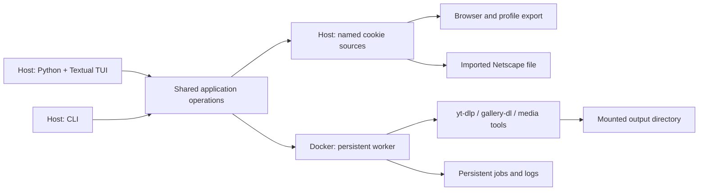

# Target design

Status: agreed direction with implementation details still proposed.

## Agreed decisions

These are recorded in the [decision log](decisions.md), with their reasons:

1. Support macOS and Linux hosts, keeping download execution in Docker (DEC-1).
2. Abstract host-specific setup and file locations out of operational logic
   (DEC-2).
3. Support named cookie sources backed by a browser/profile or imported Netscape
   file, selectable per job (DEC-3).
4. Remove tmux entirely; it is not part of the future worker or TUI architecture
   (DEC-4).
5. Build the TUI in **Python + Textual** (DEC-5).
6. Preserve useful existing download behavior through explicit presets (DEC-6).

Stage 1 (project P0001) added DEC-7 to DEC-16: the host application and its
installation, configuration and locations, the container contract, presets,
VPN mode, structured health checks, migration, the `.env` reader's edge
cases, the D2-to-D3 transition, and the VPN helpers with the VPN off. The sections below say
which parts are settled.

Native downloader execution and a remote-server control protocol are not required
by the agreed scope. The exact worker interface remains open; host packaging
for Stage 1 is settled (DEC-7).

## Proposed boundaries



The host owns browser access, user configuration, cookie export/import, and the
TUI. Docker owns download execution, media processing, and VPN integration.

The CLI and TUI call the same application operations. They should not depend on
interactive shell startup or scrape `just doctor` output. Existing `just` commands
can remain thin compatibility wrappers during migration.

The worker must outlive the TUI. Closing and reopening the UI reconnects to
existing work. Restart recovery comes from persisted job state, not a terminal
multiplexer. The transport between host and worker needs a separate decision;
this design does not require a network API merely to support local Docker.

## Host application

Settled for Stage 1 (DEC-7). The package, its entry points, and `init` and
the `config` commands except `user-agent` are implemented (P0001-C01).
Compose and the lifecycle commands are implemented (P0001-C02), and `shell`,
`vpn`, `servers`, and the login on `config set-token` (P0001-C03): every D2
command is implemented. `config user-agent`, `dl`, `batch`, and `watch` are
implemented (P0001-C04, D3); `doctor` is implemented (P0001-C05, D4).

The shared operations, the CLI, and later the TUI are one Python package,
`downloadinux`, under `src/downloadinux/`, managed with uv and installed with
`uv tool install --editable .` from the checkout. Two entry points,
`downloadinux` and `dlx`, run the same function. Subcommands are the CLI; bare
invocation is reserved for the TUI and prints help until Stage 4. The CLI is
built on `argparse`.

Install assets (Dockerfile, Compose files, presets, container scripts) are
read from the checkout that holds the installed package; the CLI fails with an
actionable error if they are missing. Every Docker interaction goes through
the CLI, which runs `docker compose` with an explicit project name, explicit
Compose files, and an environment it computes from the effective settings.
Downloader commands are passed as argument lists, never as shell strings, and
never through interactive shell startup.

Package details, pinned for P0001-C01:

- Python 3.11 or later (`requires-python = ">=3.11"`, for `tomllib`), with
  `.python-version` naming 3.13 and `uv.lock` committed. The one runtime
  dependency is `tomlkit`, used only to write and edit the settings and
  credentials files so a user's comments survive; reading uses `tomllib`.
  pytest is a dev dependency. `python -m downloadinux` runs the same
  function as the entry points.
- The checkout root is the directory that holds `src/downloadinux/`. A
  command that needs an install asset fails, naming the missing path, if it
  is absent; a command that only reports a path (`config show`'s `/config`
  mapping) reports it whether or not it exists.
- `--config PATH` and `--set key=value` are accepted before or after the
  subcommand.
- Exit status: 0 on success, 1 when an operation fails (a refused overwrite,
  a malformed token, a failed health check), 2 for a usage error or invalid
  configuration. Errors go to stderr as `downloadinux: error: …`; a
  configuration error names the file (or `--set`) and the key.
- Writes to the settings and credentials files are atomic: a temporary file
  in the same directory, created with the final mode, then renamed into place.
- A failure the operating system reports (a directory that cannot be created,
  a file that cannot be written or read, a missing `docker` executable) is an
  operation failure: exit 1, reported as `downloadinux: error: <path>: <reason>`,
  never a traceback.

Docker invocation, pinned for P0001-C02:

- Every command that runs Compose runs `docker compose --project-name
  <container.project> --project-directory <checkout root> --file
  compose/base.yaml`, adding `--file compose/vpn.yaml` when `vpn.enabled` is
  true, as an argument list. The Compose files are install assets (a missing
  one fails as above).
- Its environment is the CLI's own, with every inherited variable whose name
  starts `DOWNLOADINUX_` removed except `DOWNLOADINUX_CONFIG` and
  `DOWNLOADINUX_IMAGE`, and then the variables of *Container contract*'s
  table set from the effective settings. The `DOWNLOADINUX_NORDVPN_*`
  variables are set only when `vpn.enabled` is true; otherwise the token
  appears nowhere in the command or its environment.
- `compose -- <args>` appends `<args>` unchanged and exits with
  `docker compose`'s own status. It creates no directory and checks no path.
- `build` runs `build`; `up` runs `up -d`; `down` runs `down`; `restart` runs
  `up -d --force-recreate`; `update` runs `build --no-cache`, then `up -d`.
  `up`, `restart`, and `update` first refuse, exit 1, when `paths.downloads`
  does not exist (naming it), and create `paths.state` and `paths.cookies`
  (the cookies directory at mode 0700) when absent. A lifecycle command whose
  `docker compose` exits non-zero exits 1.
- Operations run `docker` through an injectable runner, so no test starts a
  process.

Commands in the container, pinned for P0001-C03:

- A command that runs a program inside the container runs Compose's
  `exec -u dl downloadinux <argv>` through the invocation above, the program
  and its arguments as a list. It adds `-T` whenever the CLI captures the
  output (`servers`, the login below), never for `shell`. "The container is
  running" means `ps --status running --quiet downloadinux` exits 0 with
  non-empty output; the injectable runner gains a way to capture a
  command's standard output for this and for `servers`. Standard error is
  never captured: Compose's own failures stay on the terminal (DEC-17).
- `shell` runs `zsh` that way and exits with its status. It checks no path.
- `vpn [args…]` runs the container's `vpn` helper (`scripts/vpn.sh`) with
  `args`, `status` when there are none, and exits with its status. With
  `vpn.enabled` false it runs nothing and exits 1 with an error naming
  `vpn.enabled` (DEC-16).
- `servers [city] [country]` (defaults `New_York` and `228`, the United
  States) runs `curl -sg --max-time 40
  'https://api.nordvpn.com/v1/servers/recommendations?filters[country_id]=<country>&limit=0'`
  in the container, which is the thing on the VPN (`-g`: the brackets are
  literal, not a curl glob), and ranks the captured JSON on the host. An
  underscore in `city` stands for a space. The output is the old script's,
  unchanged: up to eight servers in that city, least load first, or, when it
  has none, the wrapped list of cities, both exit 0. A fetch that exits
  non-zero or a body that is not JSON, or is JSON but not the server list
  (DEC-18), is an operation failure, exit 1: `could not reach the Nord API
  from the container (VPN down, or killswitch blocking?)`. It runs whether
  or not the VPN is enabled. The ranking lives in the package
  (`downloadinux.servers`); the old script and the gate step that compiled
  it are gone.
- `config set-token` stores the token as before, then, when `vpn.enabled` is
  true and the container is running, logs the daemon in:
  `exec -T -u dl -e NORDVPN_TOKEN downloadinux sh -c 'nordvpn login --token
  "$NORDVPN_TOKEN"'`, with `NORDVPN_TOKEN` set only in that `docker compose`
  process's environment, so the token is in no host argument list. The
  login's output is discarded. On success it prints `Logged in.` and, when
  `vpn.autoconnect` is true, runs `nordvpn connect` with `vpn.server` split
  on whitespace (no argument when empty), reporting whether it connected; a
  failed connect is a warning, exit 0. A failed login exits 1, saying the
  token is stored but the daemon refused it, and that a daemon already
  logged in needs `dlx vpn logout --persist-token` first (a plain `logout`
  revokes the daemon's token, DEC-19). When the container is not
  running, it says the login happens at the next `dlx up`; when the VPN is
  disabled, it says the token is stored for when it is enabled and runs
  nothing; both exit 0 (DEC-16).

Downloads, pinned for P0001-C04:

- `dl <preset> <url>…` takes at least one URL; `preset` is `video` (`v`)
  or `gallery` (`gal`, `g`), anything else a usage error, exit 2. It runs
  the preset's argument list (*Presets*) with the URLs appended, through
  `exec -u dl downloadinux` uncaptured (no `-T`: the downloaders draw
  progress on the terminal), and exits with its status. It needs neither
  the VPN nor a running check: Compose reports a stopped service itself.
- `batch <preset> [queue]`: the queue defaults to the preset's default
  queue file in `paths.downloads`. A given path expands a leading `~` and
  is made absolute against the working directory without resolving links
  (`os.path.abspath`). It must be an existing file, else exit 1,
  `no such queue file: <path>`, and lie under `paths.downloads` compared
  the same way, else exit 1, `<path> is outside paths.downloads (<dir>); the
  container cannot see it`. Its container path is `/downloads/` plus its
  path relative to `paths.downloads`. The command then runs, through
  `exec -u dl downloadinux` uncaptured, `tmux new-session -d -s <session>
  -c /downloads zsh -f -c <script> zsh <container queue> <log prefix>
  <title> <colour> <argv…>`, each a separate argument. `<script>` is
  `source /home/dl/.zsh-custom/batch.zsh && _batch_downloader_core "$@";
  echo; echo "[done — press a key]"; read -k1`; `zsh -f` reads none of
  `dl`'s startup files. `<argv…>` is the preset's argument list without URLs, and for
  `gallery` has `-q` right after `gallery-dl`, as `dlgal_batch` does today
  (DEC-6). tmux runs a command given as several arguments directly, without
  a shell, so every word arrives intact (checked against the image's tmux
  3.5a). On success it prints `Queue: <container queue>` and `Running
  detached in tmux session <session>. Watch it with: dlx watch <preset>`,
  exit 0. A non-zero status from Compose (a session of that name already
  running, a stopped container) exits 1: `could not start tmux session
  <session>; if one is already running, attach with dlx watch <preset>`.

  | Preset | Session | Default queue | Log prefix | Title | Colour |
  | --- | --- | --- | --- | --- | --- |
  | `video` | `batch-video` | `dlmp4_queue` | `dlmp4` | `Batch Download` | `blue` |
  | `gallery` | `batch-gallery` | `dlgal_queue` | `dlgal` | `Gallery Batch Download` | `magenta` |

- `watch [preset]` (default `video`) maps `video`/`v` to `batch-video` and
  `gallery`/`gal`/`g` to `batch-gallery`; any other word is taken as a tmux
  session name, as today. It runs `tmux attach -t <session>` through
  `exec -u dl downloadinux` uncaptured and exits with its status.
- `config user-agent` reads `CFBundleShortVersionString` from
  `/Applications/Google Chrome.app/Contents/Info.plist` with `plistlib`
  (no `defaults` subprocess). The major version is the text before the
  first `.` and must be all digits. It sets `downloads.user_agent` to
  `Mozilla/5.0 (Macintosh; Intel Mac OS X 10_15_7) AppleWebKit/537.36
  (KHTML, like Gecko) Chrome/<major>.0.0.0 Safari/537.36` (Chrome freezes
  the macOS version and zeroes everything after the major) and prints
  `User-agent pinned to Chrome <major> (host has <version>).`. An existing
  settings file is edited with `tomlkit`, so comments survive (adding a
  `[downloads]` table when it has none), written atomically with its
  current permission bits, and not written at all when it already holds
  that value. A missing settings file is written as the starter file `init`
  would write (`--set` values included), with the new value in place of
  `downloads.user_agent`. When the version cannot be read
  it prints `downloadinux: warning: cannot read Chrome's version from
  <plist path>; downloads.user_agent is unchanged`, writes nothing, and
  exits 0 (DEC-21).

Stage 1 subcommands, each a thin front for an operation the TUI will call:

| Command | Operation |
| --- | --- |
| `init` | Write a starter config (VPN off) if none exists |
| `config show [--json]` | Effective settings, the source of each, and host→container mappings; secrets shown only as `set`/`unset` |
| `config import-env` | Migrate an existing `.env` (DEC-13) |
| `config set-token` | Validate and store the NordVPN token; log in if the container runs |
| `config user-agent` | Refresh the user-agent setting (DEC-10) |
| `build`, `up`, `down`, `restart`, `update` | Image and container lifecycle |
| `compose -- <args>` | Pass-through to `docker compose` with the computed project, files, and environment |
| `shell` | Interactive zsh in the container as `dl` (a convenience, not an execution path) |
| `dl <preset> <url>…` | Download with a preset |
| `batch <preset> [queue]`, `watch <preset>` | Stage 1 compatibility batch (DEC-13) |
| `vpn <args>`, `servers [city] [country]` | NordVPN helpers |
| `doctor [--json]` | Structured health check (DEC-12) |

`video` (alias `v`) and `gallery` (aliases `gal`, `g`) name the presets.

## Configuration and paths

Settled for Stage 1 (DEC-8). Implemented in P0001-C01: the settings and
credentials files, their locations, `config show`, `init`, and
`config set-token` (storing; its login on set is implemented in P0001-C03).

Separate installation files, user configuration, credentials, and mutable state.
Routine operation must not rewrite tracked files in the checkout.

| What | Default host location |
| --- | --- |
| Settings | `$XDG_CONFIG_HOME/downloadinux/config.toml` |
| Credentials (NordVPN token) | `credentials.toml` beside the settings file, mode 0600 |
| Managed cookies | `$XDG_DATA_HOME/downloadinux/cookies/` (directory 0700) |
| State | `$XDG_STATE_HOME/downloadinux/` |

Unset or empty `XDG_*` variables fall back to `~/.config`, `~/.local/share`,
and `~/.local/state` on both macOS and Linux. The settings file is chosen by
`--config PATH`, then `DOWNLOADINUX_CONFIG`, then the default. A missing
settings file is not an error: every setting has a default. The CLI creates
the cookies and state directories when it needs them; it never creates the
downloads directory, because a missing one usually means an unmounted drive.

Precedence, highest first: invocation overrides (`--set key=value`,
repeatable, on any command), the settings file, built-in defaults. No other
environment variable sets a setting.

Settings in Stage 1:

```toml
[paths]
downloads = "~/Downloads"   # host output root; must exist
# state   = default from XDG_STATE_HOME
# cookies = default from XDG_DATA_HOME

[container]
project  = "downloadinux"   # Compose project name
# uid, gid = the invoking host user's
# timezone = the host's zone (from /etc/localtime), else "UTC"

[downloads]
user_agent = "Mozilla/5.0 (Macintosh; Intel Mac OS X 10_15_7) AppleWebKit/537.36 (KHTML, like Gecko) Chrome/151.0.0.0 Safari/537.36"

[vpn]
enabled     = false
server      = ""          # passed to `nordvpn connect`; empty = fastest
technology  = "openvpn"   # or "nordlynx"
killswitch  = false
autoconnect = false
```

Validation: an unknown table or key, or a value of the wrong type, is an error
that names the key and the file. Paths expand a leading `~`; a path that is
still relative is an error. `technology` accepts only `openvpn` and
`nordlynx`. `--set` values are parsed as TOML values, falling back to a plain
string. The token, when set, must be 64 lowercase hex characters.

`config show` lists every effective setting with its source (`default`,
`file`, or `override`) and the host→container mapping of each mount, and
never prints the token or cookie contents.

Further rules, pinned for P0001-C01:

- An `XDG_*` variable that is relative is treated as unset, as the XDG
  specification requires. `--config` and `DOWNLOADINUX_CONFIG` expand `~` and
  resolve a relative path against the working directory; an empty
  `DOWNLOADINUX_CONFIG` is unset. A missing file named by either is not an
  error, the same as the default.
- `container.uid` and `container.gid` are non-negative integers defaulting
  to `os.getuid()` and `os.getgid()`. `container.timezone` defaults to the
  part of `/etc/localtime`'s symlink target after `zoneinfo/`, and to `UTC`
  when that is not a symlink or has no such part.
- `paths.state` defaults to `$XDG_STATE_HOME/downloadinux` and `paths.cookies`
  to `$XDG_DATA_HOME/downloadinux/cookies`. Paths are expanded (`~`) but not
  resolved, so a symlinked drive keeps the path the user wrote.
- `--set` takes `table.key=value`; a missing `=` or an unknown key is a
  configuration error naming `--set`. For a string or path setting, a value
  that is not a quoted TOML string is the plain text after `=` (so
  `--set vpn.server=123` is the string `123`); integer and boolean settings
  parse the value as TOML. A `--set` is validated like a file value.
- Loading settings never checks that `paths.downloads` exists: `config show`
  marks it missing, `up` refuses to start without it, and `doctor` reports
  it.
- The credentials file is TOML with one table, `[nordvpn]`, holding
  `token`. Unknown keys and wrong types are configuration errors, like the
  settings file's. A token that is not 64 lowercase hex characters is not a
  load error: `config show` reports it `malformed` and `doctor` fails it.
- `config show` prints one line per setting (`key = value  (source)`), then
  the settings and credentials file paths (each marked missing when absent),
  the token's state, and the four mounts. `config show --json` prints:

  ```json
  {"config_file": {"path": "/home/u/.config/downloadinux/config.toml", "exists": true},
   "credentials_file": {"path": "/home/u/.config/downloadinux/credentials.toml", "exists": false},
   "settings": [{"key": "paths.downloads", "value": "/home/u/Downloads", "source": "file"}],
   "token": "unset",
   "mounts": [{"container": "/downloads", "host": "/home/u/Downloads", "access": "rw", "exists": true}]}
  ```

  `settings` lists every setting in schema order (the order of the example
  above, with `paths.state` and `paths.cookies` after `paths.downloads` and
  `container.uid`, `container.gid`, `container.timezone` after
  `container.project`); `token` is `set`, `unset`, or `malformed`; `mounts`
  lists `/downloads`, `/config`, `/state`, `/cookies` in that order.
- `init` writes the starter file at the selected settings path: every
  setting of the example above with its default, the computed defaults
  (`paths.state`, `paths.cookies`, `container.uid`, `gid`, `timezone`) left
  commented out, and any `--set` values written in. It refuses, exit 1, if
  the file exists; it has no `--force`. It writes no credentials file.
- `config set-token [TOKEN]` takes the token as an argument, else prompts
  without echo on a terminal, else reads one line from standard input. A
  malformed token is refused, exit 1, with its length but never its value.
  It writes the credentials file at mode 0600, creating the directory.

## Container contract

Settled for Stage 1 (DEC-9). Implemented in P0001-C02: Compose files,
runtime identity, mount preparation, and transitional links (DEC-15).
Implemented in P0001-C04 (D3): `DL_USER_AGENT`, the shell helpers on the
presets, the batch loop's own file, and the end of DEC-15's interval (the
`/legacy/` binds and the links are gone).

| Container location | Host source | Access | Purpose |
| --- | --- | --- | --- |
| `/downloads` | `paths.downloads` | read-write | Download output, queues, batch logs, gallery archive |
| `/config` | the checkout's `presets/` | read-only | Shipped presets |
| `/state` | `paths.state` | read-write | Generated per-invocation files; later jobs and logs |
| `/cookies` | `paths.cookies` | read-write | Managed cookie jar (`cookies.txt` in Stage 1) |

Binds use Compose's long volume syntax, so host paths may contain spaces or
colons. The NordVPN login and shell history keep their named volumes.

The container user is always `dl`. The entrypoint, running as root, applies
the UID and GID the CLI passes (reusing an existing group with that GID),
creates the directories it needs under `/downloads`, `/state`, and `/cookies`
as that user, and drops to it. It never changes ownership recursively on a
mount. The worker never needs the host username or home directory (DEC-2).
Compose sets no `container_name`; `container.project` names the project, so
two configs with different project names run side by side.

Compose files and the entrypoint, pinned for P0001-C02:

- `compose/base.yaml` defines the one service, `downloadinux` (hostname
  `downloadinux`, image `${DOWNLOADINUX_IMAGE:-downloadinux:latest}`, build
  context the project directory, `stdin_open`, `tty`,
  `restart: unless-stopped`), the four binds above in long syntax, and the
  named volumes `nordvpn-data` (at `/var/lib/nordvpn`) and `zsh-history` (at
  `/home/dl/.local/share/downloadinux`). It has no `container_name`, no
  `env_file`, no build arguments, and apart from the image name interpolates
  only the variables below, each without a default. The default project
  name, `downloadinux`, is the one Compose derived from the checkout's
  directory before, so the existing named volumes and the NordVPN login carry
  over. `compose/vpn.yaml` is in
  *VPN mode*. `DOWNLOADINUX_IMAGE` is a test seam the gate's smoke test sets;
  the CLI never sets it.

  | Compose variable | From | Container environment |
  | --- | --- | --- |
  | `DOWNLOADINUX_DOWNLOADS` | `paths.downloads` | bind source of `/downloads` |
  | `DOWNLOADINUX_PRESETS` | the checkout's `presets/` | bind source of `/config` |
  | `DOWNLOADINUX_STATE` | `paths.state` | bind source of `/state` |
  | `DOWNLOADINUX_COOKIES` | `paths.cookies` | bind source of `/cookies` |
  | `DOWNLOADINUX_UID`, `DOWNLOADINUX_GID` | `container.uid`, `container.gid` | `DL_UID`, `DL_GID` |
  | `DOWNLOADINUX_TZ` | `container.timezone` | `TZ` |
  | `DOWNLOADINUX_USER_AGENT` | `downloads.user_agent` | `DL_USER_AGENT` (from P0001-C04, DEC-20) |

  The prefix keeps Compose's automatic read of a `.env` in the project
  directory from supplying any of them: the legacy `.env` names none.
- The image builds user `dl` as UID and GID 1000 with home `/home/dl`, and
  its working directory is `/downloads`. At start the entrypoint, as root,
  applies `DL_UID` and `DL_GID` (either unset keeps the image's value): a GID
  that already names a group makes that group `dl`'s primary group, else
  `dl`'s own group takes the GID; a UID already used by another account is an
  error that stops the container with a message naming it. Ownership changes
  stay inside the image's `/home/dl` and never follow a link. Then, as `dl`,
  it creates `/downloads/dlmp4` and `/downloads/dlgal`, and the placeholder
  `/cookies/cookies.txt` (mode 0600) when absent; a mount it cannot write is
  a warning, not a stop, so `doctor` can report it.
- The checkout's `presets/` exists from P0001-C02 (holding a README until D3
  moves the presets in), since a long-syntax bind fails on a missing source.
- Until D3 (done in P0001-C04, below) the entrypoint also kept the old
  in-container paths working (DEC-15): the base file binds the checkout's `config/yt-dlp` and
  `config/gallery-dl` read-only at `/legacy/yt-dlp` and `/legacy/gallery-dl`,
  and the entrypoint links `/home/dl/Downloads` → `/downloads`,
  `/home/dl/cookies` → `/cookies`, `/home/dl/.config/yt-dlp` →
  `/legacy/yt-dlp`, and `/home/dl/.config/gallery-dl` → `/legacy/gallery-dl`,
  after applying the IDs.

Pinned for P0001-C04, the end of DEC-15's interval:

- The base file's environment gains `DL_USER_AGENT` from
  `DOWNLOADINUX_USER_AGENT` (table above, DEC-20), in both VPN modes.
- The `/legacy/` binds, the four links, and the entrypoint loop that
  removes stale links before `usermod` are gone, and so is the checkout's
  `config/` directory (*Presets*). Nothing in the image, the entrypoint, or
  the `zsh/` files names `/home/dl/Downloads`, `~/cookies`,
  `~/.config/yt-dlp`, or `~/.config/gallery-dl`; the interactive shell
  starts in `/downloads`. The gate's smoke test asserts that the four old
  paths do not exist and that `/config/video/yt-dlp.conf` and
  `/config/gallery/config.json` are readable as `dl`.
- The container's `dlmp4`, `dlgal`, `dlmp4_batch`, and `dlgal_batch` keep
  their names and run the argument lists of *Presets* and of `batch`
  (*Host application*), with `$DL_USER_AGENT` as the user-agent. The batch
  loop, `_batch_downloader_core`, moves unchanged into its own file,
  `zsh/batch.zsh` (in the image `/home/dl/.zsh-custom/batch.zsh`), which
  `batch` sources and the interactive shell sources with the other `zsh/`
  files; `exifmod` stays in `functions.zsh`.
- Entrypoint messages (issue #18): without a token, `NORDVPN_TOKEN not set.
  Store one on the host with: just token <token>`; the last line, `Ready.
  Shell in with: just shell (or dlx shell)`.

## Presets

Settled for Stage 1 (DEC-6, DEC-10). Implemented in P0001-C04 (D3): the
preset files, their argument lists, and `config user-agent`.

The checkout's `presets/` holds one directory per preset, `video/` (the
`dlmp4` yt-dlp config) and `gallery/` (the `dlgal` gallery-dl config). Preset
files carry media behavior only: naming, format selection, metadata and
embedding, SponsorBlock, throttling, and site-specific scoping such as
gallery-dl's Instagram block. They carry no output root, cookie path, or
user-agent.

At invocation the operations layer adds, from application configuration:

| Preset | Output root | Cookies | User-agent |
| --- | --- | --- | --- |
| `video` | `/downloads/dlmp4` | `/cookies/cookies.txt` | `downloads.user_agent` |
| `gallery` | `/downloads/dlgal` for Instagram | `/cookies/cookies.txt` for Instagram | `downloads.user_agent`, globally and for Instagram |

The gallery archive stays at `/downloads/dlgal/gallery-dl-archive.sqlite3`,
the same host file as today. Settings applied only to Instagram today stay
Instagram-only. The overrides go in as downloader arguments or as a generated
file under `/state`; shipped preset files are never written.

`config user-agent` writes `downloads.user_agent` into the settings file. In
Stage 1 it keeps today's source, the host Chrome major version on macOS, and
reports when it cannot read one; Stage 2 replaces that lookup.

Pinned for P0001-C04:

- `presets/video/yt-dlp.conf` is today's `config/yt-dlp/dlmp4.conf` and
  `presets/gallery/config.json` is `config/gallery-dl/config.json`, moved
  with `git mv`; `config/` is then gone. (The strip removes over half of the
  gallery file's bytes, so git shows it as a rename, and `git log --follow`
  follows it, only with `-M40%`.) Stripped
  from the video preset: `--paths`, `--cookies`, and `--user-agent`, with
  the comments that describe only them, including a section header whose
  section held nothing else. Stripped from the gallery preset:
  `extractor.user-agent`, `extractor.archive`, and `extractor.instagram`'s
  `user-agent`, `base-directory`, and `cookies`. Every other line stays as
  it is and in order (the gallery file keeps its tabs and empty stub
  sections); `presets/README.md` describes the two.
- The operations layer builds these argument lists, each item one list
  element, `<ua>` being `downloads.user_agent`, with the URLs after them
  (DEC-20). `video`:

  ```
  yt-dlp --config-locations /config/video/yt-dlp.conf
    --paths /downloads/dlmp4 --cookies /cookies/cookies.txt
    --add-headers User-Agent:<ua>
  ```

  `gallery`:

  ```
  gallery-dl --config /config/gallery/config.json
    -o extractor.archive=/downloads/dlgal/gallery-dl-archive.sqlite3
    -o extractor.user-agent=<ua> -o extractor.instagram.user-agent=<ua>
    -o extractor.instagram.base-directory=/downloads/dlgal
    -o extractor.instagram.cookies=/cookies/cookies.txt
  ```

  The gallery overrides keep today's scoping: user-agent and archive for
  every extractor, output root and cookies for Instagram only. gallery-dl
  applies each dotted `-o` key inside the loaded configuration, after
  loading it (checked against the image's gallery-dl 1.32.15).
  `--add-headers User-Agent:<ua>` is the documented spelling of the
  preset's old `--user-agent`, which yt-dlp 2026.08.19 hides from `--help`
  and turns into the same header.

## VPN mode

Settled for Stage 1 (DEC-11). Implemented: base/overlay selection and the
entrypoint switch (P0001-C02), and the VPN helper commands and the login on
`config set-token` (P0001-C03), so every D2 command is implemented.

`vpn.enabled = false` starts Compose from the base file only: no added
capabilities, no `/dev/net/tun`, no `systempaths=unconfined`, and no NordVPN
variables, and the entrypoint does not start `nordvpnd`. `true` adds the VPN
overlay file, which carries those settings and the `vpn.*` values and token.
The token reaches Compose only through the environment of the CLI's
`docker compose` process; it is never written to a file in the checkout.
NordVPN remains the only provider. Whether VPN runs in the worker container or
a separate service remains open.

Pinned for P0001-C02: `compose/vpn.yaml` adds to the service `cap_add`
`NET_ADMIN` and `NET_RAW`, the device `/dev/net/tun`, the sysctl
`net.ipv4.conf.all.src_valid_mark: 1`, `security_opt`
`systempaths=unconfined`, and this environment, which the entrypoint reads:

| Compose variable | From | Container environment |
| --- | --- | --- |
| (none) | | `DL_VPN=on` |
| `DOWNLOADINUX_NORDVPN_TOKEN` | credentials `nordvpn.token` (empty when unset or malformed) | `NORDVPN_TOKEN` |
| `DOWNLOADINUX_NORDVPN_SERVER` | `vpn.server` | `NORDVPN_SERVER` |
| `DOWNLOADINUX_NORDVPN_TECHNOLOGY` | `vpn.technology` | `NORDVPN_TECHNOLOGY` |
| `DOWNLOADINUX_NORDVPN_KILLSWITCH` | `vpn.killswitch`: `on` or `off` | `NORDVPN_KILLSWITCH` |
| `DOWNLOADINUX_NORDVPN_AUTOCONNECT` | `vpn.autoconnect`: `true` or `false` | `NORDVPN_AUTOCONNECT` |

The entrypoint starts `nordvpnd` only when `DL_VPN` is `on`.

## Health checks

Settled for Stage 1 (DEC-12); implemented in P0001-C05 (D4).

`doctor` returns an ordered list of checks:

```json
{"ok": false, "checks": [
  {"id": "config.file", "status": "ok", "summary": "~/.config/downloadinux/config.toml"},
  {"id": "mount.downloads.mounted", "status": "ok", "summary": "/downloads is a mount point"},
  {"id": "mount.downloads.writable", "status": "fail", "summary": "dl (uid 1000) cannot write /downloads",
   "fix": "make the host directory writable by uid 1000"},
  {"id": "vpn.connected", "status": "skip", "summary": "VPN disabled in config"}
]}
```

`status` is `ok`, `warn`, `fail`, or `skip`; `fix`, when present, names the
command or change that resolves it. `ok` is false exactly when a check failed,
and the command exits 1 then, else 0. The human view renders the same list.

Stage 1 checks cover: the settings and credentials files (credentials mode
0600), token well-formedness, the cookie jar and which sites have a session
cookie present, the Docker daemon, the container running, each mount as a
mount point and (except `/config`) writable by `dl` via a create-and-remove
probe, `/config` read-only, tool versions, and, when the VPN is enabled, the
daemon's login, connection, killswitch state, and exit IP. When the VPN is
disabled, VPN checks are `skip`. Container checks are `skip` when the
container is not running. No check prints a secret or a cookie value, and none
claims a login is valid.

Pinned for P0001-C05 (DEC-22):

- `doctor [--json]` loads the settings and credentials like every command:
  an invalid file or a bad `--set` is a configuration error, exit 2, and an
  unreadable one an operation failure, exit 1, both with no check list.
  Otherwise it runs every check below, in the table's order, except that the
  `mount.*` checks go mount by mount in *Container contract*'s order
  (`downloads`, `config`, `state`, `cookies`), each mount's `mounted` check
  before its `writable` or `readonly` one. It exits 1 when any check is
  `fail`, else 0. `--json` prints the object
  above (`fix` present only when the table gives one) as one JSON document on
  standard output.
- The human view prints `downloadinux`, then one line per check: two spaces,
  a mark (`✓` ok, `!` warn, `✗` fail, `-` skip), a space, the summary; then,
  when there is a `fix`, a line of six spaces, `fix: `, and the fix. Marks
  are coloured (green, yellow, red, dim) only when standard output is a
  terminal and `NO_COLOR` is unset or empty.
- A fix names a `dlx` command where one does the job, else a `just` recipe
  (`just cookies` until Stage 2), else the change in words.
- Host checks read files on the host. The Netscape jar is read as lines: a
  line starting `#HttpOnly_` is a cookie line with that prefix removed (yt-dlp
  writes session cookies that way), any other line starting `#` and any
  blank line is not, and a cookie line is one with exactly seven
  tab-separated fields (domain, include-subdomains, path, secure, expiry,
  name, value). The file is decoded as UTF-8 with undecodable bytes replaced,
  so only an operating-system failure makes it unreadable. A cookie belongs
  to a site when its domain, less a leading `.`, is the site's domain or ends
  with `.` and the site's domain. Only domains and names are ever compared
  or reported.
- `docker.daemon` runs `docker info --format {{.ServerVersion}}` captured,
  with the CLI's own environment (no `DOWNLOADINUX_*` variables, so never the
  token). `container.running` is the running check of *Host application*
  ("Commands in the container"). Every container check runs `exec -T -u dl
  downloadinux <argv>` captured, one per check, through the invocation of
  *Host application*. A `docker` executable that cannot be started fails
  `docker.daemon` (summary `docker: <reason>`) instead of ending the command,
  and every check that would run Docker is then `skip`.
- Skips, first match wins: a VPN check (the four `vpn.*` checks) with
  `vpn.enabled` false is `skip`, `VPN disabled in config`; `container.running` is `skip`, `Docker daemon not
  reachable`, when `docker.daemon` is not `ok`; a container or VPN check is
  `skip`, `container not running`, when `container.running` is not `ok`; a
  `mount.<m>.writable` check, and `mount.config.readonly`, is `skip`,
  `<path> is not a mount point`, when that mount's `mounted` check failed
  (an absent `/config` is not writable either, so `test -w` would pass it
  for the wrong reason; DEC-22, amended 2026-10-07); `cookies.instagram` and
  `cookies.youtube` are `skip`, `no cookie jar`, when `cookies.jar` is not
  `ok`.

| `id` | Runs | `ok` when, with summary | Otherwise: status, summary, fix |
| --- | --- | --- | --- |
| `config.file` | the settings file exists | `<path>` | warn, `<path> missing; built-in defaults apply`, `dlx init` |
| `credentials.file` | the credentials file's mode | no group or other bits: `<path> (mode 0600)` (the actual mode, four octal digits) | missing: skip, `no credentials file`; else fail, `<path> is mode <mode>; it holds the NordVPN token`, `chmod 600 <path>` |
| `credentials.token` | the token's state | `set`: `NordVPN token well-formed` | `malformed`: fail, `NordVPN token is not 64 lowercase hex characters`, `dlx config set-token`; `unset`: warn, `no NordVPN token`, `dlx config set-token`, but skip, `VPN disabled in config`, when the VPN is disabled |
| `paths.downloads` | the host directory exists | `<path>` | fail, `<path> does not exist (an unmounted drive?)`, `create it, or set paths.downloads` |
| `cookies.jar` | `<paths.cookies>/cookies.txt` | at least one cookie line: `<path>: <n> cookies` | missing, or no cookie lines: warn, `no cookies yet; public downloads still work`, `just cookies`; unreadable: fail, `<path>: <reason>`, no fix |
| `cookies.instagram` | site `instagram.com`, name `sessionid` | `instagram: session cookie present` | warn, `instagram: no session cookie`, `log in to Instagram in Firefox, then: just cookies` |
| `cookies.youtube` | site `youtube.com`, name `__Secure-3PSID` or `SAPISID` | `youtube: session cookie present` | warn, `youtube: no session cookie (fine unless you need age-gated or members-only video)`, no fix |
| `downloads.user_agent` | the first `Chrome/<digits>` in the setting, and the host Chrome major (`config user-agent`'s lookup) | `Chrome <n>` (also when the host Chrome cannot be read) | none: warn, `user-agent is not Chrome's; Instagram caps video at 720p`, `dlx config user-agent`; host major differs: warn, `user-agent says Chrome <n>, host Chrome is <m>`, `dlx config user-agent` |
| `docker.daemon` | as above | exit 0: `Docker <server version>` | fail, `Docker daemon not reachable`, `start Docker` |
| `container.running` | as above | `container running (project <container.project>)` | fail, `container not running`, `dlx up` |
| `mount.downloads.mounted`, `mount.config.mounted`, `mount.state.mounted`, `mount.cookies.mounted` | `mountpoint -q <path>` | exit 0: `<path> is a mount point` | fail, `<path> is not a mount point`, `dlx restart` |
| `mount.downloads.writable`, `mount.state.writable`, `mount.cookies.writable` | `sh -c 'f=$(mktemp -p "$1" .downloadinux-doctor.XXXXXX 2>/dev/null) && rm -f "$f"' sh <path>` | exit 0: `dl (uid <container.uid>) can write <path>` | fail, `dl (uid <container.uid>) cannot write <path>`, `make <host path> writable by uid <container.uid>` |
| `mount.config.readonly` | `test -w /config` | exit non-zero: `/config is read-only` | fail, `/config is writable`, `dlx restart` |
| `tools.yt-dlp`, `tools.gallery-dl` | `<tool> --version` | exit 0, non-empty output: `<tool> <first line>` | fail, `<tool> did not run`, `dlx update` |
| `vpn.login` | `nordvpn account` (output discarded: it holds the account's email) | exit 0: `NordVPN daemon logged in` | fail, `NordVPN daemon not logged in (token missing, invalid, or revoked)`, `dlx config set-token` |
| `vpn.connected` | `nordvpn status` | a line `Status: Connected`: `connected: <country>, <server>` (from the `Country:` and `Server:` lines, each omitted when absent) | fail, `VPN not connected`, `dlx vpn on` |
| `vpn.killswitch` | `nordvpn settings` | the `Kill Switch:` line's `enabled` or `disabled` matches `vpn.killswitch`: `killswitch <state>, as configured` | differs: warn, `killswitch <state>, but vpn.killswitch is <true/false>`, `dlx restart`; no such line: warn, `killswitch state unknown`, no fix |
| `vpn.exit_ip` | `curl -s --max-time 8 https://ipinfo.io/json` | exit 0, a JSON object with a string `ip`: `exit IP <ip> (<city>, <country>)` (the parenthesis omitted when either is absent) | killswitch `enabled` and not connected: fail, `no internet: the killswitch is blocking traffic while the VPN is disconnected`, `dlx vpn on`; else fail, `no internet from the container`, no fix |

`nordvpn` output is read only from a run that exits 0 (a failed run counts as
no such line), split into lines on `\n` and `\r` (its spinner writes
carriage returns), and each line stripped; `Status:`, `Country:`, `Server:`,
and `Kill Switch:` match case-insensitively at the start of a line, and the
value is the rest of the line, stripped (`Connected` exactly, ignoring case,
so `Disconnected` never matches). With neither `Country:` nor `Server:`, the
summary is `connected` alone. A `Kill Switch:` line whose value is neither
`enabled` nor `disabled` (ignoring case) counts as no such line.
`vpn.exit_ip`'s killswitch arm uses the states `vpn.killswitch` and
`vpn.connected` read. Mount paths are the container locations of
*Container contract*; `<host path>` is the mount's host source.

## Migration

Settled for Stage 1 (DEC-13). `config import-env` is implemented (P0001-C01);
the lifecycle/token wrappers, computed Compose access, managed cookie export,
and setup's import step are implemented (P0001-C02); the `shell`, `vpn`,
`servers`, and `status` wrappers and `doctor`'s token line without `.env`
are implemented (P0001-C03), so every D2 command and wrapper is implemented.
The `dl`, `batch`, `watch`, and `useragent` wrappers are implemented
(P0001-C04, D3); the structured `doctor`, its wrapper, and the gate's
VPN-off health run are implemented (P0001-C05, D4). The setup rewrite
(DEC-23, "Pinned for P0001-C06" below) and the gate's fresh-`init` health run
are implemented (P0001-C06, D5), so Stage 1's migration is implemented.

`config import-env [--env PATH]` (default: `.env` in the checkout) writes the
settings and credentials files from `HOST_DOWNLOADS`, `PUID`, `PGID`, `TZ`,
and the `NORDVPN_*` values, with `vpn.enabled = true`, and copies
`cookies/cookies.txt` into the managed cookies directory (mode 0600) when the
destination has none. `USERNAME` is dropped (the container user is always
`dl`). It leaves `.env` and the old jar in place, refuses to overwrite an
existing settings file without `--force`, and prints which settings it
imported, never the token's value.

Import details, pinned for P0001-C01:

- `.env` is read as `KEY=VALUE` lines; blank lines and lines starting with
  `#` are skipped, an `export ` prefix is allowed, and one pair of matching
  surrounding single or double quotes is stripped. There is no variable
  interpolation. A key missing or empty is not imported, and its setting
  keeps its default. A line without `=` is a key with an empty value, a
  repeated key takes its later value, whitespace around key and value is
  trimmed, and an unquoted value runs to the end of the line (DEC-14).

  | `.env` key | Setting | Conversion |
  | --- | --- | --- |
  | `HOST_DOWNLOADS` | `paths.downloads` | path, validated as a setting |
  | `PUID`, `PGID` | `container.uid`, `container.gid` | integer |
  | `TZ` | `container.timezone` | as is |
  | `NORDVPN_SERVER` | `vpn.server` | as is |
  | `NORDVPN_TECHNOLOGY` | `vpn.technology` | validated as a setting |
  | `NORDVPN_AUTOCONNECT` | `vpn.autoconnect` | `true` → true, `false` → false |
  | `NORDVPN_KILLSWITCH` | `vpn.killswitch` | `on`/`true` → true, `off`/`false` → false |
  | `NORDVPN_TOKEN` | credentials `nordvpn.token` | must be 64 lowercase hex |

  Any other value for a converted key is a configuration error naming the
  `.env` file and key; nothing is written. A malformed `NORDVPN_TOKEN` is not
  imported: the command warns, naming the key and the length, and carries
  on. `USERNAME` and keys not in the table are listed by name as not
  imported.
- The settings file is the starter file `init` writes, with the imported
  values and `vpn.enabled = true` in place of the defaults (`--set` values
  are applied on top). The credentials file is written only when a token is
  imported.
- Without `--force`, the command refuses, exit 1, if the settings file, or
  the credentials file when a token would be written, already exists; it
  checks before writing anything.
- The jar copied is `cookies/cookies.txt` beside the imported `.env`, to
  `cookies.txt` in the effective `paths.cookies` (directory created 0700, jar
  0600). An existing destination jar is kept, even with `--force`; a missing
  source jar is reported, not an error.
- `--env PATH` resolves like `--config`; the default is `.env` in the
  checkout root.

The `just` recipes keep their names and run `uv run downloadinux …`. `just
batch` and `just watch` keep tmux until Stage 3: the CLI starts the existing
zsh loop non-interactively, sourcing only the loop's own file, with the
argument list the `dl` operation would use (plus gallery-dl's `-q`, as
today's gallery batch has). The queue file must still be under the
downloads root.

`just cookies` keeps its Firefox export through host yt-dlp until Stage 2
replaces it, but writes the managed jar (`paths.cookies`/`cookies.txt`) instead
of the checkout's `cookies/` directory.

Recipes when the Compose files change, pinned for P0001-C02 (the old
`docker-compose.yml` is removed then, so no recipe may call `docker compose`
directly from that point):

- The justfile's Compose access goes through the CLI: its `compose` variable
  becomes `uv run downloadinux compose --`, and `dex` that plus
  `exec -u dl downloadinux`, so recipes not yet converted (`dl`, `batch`,
  `watch`, `shell`, `vpn`, `servers`, `status`, `logs`, `nuke`, `doctor`)
  reach the container of the configured project.
- `build`, `up`, `down`, `restart`, and `update` run the CLI commands of the
  same names (`update` then runs `just doctor`, as before). `token` runs
  `config set-token`.
- Recipes that need a setting read it from `config show --json`: `batch`
  takes the downloads root from `paths.downloads` instead of
  `HOST_DOWNLOADS`, and `cookies`, `setup`, and `doctor` use the jar at
  `paths.cookies`/`cookies.txt` (`cookies` creating the directory at 0700 and
  writing the jar at 0600) instead of `cookies/cookies.txt`.
- `setup` runs `config import-env` right after writing `.env` when no
  settings file exists, so a cold start still produces a VPN-on config.

Pinned for P0001-C03, completing D2's wrappers:

- `shell`, `vpn`, and `servers` run the CLI commands of the same names;
  `status` runs `compose -- ps`, then `vpn status`, ignoring its failure;
  `logs` and `nuke` stay on `compose --` (`logs -f`, `down -v`).
- `doctor` no longer reads or requires `.env`: its token line reports the
  `token` state from `config show --json` (`set`, `unset`, or `malformed`).
  The rest of the recipe waits for D4.

Pinned for P0001-C04, D3's wrappers:

- `dl`, `batch`, and `watch` run the CLI commands of the same names
  (`batch` passes the queue only when one is given); `useragent` runs
  `config user-agent`; `cookies` keeps its export and still ends with
  `just useragent`. No recipe names `/home/dl` any more, so the `chome`
  variable goes.
- `doctor` changes only where the retired paths reach it: its user-agent
  line reads `downloads.user_agent` through `scripts/config-value.sh` and
  compares its Chrome major with the host's as before (the "configs
  disagree" arm goes with the configs: there is one value now), and its
  mount line tests `/downloads` instead of `/home/dl/Downloads`. The rest
  waits for D4.

Pinned for P0001-C05, D4's wrapper:

- `doctor` runs `uv run downloadinux doctor`, passing its arguments (so
  `just doctor --json` works), and exits with its status; `setup` and
  `update` keep calling `just doctor`. `scripts/config-value.sh` stays for
  `setup` and `cookies`.
- The gate's smoke test brings up the check project's container (VPN off,
  its temporary mounts) with the CLI's `up`, runs `doctor --json`, and
  asserts exit 0, `ok` true, every `mount.*` and `tools.*` check `ok`,
  `docker.daemon` and `container.running` `ok`, and every `vpn.*` check
  `skip`. Its existing cleanup (`compose -- down -v`) removes the container.

Pinned for P0001-C06, D5's setup (DEC-23):

- `setup` runs five steps, each headed `==> <n>/5  <title>` as today:
  `Settings`, `NordVPN token`, `Exporting browser cookies`, `Building the
  image (first run takes a few minutes)`, `Starting up`. It no longer runs
  `just env` or writes `.env`.
- *Settings:* when the settings file exists (`config_file.exists` in
  `config show --json`), it prints that it is leaving it alone. Otherwise,
  when `.env` exists in the checkout, it runs `config import-env`. Otherwise
  it asks `Route downloads through NordVPN? [y/N] `: `y` or `yes`, in any
  case, runs `init --set vpn.enabled=true`; any other answer, an empty one
  or end of input included, runs `init`.
- *NordVPN token:* with `vpn.enabled` false it asks nothing and prints that
  the VPN is off, and how to turn it on later: set `enabled = true` under
  `[vpn]` in the settings file (naming its path), then `just token <token>`
  and `just restart`. With it true, a `set` token is left alone as today;
  otherwise it prompts as today, and an empty answer or end of input skips,
  pointing at `just token <token>`.
- *Exporting browser cookies*, *Building*, and *Starting up* are unchanged:
  the export is skipped when the jar already holds an Instagram `sessionid`
  line (Stage 2 replaces this step), a failed export is reported and setup
  carries on; then `build`, `up`, a ten-second pause, and `just doctor`,
  whose failure ends setup with its status before `Ready.`.
- Every prompt reads standard input; end of input is an empty answer, never
  an abort.
- `.env.example` stays, headed as the legacy format that only
  `config import-env` reads; `just env` keeps its name and still writes
  `.env` from it with the host UID/GID, its menu text saying it is for that
  import. A new setup needs neither.
- The gate's smoke test, after its `doctor --json` assertion, writes a
  settings file with `init` into its temporary directory (its `--set` values
  written in) and runs `doctor --json` again with only `--config <that
  file>`, asserting exit 0, `ok` true, and `config.file` `ok`. CI's Linux run
  of it is Stage 1's evidence that a fresh `init` config passes `doctor` with
  the VPN off.

## Named cookie sources

A source has a stable identity, display name, source type, origin, and refresh
metadata. Examples: `personal-firefox` and `instagram-secondary`.

| Source type | Input |
| --- | --- |
| Browser | Browser selection plus profile name or path; additional selectors only where supported |
| File | Imported Netscape-format cookie file |

Anonymous execution is an explicit job choice, not a fake cookie source. Support
an application default; optional site defaults can be added if useful. Proposed
resolution order: explicit job choice, site default, application default.

Browser extraction runs on the host. Available browsers and export support may
differ by OS and installed tooling; expose supported options and actionable
errors rather than promising every browser works everywhere.

At job startup, resolve the selected source into a private working snapshot.
Downloader writeback changes that snapshot, not the canonical source or another
job's credentials. Record source identity and snapshot revision on the job.
Whether a queued job pins the source revision at submission or startup needs a
final decision; startup snapshotting is the current proposal.

Refreshing a source is explicit and atomic: a failed export must not replace a
working source. Decouple export from an unrelated download probe. Treat imported
files as managed copies by default; decide whether externally linked files are
also needed.

Display source origin, last successful refresh, relevant domains, and available
expiry information. Distinguish “cookie present” from “authentication verified.”
Do not display cookie values in the TUI, job metadata, or ordinary logs. Define
permissions, snapshot retention, and cleanup with the implementation.

User-agent policy is separate from cookie selection. Preserve the current
explicit Chrome policy as a preset option, with overrides where needed, without
requiring Chrome at a macOS-specific location. Historical Instagram quality
claims should be validated before becoming enforced application rules.

## Persistent jobs

Proposed job data:

- Job ID, URL, downloader, preset, and destination.
- Selected cookie source and resolved snapshot revision, or anonymous mode.
- State, timestamps, attempt count, and structured error/result.
- Log location and available downloader progress.
- Output references when they can be obtained reliably.

Proposed states: queued, running, throttling, succeeded, failed, cancelled, and
interrupted. Network/VPN readiness should be an explicit waiting reason rather
than an unexplained lack of progress. Final transition rules remain to be defined.

Persist jobs independently of downloader archive databases. Job history explains
execution; archives prevent redownloading previously seen media.

Use explicit process arguments rather than constructing nested shell commands.
Capture diagnostics and retain downloader exit status. Cancellation must reach
child processes. On worker restart, reconcile previously running jobs instead of
silently declaring them complete. Resuming a partially downloaded file remains
subject to the downloader's capabilities.

Text queues become an import/export format. They are no longer the mutable source
of truth. Define duplicate handling, retry policy, concurrency, and throttling
before implementing automatic scheduling.

## Python + Textual TUI

Initial views:

- **Jobs:** queue and history, with selected-job details and logs.
- **Submit:** URLs, downloader/preset, destination, and named cookie source or
  anonymous mode.
- **Cookies:** add/import, inspect non-secret metadata, refresh, and select defaults.
- **Status/settings:** container, worker, VPN, mounts, paths, and tool versions.

Expose retry and cancellation once worker semantics are defined. Show downloading,
throttling, waiting for VPN, and failure as distinct conditions. Authentication
errors should only be labeled as such when supported by evidence.

Do not implement a terminal emulator or tmux attachment view. The UI consumes job
state and logs from the worker. Closing it must leave jobs running.

Specific Textual APIs, dependency versions, packaging, and interaction/keybinding
design are intentionally deferred until implementation research.
