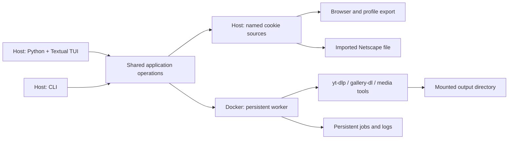

# Target design

Status: agreed direction with implementation details still proposed.

## Agreed decisions

These are recorded in the [decision log](decisions.md), with their reasons:

1. Support macOS and Linux hosts, keeping download execution in Docker (DEC-1).
2. Abstract host-specific setup and file locations out of operational logic
   (DEC-2).
3. Support named cookie sources backed by a browser/profile or imported Netscape
   file, selectable per job (DEC-3).
4. Remove tmux entirely; it is not part of the future worker or TUI architecture
   (DEC-4).
5. Build the TUI in **Python + Textual** (DEC-5).
6. Preserve useful existing download behavior through explicit presets (DEC-6).

Native downloader execution and a remote-server control protocol are not required
by the agreed scope. The exact worker interface and host packaging remain open.

## Proposed boundaries

The host owns browser access, user configuration, cookie export/import, and the
TUI. Docker owns download execution, media processing, and VPN integration.

The CLI and TUI call the same application operations. They should not depend on
interactive shell startup or scrape `just doctor` output. Existing `just` commands
can remain thin compatibility wrappers during migration.

The worker must outlive the TUI. Closing and reopening the UI reconnects to
existing work. Restart recovery comes from persisted job state, not a terminal
multiplexer. The transport between host and worker needs a separate decision;
this design does not require a network API merely to support local Docker.

## Configuration and paths

Separate installation files, user configuration, credentials, and mutable state.
Routine operation must not rewrite tracked files in the checkout.

Suggested container mount contract:

| Container location | Purpose |
| --- | --- |
| `/downloads` | Download output |
| `/config` | Effective application settings and presets |
| `/state` | Job records, logs, archives, worker state |
| `/cookies` | Managed cookie material with restricted access |

These names are proposals, not implemented paths. Host locations should be
configurable and resolved once at the boundary. The worker should not need to
know the host username or mirror the host home directory.

Define setting precedence explicitly: invocation/job overrides, user settings,
then application defaults. Presets describe media behavior; path and credential
selection belong to application configuration. Generate effective downloader
arguments or config without editing shipped templates.

Preserve the existing video and Instagram naming, quality, metadata, archive, and
throttling choices as migration defaults. Decide archive placement and migration
explicitly so existing gallery history remains useful.

Provide an explicit VPN-disabled mode. Retain NordVPN integration initially;
supporting arbitrary VPN providers is not an agreed requirement. Whether VPN
runs in the worker container or a separate service remains open.

## Named cookie sources

A source has a stable identity, display name, source type, origin, and refresh
metadata. Examples: `personal-firefox` and `instagram-secondary`.

| Source type | Input |
| --- | --- |
| Browser | Browser selection plus profile name or path; additional selectors only where supported |
| File | Imported Netscape-format cookie file |

Anonymous execution is an explicit job choice, not a fake cookie source. Support
an application default; optional site defaults can be added if useful. Proposed
resolution order: explicit job choice, site default, application default.

Browser extraction runs on the host. Available browsers and export support may
differ by OS and installed tooling; expose supported options and actionable
errors rather than promising every browser works everywhere.

At job startup, resolve the selected source into a private working snapshot.
Downloader writeback changes that snapshot, not the canonical source or another
job's credentials. Record source identity and snapshot revision on the job.
Whether a queued job pins the source revision at submission or startup needs a
final decision; startup snapshotting is the current proposal.

Refreshing a source is explicit and atomic: a failed export must not replace a
working source. Decouple export from an unrelated download probe. Treat imported
files as managed copies by default; decide whether externally linked files are
also needed.

Display source origin, last successful refresh, relevant domains, and available
expiry information. Distinguish “cookie present” from “authentication verified.”
Do not display cookie values in the TUI, job metadata, or ordinary logs. Define
permissions, snapshot retention, and cleanup with the implementation.

User-agent policy is separate from cookie selection. Preserve the current
explicit Chrome policy as a preset option, with overrides where needed, without
requiring Chrome at a macOS-specific location. Historical Instagram quality
claims should be validated before becoming enforced application rules.

## Persistent jobs

Proposed job data:

- Job ID, URL, downloader, preset, and destination.
- Selected cookie source and resolved snapshot revision, or anonymous mode.
- State, timestamps, attempt count, and structured error/result.
- Log location and available downloader progress.
- Output references when they can be obtained reliably.

Proposed states: queued, running, throttling, succeeded, failed, cancelled, and
interrupted. Network/VPN readiness should be an explicit waiting reason rather
than an unexplained lack of progress. Final transition rules remain to be defined.

Persist jobs independently of downloader archive databases. Job history explains
execution; archives prevent redownloading previously seen media.

Use explicit process arguments rather than constructing nested shell commands.
Capture diagnostics and retain downloader exit status. Cancellation must reach
child processes. On worker restart, reconcile previously running jobs instead of
silently declaring them complete. Resuming a partially downloaded file remains
subject to the downloader's capabilities.

Text queues become an import/export format. They are no longer the mutable source
of truth. Define duplicate handling, retry policy, concurrency, and throttling
before implementing automatic scheduling.

## Python + Textual TUI

Initial views:

- **Jobs:** queue and history, with selected-job details and logs.
- **Submit:** URLs, downloader/preset, destination, and named cookie source or
  anonymous mode.
- **Cookies:** add/import, inspect non-secret metadata, refresh, and select defaults.
- **Status/settings:** container, worker, VPN, mounts, paths, and tool versions.

Expose retry and cancellation once worker semantics are defined. Show downloading,
throttling, waiting for VPN, and failure as distinct conditions. Authentication
errors should only be labeled as such when supported by evidence.

Do not implement a terminal emulator or tmux attachment view. The UI consumes job
state and logs from the worker. Closing it must leave jobs running.

Specific Textual APIs, dependency versions, packaging, and interaction/keybinding
design are intentionally deferred until implementation research.
