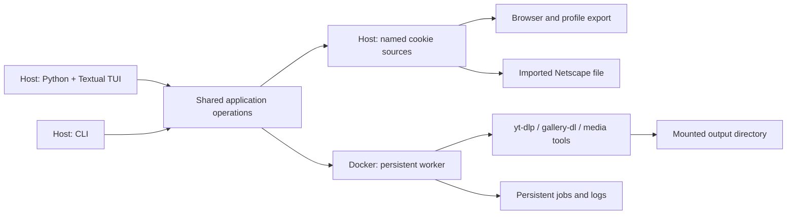

# Target design

Status: Stages 1–3 are implemented; Stage 4 is settled, not implemented.
P0002's portable writes and cookie/setup refresh
hardening and runtime-home ownership are implemented. Stage 2's named cookie
source contract is settled in P0003. P0003-C01 implements its internal parser,
safe summaries, immutable registry reader, and locked atomic host writer;
P0003-C02 implements locked legacy migration and public list/inspect/default
operations. PR #41 implements accepted browser/file registration and explicit refresh.
PR #49 ships the container runner for private execution, tested in the image;
PR #52 adds public `cookies cleanup` and `config user-agent VALUE`. PR #55
adds the `cookies firefox` and `cookies setup` fronts (DEC-38) and TOML 1.0
settings writes. PR #62 implements D4's cutover: `dl` and `batch` select,
pin, and launch through the runner with `--user-agent`; `just cookies`,
setup, and doctor use named sources; the container's download shortcuts,
`DL_USER_AGENT`, and the placeholder jar are retired. PR #63 adds Stage 2's
completion evidence (D5), so Stage 2 is implemented. Passages
the cutover replaced are marked as history where they stand.
Stage 3's persistent worker and jobs are settled (*Persistent worker and
jobs*, DEC-41 to DEC-57, issue #64). Implemented: the job store (§2's
foundation and §5's store lifecycle operations), §4's scheduler passes, VPN
probe, and throttle seam helper (DEC-47), §5's runner execution: launch,
attempt logs, exit polls, cancel signals, and the shutdown wait (DEC-48,
DEC-49), and §1's service with its `status`, `submit`, and `show` clients
as the module `downloadinux.worker` (DEC-50, DEC-51; PR #78). PR #84
packages it as the image's command under `init` with the 30-second grace
period, drops a client being served on a stop (DEC-52), and adds the
host's worker call (DEC-53) and `doctor`'s `worker.running` (§8). PR #87
adds the worker's job clients, `list`, `cancel`, `retry`, and `logs`,
with their reply bounds (DEC-54). The host's streaming call, job
operations, and `jobs` commands (DEC-55) are implemented in PR #90. PR #92
adds reusable host submissions and byte-preserving queue imports (DEC-56). PR #94
adds the following client, shared record predicates, typed host following events,
and download status reduction (DEC-57). The coordinated `dl`, `batch`, and
`watch` fronts and retirement are implemented (DEC-44, DEC-56, DEC-57).
[PR #97](https://github.com/johnfoland/downloadinux/pull/97) adds D5's joined
Stage 3 completion evidence. Stage 4, the Python + Textual TUI and its
`config set`/`config unset` settings writes, is settled (*Python + Textual
TUI*, DEC-58 to DEC-62, issue #98) and not implemented.

## Agreed decisions

These are recorded in the [decision log](decisions.md), with their reasons:

1. Support macOS and Linux hosts, keeping download execution in Docker (DEC-1).
2. Abstract host-specific setup and file locations out of operational logic
   (DEC-2).
3. Support named cookie sources backed by a browser/profile or imported Netscape
   file, selectable per job (DEC-3).
4. Remove tmux entirely; it is not part of the future worker or TUI architecture
   (DEC-4).
5. Build the TUI in **Python + Textual** (DEC-5).
6. Preserve useful existing download behavior through explicit presets (DEC-6).

Stage 1 (project P0001) added DEC-7 to DEC-23: the host application and its
installation, configuration and locations, the container contract, presets,
VPN mode, structured health checks, migration, and the implementation details
the delivery chunks settled. The sections below distinguish the implemented
Stage 1 contracts from the later proposals.

Project P0002 adds DEC-24 to DEC-27 for the remaining Stage 1 follow-ups:
portable no-clobber writes, cookie and user-agent refresh outcomes, and runtime
ownership of application directories in `dl`'s home. P0002-C01 implements the
portable writes (D1); P0002-C02 implements cookie and setup refresh (D2).
P0002-C03 implements runtime-home ownership (D3, DEC-26).

Project P0003 settles Stage 2 with DEC-28 to DEC-33: a managed source store,
browser/file operations, strict parsing, submission-pinned cookie revisions,
private startup jars, independent user-agent policy, and host-command migration.
DEC-34 pins snapshot metadata and interrupted staging details for the shared
producer/cleanup boundary. See *Named cookie sources*.

Stage 3 ([issue #64](https://github.com/johnfoland/downloadinux/issues/64))
settles DEC-41 to DEC-44: the worker's place in the download container and its
`compose exec` interface, per-URL jobs in a worker-owned store, batch lanes,
throttling and VPN readiness, and the host commands that replace tmux. See
*Persistent worker and jobs*.

Native downloader execution and a remote-server control protocol are not required
by the agreed scope. The worker interface is settled for Stage 3 (DEC-41); host
packaging for Stage 1 is settled (DEC-7).

## Proposed boundaries



The host owns browser access, user configuration, cookie export/import, and the
TUI. Docker owns download execution, media processing, and VPN integration.

The CLI and TUI call the same application operations. They should not depend on
interactive shell startup or scrape `just doctor` output. Existing `just` commands
can remain thin compatibility wrappers during migration.

The worker must outlive the TUI. Closing and reopening the UI reconnects to
existing work. Restart recovery comes from persisted job state, not a terminal
multiplexer. The host reaches the worker by running a container-side client
through `docker compose exec`, over a socket inside the container, with no
network API (*Persistent worker and jobs* §1, DEC-41).

## Host application

Settled for Stage 1 (DEC-7). The package, its entry points, and `init` and
the `config` commands except `user-agent` are implemented (P0001-C01).
Compose and the lifecycle commands are implemented (P0001-C02), and `shell`,
`vpn`, `servers`, and the login on `config set-token` (P0001-C03): every D2
command is implemented. `config user-agent`, `dl`, `batch`, and `watch` are
implemented (P0001-C04, D3); `doctor` is implemented (P0001-C05, D4).

The shared operations, the CLI, and later the TUI are one Python package,
`downloadinux`, under `src/downloadinux/`, managed with uv and installed with
`uv tool install --editable .` from the checkout. Two entry points,
`downloadinux` and `dlx`, run the same function. Subcommands are the CLI; bare
invocation is reserved for the TUI and prints help until Stage 4, which opens
the TUI there on a terminal and keeps help elsewhere (*Python + Textual TUI*
§1, DEC-58). The CLI is built on `argparse`.

Install assets (Dockerfile, Compose files, presets, container scripts) are
read from the checkout that holds the installed package; the CLI fails with an
actionable error if they are missing. Every Docker interaction goes through
the CLI, which runs `docker compose` with an explicit project name, explicit
Compose files, and an environment it computes from the effective settings.
Downloader commands are passed as argument lists, never as shell strings, and
never through interactive shell startup.

Package details, pinned for P0001-C01:

- Python 3.11 or later (`requires-python = ">=3.11"`, for `tomllib`), with
  `.python-version` naming 3.13 and `uv.lock` committed. The one runtime
  dependency in Stage 1 was `tomlkit`, used only to write and edit settings
  and credentials so comments survive; reading uses `tomllib`. Every string
  a writer emits is TOML 1.0, the version `tomllib` reads: a control
  character without a short escape is written `\uXXXX`, never TOML 1.1's
  `\e` or `\xHH`, so whatever a writer accepts reads back exactly
  ([issue #53](https://github.com/johnfoland/downloadinux/issues/53)). Stage 2 adds
  `yt-dlp==2026.8.19` for host-only direct browser cookie extraction
  (DEC-29, PR #41); its browser code is loaded only for browser operations.
  No host media dependency is added.
  pytest is a dev dependency. `python -m downloadinux` runs the same
  function as the entry points.
- The checkout root is the directory that holds `src/downloadinux/`. A
  command that needs an install asset fails, naming the missing path, if it
  is absent; a command that only reports a path (`config show`'s `/config`
  mapping) reports it whether or not it exists.
- `--config PATH` and `--set key=value` are accepted before or after the
  subcommand.
- Exit status: 0 on success, 1 when an operation fails (a refused overwrite,
  a malformed token, a failed health check), 2 for a usage error or invalid
  configuration. Errors go to stderr as `downloadinux: error: …`; a
  configuration error names the file (or `--set`) and the key.
- Writes to the settings and credentials files go through a temporary file in
  the same directory, created with the final mode and synced before it is
  published. Replacing an existing file uses an atomic rename; a no-clobber
  write never replaces a target that already exists.
- A failure the operating system reports (a directory that cannot be created,
  a file that cannot be written or read, a missing `docker` executable) is an
  operation failure: exit 1, reported as `downloadinux: error: <path>: <reason>`,
  never a traceback.

Portable no-clobber writes, pinned for P0002 (DEC-24):

Implemented in P0002-C01 (D1), including settings and credentials import
creation. DEC-27 clarifies cleanup when the OS cannot prove ownership or
remove an entry.

- A no-clobber write first tries to publish its synced same-directory
  temporary file by hard link, which atomically fails with `FileExistsError`
  when the target exists. Only `EPERM`, `EOPNOTSUPP`, or `ENOTSUP` from that
  link attempt select the fallback; every other error keeps its normal failure
  meaning.
- The fallback reserves the target with `O_CREAT | O_EXCL` at mode 000, records
  that reservation's device and inode, closes it, and atomically replaces that
  reservation with the temporary file. An existing target still produces
  `FileExistsError`. On a handled failure after reservation, cleanup removes
  the target only when it is still the reservation the operation created; it
  never removes a path another actor replaced.
- The fallback therefore supports exFAT and other filesystems without hard
  links while keeping the completed contents behind one replace and preserving
  the no-clobber boundary. A process killed between reservation and replacement
  may leave the mode-000 reservation; a later no-clobber write refuses it as an
  existing target rather than guessing that it is safe to delete.
- If `fstat` cannot record the reservation's identity, or cleanup cannot inspect
  the directory entry, that entry is preserved rather than guessed safe to
  remove (DEC-27). A failed unlink can also leave residue. Descriptor closure
  and temporary cleanup are attempted regardless; OS errors from publication
  or cleanup retain the path-bearing exit-1 contract. A cleanup error takes
  precedence over the original error.

Docker invocation, pinned for P0001-C02:

- Every command that runs Compose runs `docker compose --project-name
  <container.project> --project-directory <checkout root> --file
  compose/base.yaml`, adding `--file compose/vpn.yaml` when `vpn.enabled` is
  true, as an argument list. The Compose files are install assets (a missing
  one fails as above).
- Its environment is the CLI's own, with every inherited variable whose name
  starts `DOWNLOADINUX_` removed except `DOWNLOADINUX_CONFIG` and
  `DOWNLOADINUX_IMAGE`, and then the variables of *Container contract*'s
  table set from the effective settings. The `DOWNLOADINUX_NORDVPN_*`
  variables are set only when `vpn.enabled` is true; otherwise the token
  appears nowhere in the command or its environment.
- `compose -- <args>` appends `<args>` unchanged and exits with
  `docker compose`'s own status. It creates no directory and checks no path.
- `build` runs `build`; `up` runs `up -d`; `down` runs `down`; `restart` runs
  `up -d --force-recreate`; `update` runs `build --no-cache`, then `up -d`.
  `up`, `restart`, and `update` first refuse, exit 1, when `paths.downloads`
  does not exist (naming it), and create `paths.state` and `paths.cookies`
  (the cookies directory at mode 0700) when absent. A lifecycle command whose
  `docker compose` exits non-zero exits 1.
- Operations run `docker` through an injectable runner, so no test starts a
  process.

Commands in the container, pinned for P0001-C03:

- A command that runs a program inside the container runs Compose's
  `exec -u dl downloadinux <argv>` through the invocation above, the program
  and its arguments as a list. It adds `-T` whenever the CLI captures the
  output (`servers`, the login below), never for `shell`. "The container is
  running" means `ps --status running --quiet downloadinux` exits 0 with
  non-empty output; the injectable runner gains a way to capture a
  command's standard output for this and for `servers`. Standard error is
  never captured: Compose's own failures stay on the terminal (DEC-17).
- `shell` runs `zsh` that way and exits with its status. It checks no path.
- `vpn [args…]` runs the container's `vpn` helper (`scripts/vpn.sh`) with
  `args`, `status` when there are none, and exits with its status. With
  `vpn.enabled` false it runs nothing and exits 1 with an error naming
  `vpn.enabled` (DEC-16).
- `servers [city] [country]` (defaults `New_York` and `228`, the United
  States) runs `curl -sg --max-time 40
  'https://api.nordvpn.com/v1/servers/recommendations?filters[country_id]=<country>&limit=0'`
  in the container, which is the thing on the VPN (`-g`: the brackets are
  literal, not a curl glob), and ranks the captured JSON on the host. An
  underscore in `city` stands for a space. The output is the old script's,
  unchanged: up to eight servers in that city, least load first, or, when it
  has none, the wrapped list of cities, both exit 0. A fetch that exits
  non-zero or a body that is not JSON, or is JSON but not the server list
  (DEC-18), is an operation failure, exit 1: `could not reach the Nord API
  from the container (VPN down, or killswitch blocking?)`. It runs whether
  or not the VPN is enabled. The ranking lives in the package
  (`downloadinux.servers`); the old script and the gate step that compiled
  it are gone. Stage 4's TUI reads the same ranking as data through
  `operations.server_choices` (*Python + Textual TUI* §7, DEC-62).
- `config set-token` stores the token as before, then, when `vpn.enabled` is
  true and the container is running, logs the daemon in:
  `exec -T -u dl -e NORDVPN_TOKEN downloadinux sh -c 'nordvpn login --token
  "$NORDVPN_TOKEN"'`, with `NORDVPN_TOKEN` set only in that `docker compose`
  process's environment, so the token is in no host argument list. The
  login's output is discarded. On success it prints `Logged in.` and, when
  `vpn.autoconnect` is true, runs `nordvpn connect` with `vpn.server` split
  on whitespace (no argument when empty), reporting whether it connected; a
  failed connect is a warning, exit 0. A failed login exits 1, saying the
  token is stored but the daemon refused it, and that a daemon already
  logged in needs `dlx vpn logout --persist-token` first (a plain `logout`
  revokes the daemon's token, DEC-19). When the container is not
  running, it says the login happens at the next `dlx up`; when the VPN is
  disabled, it says the token is stored for when it is enabled and runs
  nothing; both exit 0 (DEC-16).

Downloads, pinned for P0001-C04:

*History:* Stage 2's cutover (PR #62) replaced the direct preset launch
below with the pinned runner (*Named cookie sources* §3, DEC-39). The
implemented Stage 3 cutover now replaces those foreground/tmux routes,
queue containment and reports, session columns, and `watch` session names
with *Persistent worker and jobs* §6/§7 (DEC-44). Preset aliases and URL
argument validation remain; `config user-agent` below remains current.

- `dl <preset> <url>…` takes at least one URL; `preset` is `video` (`v`)
  or `gallery` (`gal`, `g`), anything else a usage error, exit 2. It runs
  the preset's argument list (*Presets*) with the URLs appended, through
  `exec -u dl downloadinux` uncaptured (no `-T`: the downloaders draw
  progress on the terminal), and exits with its status. It needs neither
  the VPN nor a running check: Compose reports a stopped service itself.
- `batch <preset> [queue]`: the queue defaults to the preset's default
  queue file in `paths.downloads`. A given path expands a leading `~` and
  is made absolute against the working directory without resolving links
  (`os.path.abspath`). It must be an existing file, else exit 1,
  `no such queue file: <path>`, and lie under `paths.downloads` compared
  the same way, else exit 1, `<path> is outside paths.downloads (<dir>); the
  container cannot see it`. Its container path is `/downloads/` plus its
  path relative to `paths.downloads`. The command then runs, through
  `exec -u dl downloadinux` uncaptured, `tmux new-session -d -s <session>
  -c /downloads zsh -f -c <script> zsh <container queue> <log prefix>
  <title> <colour> <argv…>`, each a separate argument. `<script>` is
  `source /home/dl/.zsh-custom/batch.zsh && _batch_downloader_core "$@";
  echo; echo "[done — press a key]"; read -k1`; `zsh -f` reads none of
  `dl`'s startup files. `<argv…>` is the preset's argument list without URLs, and for
  `gallery` has `-q` right after `gallery-dl`, as `dlgal_batch` does today
  (DEC-6). tmux runs a command given as several arguments directly, without
  a shell, so every word arrives intact (checked against the image's tmux
  3.5a). On success it prints `Queue: <container queue>` and `Running
  detached in tmux session <session>. Watch it with: dlx watch <preset>`,
  exit 0. A non-zero status from Compose (a session of that name already
  running, a stopped container) exits 1: `could not start tmux session
  <session>; if one is already running, attach with dlx watch <preset>`.

  | Preset | Session | Default queue | Log prefix | Title | Colour |
  | --- | --- | --- | --- | --- | --- |
  | `video` | `batch-video` | `dlmp4_queue` | `dlmp4` | `Batch Download` | `blue` |
  | `gallery` | `batch-gallery` | `dlgal_queue` | `dlgal` | `Gallery Batch Download` | `magenta` |

- `watch [preset]` (default `video`) maps `video`/`v` to `batch-video` and
  `gallery`/`gal`/`g` to `batch-gallery`; any other word is taken as a tmux
  session name, as today. It runs `tmux attach -t <session>` through
  `exec -u dl downloadinux` uncaptured and exits with its status.
- `config user-agent` reads `CFBundleShortVersionString` from
  `/Applications/Google Chrome.app/Contents/Info.plist` with `plistlib`
  (no `defaults` subprocess). The major version is the text before the
  first `.` and must be all digits. It sets `downloads.user_agent` to
  `Mozilla/5.0 (Macintosh; Intel Mac OS X 10_15_7) AppleWebKit/537.36
  (KHTML, like Gecko) Chrome/<major>.0.0.0 Safari/537.36` (Chrome freezes
  the macOS version and zeroes everything after the major) and prints
  `User-agent pinned to Chrome <major> (host has <version>).`. An existing
  settings file is edited with `tomlkit`, so comments survive (adding a
  `[downloads]` table when it has none), written atomically with its
  current permission bits, and not written at all when it already holds
  that value. A missing settings file is written as the starter file `init`
  would write (`--set` values included), with the new value in place of
  `downloads.user_agent`. When the version cannot be read
  it prints `downloadinux: warning: cannot read Chrome's version from
  <plist path>; downloads.user_agent is unchanged`, writes nothing, and
  exits 0 (DEC-21). With a `VALUE` argument it writes that literal through
  the same edit instead and never reads the plist (*Named cookie sources*
  §4, DEC-37; implemented).

Stage 1 subcommands, each a thin front for an operation the TUI will call:

| Command | Operation |
| --- | --- |
| `init` | Write a starter config (VPN off) if none exists |
| `config show [--json]` | Effective settings, the source of each, and host→container mappings; secrets shown only as `set`/`unset` |
| `config import-env` | Migrate an existing `.env` (DEC-13) |
| `config set-token` | Validate and store the NordVPN token; log in if the container runs |
| `config user-agent [VALUE]` | Write an explicit user-agent literal, or refresh it from the host Chrome (DEC-10; *Named cookie sources* §4) |
| `config set KEY VALUE`, `config unset KEY` | Write or remove one setting in the settings file (Stage 4, DEC-61; *Configuration and paths*) |
| `build`, `up`, `down`, `restart`, `update` | Image and container lifecycle |
| `compose -- <args>` | Pass-through to `docker compose` with the computed project, files, and environment |
| `shell` | Interactive zsh in the container as `dl` (a convenience, not an execution path) |
| `dl <preset> <url>…` | Download with a preset |
| `batch <preset> [queue]`, `watch <preset>` | Stage 1 compatibility batch (DEC-13) |
| `vpn <args>`, `servers [city] [country]` | NordVPN helpers |
| `doctor [--json]` | Structured health check (DEC-12) |

`video` (alias `v`) and `gallery` (aliases `gal`, `g`) name the presets.

Stage 3's implemented cutover submits `dl` and `batch` to the persistent
worker, makes `watch` follow a batch lane, and includes `jobs`
(*Persistent worker and jobs* §6, DEC-44).

## Configuration and paths

Settled for Stage 1 (DEC-8). Implemented in P0001-C01: the settings and
credentials files, their locations, `config show`, `init`, and
`config set-token` (storing; its login on set is implemented in P0001-C03).

Separate installation files, user configuration, credentials, and mutable state.
Routine operation must not rewrite tracked files in the checkout.

| What | Default host location |
| --- | --- |
| Settings | `$XDG_CONFIG_HOME/downloadinux/config.toml` |
| Credentials (NordVPN token) | `credentials.toml` beside the settings file, mode 0600 |
| Managed cookies | `$XDG_DATA_HOME/downloadinux/cookies/` (directory 0700) |
| State | `$XDG_STATE_HOME/downloadinux/` |

Unset or empty `XDG_*` variables fall back to `~/.config`, `~/.local/share`,
and `~/.local/state` on both macOS and Linux. The settings file is chosen by
`--config PATH`, then `DOWNLOADINUX_CONFIG`, then the default. A missing
settings file is not an error: every setting has a default. The CLI creates
the cookies and state directories when it needs them; it never creates the
downloads directory, because a missing one usually means an unmounted drive.

Precedence, highest first: invocation overrides (`--set key=value`,
repeatable, on any command), the settings file, built-in defaults. No other
environment variable sets a setting.

Settings in Stage 1:

```toml
[paths]
downloads = "~/Downloads"   # host output root; must exist
# state   = default from XDG_STATE_HOME
# cookies = default from XDG_DATA_HOME

[container]
project  = "downloadinux"   # Compose project name
# uid, gid = the invoking host user's
# timezone = the host's zone (from /etc/localtime), else "UTC"

[downloads]
user_agent = "Mozilla/5.0 (Macintosh; Intel Mac OS X 10_15_7) AppleWebKit/537.36 (KHTML, like Gecko) Chrome/151.0.0.0 Safari/537.36"

[vpn]
enabled     = false
server      = ""          # passed to `nordvpn connect`; empty = fastest
technology  = "openvpn"   # or "nordlynx"
killswitch  = false
autoconnect = false
```

Validation: an unknown table or key, or a value of the wrong type, is an error
that names the key and the file. Paths expand a leading `~`; a path that is
still relative is an error. `technology` accepts only `openvpn` and
`nordlynx`. `--set` values are parsed as TOML values, falling back to a plain
string. The token, when set, must be 64 lowercase hex characters.

`config show` lists every effective setting with its source (`default`,
`file`, or `override`) and the host→container mapping of each mount, and
never prints the token or cookie contents.

Further rules, pinned for P0001-C01:

- An `XDG_*` variable that is relative is treated as unset, as the XDG
  specification requires. `--config` and `DOWNLOADINUX_CONFIG` expand `~` and
  resolve a relative path against the working directory; an empty
  `DOWNLOADINUX_CONFIG` is unset. A missing file named by either is not an
  error, the same as the default.
- `container.uid` and `container.gid` are non-negative integers defaulting
  to `os.getuid()` and `os.getgid()`. `container.timezone` defaults to the
  part of `/etc/localtime`'s symlink target after `zoneinfo/`, and to `UTC`
  when that is not a symlink or has no such part.
- `paths.state` defaults to `$XDG_STATE_HOME/downloadinux` and `paths.cookies`
  to `$XDG_DATA_HOME/downloadinux/cookies`. Paths are expanded (`~`) but not
  resolved, so a symlinked drive keeps the path the user wrote.
- `--set` takes `table.key=value`; a missing `=` or an unknown key is a
  configuration error naming `--set`. For a string or path setting, a value
  that is not a quoted TOML string is the plain text after `=` (so
  `--set vpn.server=123` is the string `123`); integer and boolean settings
  parse the value as TOML. A `--set` is validated like a file value.
- Loading settings never checks that `paths.downloads` exists: `config show`
  marks it missing, `up` refuses to start without it, and `doctor` reports
  it.
- The credentials file is TOML with one table, `[nordvpn]`, holding
  `token`. Unknown keys and wrong types are configuration errors, like the
  settings file's. A token that is not 64 lowercase hex characters is not a
  load error: `config show` reports it `malformed` and `doctor` fails it.
- `config show` prints one line per setting (`key = value  (source)`), then
  the settings and credentials file paths (each marked missing when absent),
  the token's state, and the four mounts. `config show --json` prints:

  ```json
  {"config_file": {"path": "/home/u/.config/downloadinux/config.toml", "exists": true},
   "credentials_file": {"path": "/home/u/.config/downloadinux/credentials.toml", "exists": false},
   "settings": [{"key": "paths.downloads", "value": "/home/u/Downloads", "source": "file"}],
   "token": "unset",
   "mounts": [{"container": "/downloads", "host": "/home/u/Downloads", "access": "rw", "exists": true}]}
  ```

  `settings` lists every setting in schema order (the order of the example
  above, with `paths.state` and `paths.cookies` after `paths.downloads` and
  `container.uid`, `container.gid`, `container.timezone` after
  `container.project`); `token` is `set`, `unset`, or `malformed`; `mounts`
  lists `/downloads`, `/config`, `/state`, `/cookies` in that order.
- `init` writes the starter file at the selected settings path: every
  setting of the example above with its default, the computed defaults
  (`paths.state`, `paths.cookies`, `container.uid`, `gid`, `timezone`) left
  commented out, and any `--set` values written in. It refuses, exit 1, if
  the file exists; it has no `--force`. It writes no credentials file.
- `config set-token [TOKEN]` takes the token as an argument, else prompts
  without echo on a terminal, else reads one line from standard input. A
  malformed token is refused, exit 1, with its length but never its value.
  It writes the credentials file at mode 0600, creating the directory.

Settings writes, settled for Stage 4 (DEC-61; not implemented):

- `config set KEY VALUE` and `config unset KEY` are the shared settings
  writes, `operations.set_setting(key, value, config=None, overrides=(),
  host=Host())` and `operations.unset_setting(key, config=None,
  overrides=(), host=Host())`, each returning a frozen
  `SettingWrite(settings_file: Path, key: str, value: Any, written: bool)`
  (`value` the TOML value written or already held, or null for an unset;
  `written` false when nothing was written). The TUI's settings
  editor calls them (*Python + Textual TUI* §7). They take the global
  options like every command, and a `VALUE` beginning with `-` goes after
  `--`, as for `config user-agent`.
- `KEY` must be one of the settings above; any other is a configuration
  error, exit 2, `config set: KEY: unknown setting` (likewise `config
  unset`). Each checks `KEY`, then (for `config set`) `VALUE` as below,
  then loads the effective settings, so a bad settings file or `--set` is
  refused before anything is written; the first failure is the one
  reported.
- `VALUE` is parsed as a `--set` value is (a string or path setting takes
  the text as given unless it is a quoted TOML string; an integer or boolean
  setting parses it as TOML) and validated as a file value is, with `config
  set` as the error's place: `config set: KEY: PROBLEM`, exit 2. A string
  or path must also contain no CR, LF, or NUL, and `downloads.user_agent`
  must be nonempty, `config set: KEY: VALUE must be nonempty and contain no
  CR, LF, or NUL` (the second clause alone for other keys). The value
  written is the parsed TOML value before typing, so a path keeps the `~`
  the user wrote and is expanded on load, as any file value is.
- `config set` edits an existing settings file with `tomlkit`, as `config
  user-agent` does: comments and layout survive, a missing table is added at
  the end, and the file is replaced atomically with its current permission
  bits. When the file already holds an equal TOML value for the key, nothing
  is written. A missing settings file is written as `init`'s starter file,
  with the invocation's `--set` values and this value winning, through a
  no-clobber write; a file that appears meanwhile is refused as `init`
  refuses one, `PATH already exists; not overwriting it`, exit 1 (`config
  user-agent` shares this write). `config user-agent VALUE` stays, with its
  own texts.
- `config unset` removes the key from an existing file with `tomlkit`,
  keeping every comment and other key, and an emptied table; the setting
  then takes its default. With no settings file, or a file without the key,
  it writes nothing. A computed setting's commented-out starter line is a
  comment, not a value, and stays.
- Output, on standard output, exit 0: `Set KEY = VALUE in PATH.`, `KEY is
  already VALUE in PATH; nothing written.`, `Unset KEY in PATH; it now uses
  its default.`, or `KEY is not set in PATH; nothing written.`, with
  `VALUE` as TOML writes it (`"~/Downloads"`, `true`, `501`) and the
  interpolated strings escaped as DEC-55's human output is. When `--set`
  names `KEY` on the same invocation, standard error also gets
  `downloadinux: warning: --set KEY overrides the settings file for this
  command`, after the result line. A failed write to either stream is an
  operation error, exit 1, finished inside the command with no exit-time
  retry, as for `dl --detach`'s report (issue #96 tracks the older
  reports).
- Neither touches the credentials file (the token stays `config
  set-token`'s), the container, or anything else. A changed `paths.*`,
  `container.*`, or `vpn.*` setting reaches the container at the next
  `dlx restart` (or an `up` that recreates it); a changed
  `container.project` points every later command at that Compose project.

## Container contract

Settled for Stage 1 (DEC-9). Implemented in P0001-C02: Compose files,
runtime identity, mount preparation, and transitional links (DEC-15).
Implemented in P0001-C04 (D3): `DL_USER_AGENT`, the shell helpers on the
presets, the batch loop's own file, and the end of DEC-15's interval (the
`/legacy/` binds and the links are gone). *History, superseded at the Stage 2 cutover (PR #62):* `DL_USER_AGENT`, the
shell download helpers, and the placeholder jar are retired (*Named cookie
sources* §5). Stage 3's implemented cutover retires the batch loop's file
and tmux; `exifmod` and the diagnostic shell remain (§7, DEC-44).

| Container location | Host source | Access | Purpose |
| --- | --- | --- | --- |
| `/downloads` | `paths.downloads` | read-write | Download output, queue import files, retained URL logs, gallery archive |
| `/config` | the checkout's `presets/` | read-only | Shipped presets |
| `/state` | `paths.state` | read-write | Private attempt cookie snapshots, jobs and logs |
| `/cookies` | `paths.cookies` | read-write | Managed named sources (`cookies.txt` in Stage 1) |

Binds use Compose's long volume syntax, so host paths may contain spaces or
colons. The NordVPN login and shell history keep their named volumes.

The container user is always `dl`. The entrypoint, running as root, applies
the UID and GID the CLI passes (reusing an existing group with that GID),
creates the directories it needs under `/downloads`, `/state`, and `/cookies`
as that user, and drops to it. It never changes ownership recursively on a
mount. The worker never needs the host username or home directory (DEC-2).
Compose sets no `container_name`; `container.project` names the project, so
two configs with different project names run side by side.

Stage 3 makes the worker the image's command, adds `init: true` and
`stop_grace_period: 30s` to the base file, and has the entrypoint create
`/run/downloadinux` for the worker's socket; job history lives under
`/state/jobs/` (*Persistent worker and jobs* §1, §2; DEC-41). Implemented in
PR #84.

Compose files and the entrypoint, pinned for P0001-C02:

- `compose/base.yaml` defines the one service, `downloadinux` (hostname
  `downloadinux`, image `${DOWNLOADINUX_IMAGE:-downloadinux:latest}`, build
  context the project directory, `stdin_open`, `tty`,
  `restart: unless-stopped`), the four binds above in long syntax, and the
  named volumes `nordvpn-data` (at `/var/lib/nordvpn`) and `zsh-history` (at
  `/home/dl/.local/share/downloadinux`). It has no `container_name`, no
  `env_file`, no build arguments, and apart from the image name interpolates
  only the variables below, each without a default. The default project
  name, `downloadinux`, is the one Compose derived from the checkout's
  directory before, so the existing named volumes and the NordVPN login carry
  over. `compose/vpn.yaml` is in
  *VPN mode*. `DOWNLOADINUX_IMAGE` is a test seam the gate's smoke test sets;
  the CLI never sets it.

  | Compose variable | From | Container environment |
  | --- | --- | --- |
  | `DOWNLOADINUX_DOWNLOADS` | `paths.downloads` | bind source of `/downloads` |
  | `DOWNLOADINUX_PRESETS` | the checkout's `presets/` | bind source of `/config` |
  | `DOWNLOADINUX_STATE` | `paths.state` | bind source of `/state` |
  | `DOWNLOADINUX_COOKIES` | `paths.cookies` | bind source of `/cookies` |
  | `DOWNLOADINUX_UID`, `DOWNLOADINUX_GID` | `container.uid`, `container.gid` | `DL_UID`, `DL_GID` |
  | `DOWNLOADINUX_TZ` | `container.timezone` | `TZ` |
  | `DOWNLOADINUX_USER_AGENT` | `downloads.user_agent` | `DL_USER_AGENT` (from P0001-C04, DEC-20; history: removed at the Stage 2 cutover, *Named cookie sources* §5) |

  The prefix keeps Compose's automatic read of a `.env` in the project
  directory from supplying any of them: the legacy `.env` names none.
- The image builds user `dl` as UID and GID 1000 with home `/home/dl`, and
  its working directory is `/downloads`. At start the entrypoint, as root,
  applies `DL_UID` and `DL_GID` (either unset keeps the image's value): a GID
  that already names a group makes that group `dl`'s primary group, else
  `dl`'s own group takes the GID; a UID already used by another account is an
  error that stops the container with a message naming it. Ownership changes
  stay inside the image's `/home/dl` and never follow a link. Then, as `dl`,
  it creates `/downloads/dlmp4` and `/downloads/dlgal` (and, as history until
  the Stage 2 cutover, the placeholder `/cookies/cookies.txt`, mode 0600, when
  absent; no longer seeded, *Named cookie sources* §5); a mount it cannot
  write is a warning, not a stop, so `doctor` can report it.
- The checkout's `presets/` exists from P0001-C02 (holding a README until D3
  moves the presets in), since a long-syntax bind fails on a missing source.
- Until D3 (done in P0001-C04, below) the entrypoint also kept the old
  in-container paths working (DEC-15): the base file binds the checkout's `config/yt-dlp` and
  `config/gallery-dl` read-only at `/legacy/yt-dlp` and `/legacy/gallery-dl`,
  and the entrypoint links `/home/dl/Downloads` → `/downloads`,
  `/home/dl/cookies` → `/cookies`, `/home/dl/.config/yt-dlp` →
  `/legacy/yt-dlp`, and `/home/dl/.config/gallery-dl` → `/legacy/gallery-dl`,
  after applying the IDs.

Pinned for P0001-C04, the end of DEC-15's interval:

- The base file's environment gains `DL_USER_AGENT` from
  `DOWNLOADINUX_USER_AGENT` (table above, DEC-20), in both VPN modes.
  (History: removed at the Stage 2 cutover, *Named cookie sources* §5.)
- The `/legacy/` binds, the four links, and the entrypoint loop that
  removes stale links before `usermod` are gone, and so is the checkout's
  `config/` directory (*Presets*). Nothing in the image, the entrypoint, or
  the `zsh/` files names `/home/dl/Downloads`, `~/cookies`,
  `~/.config/yt-dlp`, or `~/.config/gallery-dl`; the interactive shell
  starts in `/downloads`. The gate's smoke test asserts that the four old
  paths do not exist and that `/config/video/yt-dlp.conf` and
  `/config/gallery/config.json` are readable as `dl`.
- The container's `dlmp4`, `dlgal`, `dlmp4_batch`, and `dlgal_batch` keep
  their names and run the argument lists of *Presets* and of `batch`
  (*Host application*), with `$DL_USER_AGENT` as the user-agent. The batch
  loop, `_batch_downloader_core`, moves unchanged into its own file,
  `zsh/batch.zsh` (in the image `/home/dl/.zsh-custom/batch.zsh`), which
  `batch` sources and the interactive shell sources with the other `zsh/`
  files; `exifmod` stays in `functions.zsh`.
  History: Stage 2's *Named cookie sources / Compatibility and migration*
  retired the four download shortcuts and their user-agent environment
  channel at the cutover (DEC-33, amended 2026-10-09; PR #62); the
  non-interactive batch loop remained through Stage 2. Stage 3's implemented
  cutover retires it; `exifmod` remains (DEC-44).
- Entrypoint messages (issue #18): without a token, `NORDVPN_TOKEN not set.
  Store one on the host with: just token <token>`; the last line, `Ready.
  Shell in with: just shell (or dlx shell)`.

Runtime home ownership, pinned for P0002 (DEC-26):

Implemented in P0002-C03.

- After applying the configured UID and GID, the entrypoint ensures
  `/home/dl/.local`, `/home/dl/.local/share`,
  `/home/dl/.local/share/downloadinux`, and `/home/dl/.config` exist and makes
  each directory entry, but no descendant, owned by that runtime identity.
  Ownership changes are non-recursive and do not follow a final symlink.
- This includes the root of the existing `zsh-history` named volume, but does
  not change the volume target or rewrite history data. It makes the parents
  Docker creates for that nested mount writable, so `dl` can later create
  `~/.local/bin` or another application directory without running as root.

## Presets

Settled for Stage 1 (DEC-6, DEC-10). Implemented in P0001-C04 (D3): the
preset files, their argument lists, and `config user-agent`.

The checkout's `presets/` holds one directory per preset, `video/` (the
`dlmp4` yt-dlp config) and `gallery/` (the `dlgal` gallery-dl config). Preset
files carry media behavior only: naming, format selection, metadata and
embedding, SponsorBlock, throttling, and site-specific scoping such as
gallery-dl's Instagram block. They carry no output root, cookie path, or
user-agent.

At invocation the operations layer adds, from application configuration:

| Preset | Output root | Cookies | User-agent |
| --- | --- | --- | --- |
| `video` | `/downloads/dlmp4` | `/cookies/cookies.txt` (history; now the runner's private jar) | `downloads.user_agent` |
| `gallery` | `/downloads/dlgal` for Instagram | `/cookies/cookies.txt` for Instagram (history; now the runner's private jar) | `downloads.user_agent`, globally and for Instagram |

The gallery archive stays at `/downloads/dlgal/gallery-dl-archive.sqlite3`,
the same host file as today. Settings applied only to Instagram today stay
Instagram-only. The overrides go in as downloader arguments or as a generated
file under `/state`; shipped preset files are never written.

The Stage 2 *Named cookie sources / User-agent policy* contract replaced these
Stage 1 fixed-cookie arguments with private jars, and added explicit literals:
`config user-agent VALUE` in PR #52, and the download arguments at the cutover
in PR #62. The runner builds the lists below with its private jar in place of
`/cookies/cookies.txt`, or no cookie argument for an anonymous run, and the
run's user-agent as `<ua>` (*Named cookie sources* §3, "Child argument
lists"); the `/cookies/cookies.txt` lists are history.

`config user-agent` writes `downloads.user_agent` into the settings file. In
Stage 1 it keeps today's source, the host Chrome major version on macOS, and
reports when it cannot read one; Stage 2 removes it from the required workflow
and keeps the no-argument command as optional compatibility (DEC-32).

Pinned for P0001-C04:

- `presets/video/yt-dlp.conf` is today's `config/yt-dlp/dlmp4.conf` and
  `presets/gallery/config.json` is `config/gallery-dl/config.json`, moved
  with `git mv`; `config/` is then gone. (The strip removes over half of the
  gallery file's bytes, so git shows it as a rename, and `git log --follow`
  follows it, only with `-M40%`.) Stripped
  from the video preset: `--paths`, `--cookies`, and `--user-agent`, with
  the comments that describe only them, including a section header whose
  section held nothing else. Stripped from the gallery preset:
  `extractor.user-agent`, `extractor.archive`, and `extractor.instagram`'s
  `user-agent`, `base-directory`, and `cookies`. Every other line stays as
  it is and in order (the gallery file keeps its tabs and empty stub
  sections); `presets/README.md` describes the two.
- The operations layer builds these argument lists, each item one list
  element, `<ua>` being `downloads.user_agent`, with the URLs after them
  (DEC-20). `video`:

  ```
  yt-dlp --config-locations /config/video/yt-dlp.conf
    --paths /downloads/dlmp4 --cookies /cookies/cookies.txt
    --add-headers User-Agent:<ua>
  ```

  `gallery`:

  ```
  gallery-dl --config /config/gallery/config.json
    -o extractor.archive=/downloads/dlgal/gallery-dl-archive.sqlite3
    -o extractor.user-agent=<ua> -o extractor.instagram.user-agent=<ua>
    -o extractor.instagram.base-directory=/downloads/dlgal
    -o extractor.instagram.cookies=/cookies/cookies.txt
  ```

  The gallery overrides keep today's scoping: user-agent and archive for
  every extractor, output root and cookies for Instagram only. gallery-dl
  applies each dotted `-o` key inside the loaded configuration, after
  loading it (checked against the image's gallery-dl 1.32.15).
  `--add-headers User-Agent:<ua>` is the documented spelling of the
  preset's old `--user-agent`, which yt-dlp 2026.08.19 hides from `--help`
  and turns into the same header.

## VPN mode

Settled for Stage 1 (DEC-11). Implemented: base/overlay selection and the
entrypoint switch (P0001-C02), and the VPN helper commands and the login on
`config set-token` (P0001-C03), so every D2 command is implemented.

`vpn.enabled = false` starts Compose from the base file only: no added
capabilities, no `/dev/net/tun`, no `systempaths=unconfined`, and no NordVPN
variables, and the entrypoint does not start `nordvpnd`. `true` adds the VPN
overlay file, which carries those settings and the `vpn.*` values and token.
The token reaches Compose only through the environment of the CLI's
`docker compose` process; it is never written to a file in the checkout.
NordVPN remains the only provider. Whether VPN runs in the worker container or
a separate service remains open.

Pinned for P0001-C02: `compose/vpn.yaml` adds to the service `cap_add`
`NET_ADMIN` and `NET_RAW`, the device `/dev/net/tun`, the sysctl
`net.ipv4.conf.all.src_valid_mark: 1`, `security_opt`
`systempaths=unconfined`, and this environment, which the entrypoint reads:

| Compose variable | From | Container environment |
| --- | --- | --- |
| (none) | | `DL_VPN=on` |
| `DOWNLOADINUX_NORDVPN_TOKEN` | credentials `nordvpn.token` (empty when unset or malformed) | `NORDVPN_TOKEN` |
| `DOWNLOADINUX_NORDVPN_SERVER` | `vpn.server` | `NORDVPN_SERVER` |
| `DOWNLOADINUX_NORDVPN_TECHNOLOGY` | `vpn.technology` | `NORDVPN_TECHNOLOGY` |
| `DOWNLOADINUX_NORDVPN_KILLSWITCH` | `vpn.killswitch`: `on` or `off` | `NORDVPN_KILLSWITCH` |
| `DOWNLOADINUX_NORDVPN_AUTOCONNECT` | `vpn.autoconnect`: `true` or `false` | `NORDVPN_AUTOCONNECT` |

The entrypoint starts `nordvpnd` only when `DL_VPN` is `on`.

## Health checks

Settled for Stage 1 (DEC-12); implemented in P0001-C05 (D4). Stage 3 adds
`worker.running` after `container.running` (*Persistent worker and jobs* §8,
DEC-44; implemented in PR #84).

`doctor` returns an ordered list of checks:

```json
{"ok": false, "checks": [
  {"id": "config.file", "status": "ok", "summary": "~/.config/downloadinux/config.toml"},
  {"id": "mount.downloads.mounted", "status": "ok", "summary": "/downloads is a mount point"},
  {"id": "mount.downloads.writable", "status": "fail", "summary": "dl (uid 1000) cannot write /downloads",
   "fix": "make the host directory writable by uid 1000"},
  {"id": "vpn.connected", "status": "skip", "summary": "VPN disabled in config"}
]}
```

`status` is `ok`, `warn`, `fail`, or `skip`; `fix`, when present, names the
command or change that resolves it. `ok` is false exactly when a check failed,
and the command exits 1 then, else 0. The human view renders the same list.

Stage 1 checks cover: the settings and credentials files (credentials mode
0600), token well-formedness, the cookie jar and which sites have a session
cookie present, the Docker daemon, the container running, each mount as a
mount point and (except `/config`) writable by `dl` via a create-and-remove
probe, `/config` read-only, tool versions, and, when the VPN is enabled, the
daemon's login, connection, killswitch state, and exit IP. When the VPN is
disabled, VPN checks are `skip`. Container checks are `skip` when the
container is not running. No check prints a secret or a cookie value, and none
claims a login is valid.

Pinned for P0001-C05 (DEC-22):

- `doctor [--json]` loads the settings and credentials like every command:
  an invalid file or a bad `--set` is a configuration error, exit 2, and an
  unreadable one an operation failure, exit 1, both with no check list.
  Otherwise it runs every check below, in the table's order, except that the
  `mount.*` checks go mount by mount in *Container contract*'s order
  (`downloads`, `config`, `state`, `cookies`), each mount's `mounted` check
  before its `writable` or `readonly` one. It exits 1 when any check is
  `fail`, else 0. `--json` prints the object
  above (`fix` present only when the table gives one) as one JSON document on
  standard output.
- The human view prints `downloadinux`, then one line per check: two spaces,
  a mark (`✓` ok, `!` warn, `✗` fail, `-` skip), a space, the summary; then,
  when there is a `fix`, a line of six spaces, `fix: `, and the fix. Marks
  are coloured (green, yellow, red, dim) only when standard output is a
  terminal and `NO_COLOR` is unset or empty.
- A fix names a `dlx` command where one does the job, else a `just` recipe
  (`just cookies` until Stage 2), else the change in words.
- *History, superseded at the Stage 2 cutover (PR #62):* the Netscape-lines bullet below, the `no cookie jar` skip, and
  the `cookies.jar`, `cookies.instagram`, `cookies.youtube`, and
  `downloads.user_agent` rows of the table are replaced, at the same IDs and
  positions, by *Named cookie sources* §5's Stage 2 rows (DEC-39).
- Host checks read files on the host. The Netscape jar is read as lines: a
  line starting `#HttpOnly_` is a cookie line with that prefix removed (yt-dlp
  writes session cookies that way), any other line starting `#` and any
  blank line is not, and a cookie line is one with exactly seven
  tab-separated fields (domain, include-subdomains, path, secure, expiry,
  name, value). The file is decoded as UTF-8 with undecodable bytes replaced,
  so only an operating-system failure makes it unreadable. A cookie belongs
  to a site when its domain, less a leading `.`, is the site's domain or ends
  with `.` and the site's domain. Only domains and names are ever compared
  or reported.
- `docker.daemon` runs `docker info --format {{.ServerVersion}}` captured,
  with the CLI's own environment (no `DOWNLOADINUX_*` variables, so never the
  token). `container.running` is the running check of *Host application*
  ("Commands in the container"). Every container check runs `exec -T -u dl
  downloadinux <argv>` captured, one per check, through the invocation of
  *Host application*. A `docker` executable that cannot be started fails
  `docker.daemon` (summary `docker: <reason>`) instead of ending the command,
  and every check that would run Docker is then `skip`.
- Skips, first match wins: a VPN check (the four `vpn.*` checks) with
  `vpn.enabled` false is `skip`, `VPN disabled in config`; `container.running` is `skip`, `Docker daemon not
  reachable`, when `docker.daemon` is not `ok`; a container or VPN check is
  `skip`, `container not running`, when `container.running` is not `ok`; a
  `mount.<m>.writable` check, and `mount.config.readonly`, is `skip`,
  `<path> is not a mount point`, when that mount's `mounted` check failed
  (an absent `/config` is not writable either, so `test -w` would pass it
  for the wrong reason; DEC-22, amended 2026-10-07); `cookies.instagram` and
  `cookies.youtube` are `skip`, `no cookie jar`, when `cookies.jar` is not
  `ok`.

| `id` | Runs | `ok` when, with summary | Otherwise: status, summary, fix |
| --- | --- | --- | --- |
| `config.file` | the settings file exists | `<path>` | warn, `<path> missing; built-in defaults apply`, `dlx init` |
| `credentials.file` | the credentials file's mode | no group or other bits: `<path> (mode 0600)` (the actual mode, four octal digits) | missing: skip, `no credentials file`; else fail, `<path> is mode <mode>; it holds the NordVPN token`, `chmod 600 <path>` |
| `credentials.token` | the token's state | `set`: `NordVPN token well-formed` | `malformed`: fail, `NordVPN token is not 64 lowercase hex characters`, `dlx config set-token`; `unset`: warn, `no NordVPN token`, `dlx config set-token`, but skip, `VPN disabled in config`, when the VPN is disabled |
| `paths.downloads` | the host directory exists | `<path>` | fail, `<path> does not exist (an unmounted drive?)`, `create it, or set paths.downloads` |
| `cookies.jar` | `<paths.cookies>/cookies.txt` | at least one cookie line: `<path>: <n> cookies` | missing, or no cookie lines: warn, `no cookies yet; public downloads still work`, `just cookies`; unreadable: fail, `<path>: <reason>`, no fix |
| `cookies.instagram` | site `instagram.com`, name `sessionid` | `instagram: session cookie present` | warn, `instagram: no session cookie`, `log in to Instagram in Firefox, then: just cookies` |
| `cookies.youtube` | site `youtube.com`, name `__Secure-3PSID` or `SAPISID` | `youtube: session cookie present` | warn, `youtube: no session cookie (fine unless you need age-gated or members-only video)`, no fix |
| `downloads.user_agent` | the first `Chrome/<digits>` in the setting, and the host Chrome major (`config user-agent`'s lookup) | `Chrome <n>` (also when the host Chrome cannot be read) | none: warn, `user-agent is not Chrome's; Instagram caps video at 720p`, `dlx config user-agent`; host major differs: warn, `user-agent says Chrome <n>, host Chrome is <m>`, `dlx config user-agent` |
| `docker.daemon` | as above | exit 0: `Docker <server version>` | fail, `Docker daemon not reachable`, `start Docker` |
| `container.running` | as above | `container running (project <container.project>)` | fail, `container not running`, `dlx up` |
| `mount.downloads.mounted`, `mount.config.mounted`, `mount.state.mounted`, `mount.cookies.mounted` | `mountpoint -q <path>` | exit 0: `<path> is a mount point` | fail, `<path> is not a mount point`, `dlx restart` |
| `mount.downloads.writable`, `mount.state.writable`, `mount.cookies.writable` | `sh -c 'f=$(mktemp -p "$1" .downloadinux-doctor.XXXXXX 2>/dev/null) && rm -f "$f"' sh <path>` | exit 0: `dl (uid <container.uid>) can write <path>` | fail, `dl (uid <container.uid>) cannot write <path>`, `make <host path> writable by uid <container.uid>` |
| `mount.config.readonly` | `test -w /config` | exit non-zero: `/config is read-only` | fail, `/config is writable`, `dlx restart` |
| `tools.yt-dlp`, `tools.gallery-dl` | `<tool> --version` | exit 0, non-empty output: `<tool> <first line>` | fail, `<tool> did not run`, `dlx update` |
| `vpn.login` | `nordvpn account` (output discarded: it holds the account's email) | exit 0: `NordVPN daemon logged in` | fail, `NordVPN daemon not logged in (token missing, invalid, or revoked)`, `dlx config set-token` |
| `vpn.connected` | `nordvpn status` | a line `Status: Connected`: `connected: <country>, <server>` (from the `Country:` and `Server:` lines, each omitted when absent) | fail, `VPN not connected`, `dlx vpn on` |
| `vpn.killswitch` | `nordvpn settings` | the `Kill Switch:` line's `enabled` or `disabled` matches `vpn.killswitch`: `killswitch <state>, as configured` | differs: warn, `killswitch <state>, but vpn.killswitch is <true/false>`, `dlx restart`; no such line: warn, `killswitch state unknown`, no fix |
| `vpn.exit_ip` | `curl -s --max-time 8 https://ipinfo.io/json` | exit 0, a JSON object with a string `ip`: `exit IP <ip> (<city>, <country>)` (the parenthesis omitted when either is absent) | killswitch `enabled` and not connected: fail, `no internet: the killswitch is blocking traffic while the VPN is disconnected`, `dlx vpn on`; else fail, `no internet from the container`, no fix |

`nordvpn` output is read only from a run that exits 0 (a failed run counts as
no such line), split into lines on `\n` and `\r` (its spinner writes
carriage returns), and each line stripped; `Status:`, `Country:`, `Server:`,
and `Kill Switch:` match case-insensitively at the start of a line, and the
value is the rest of the line, stripped (`Connected` exactly, ignoring case,
so `Disconnected` never matches). With neither `Country:` nor `Server:`, the
summary is `connected` alone. A `Kill Switch:` line whose value is neither
`enabled` nor `disabled` (ignoring case) counts as no such line.
`vpn.exit_ip`'s killswitch arm uses the states `vpn.killswitch` and
`vpn.connected` read. Mount paths are the container locations of
*Container contract*; `<host path>` is the mount's host source.

## Migration

Settled for Stage 1 (DEC-13). `config import-env` is implemented (P0001-C01);
the lifecycle/token wrappers, computed Compose access, managed cookie export,
and setup's import step are implemented (P0001-C02); the `shell`, `vpn`,
`servers`, and `status` wrappers and `doctor`'s token line without `.env`
are implemented (P0001-C03), so every D2 command and wrapper is implemented.
The `dl`, `batch`, `watch`, and `useragent` wrappers are implemented
(P0001-C04, D3); the structured `doctor`, its wrapper, and the gate's
VPN-off health run are implemented (P0001-C05, D4). The setup rewrite
(DEC-23, "Pinned for P0001-C06" below) and the gate's fresh-`init` health run
are implemented (P0001-C06, D5), so Stage 1's migration is implemented.

`config import-env [--env PATH]` (default: `.env` in the checkout) writes the
settings and credentials files from `HOST_DOWNLOADS`, `PUID`, `PGID`, `TZ`,
and the `NORDVPN_*` values, with `vpn.enabled = true`, and copies
`cookies/cookies.txt` into the managed cookies directory (mode 0600) when the
destination has none. `USERNAME` is dropped (the container user is always
`dl`). It leaves `.env` and the old jar in place, refuses to overwrite an
existing settings file without `--force`, and prints which settings it
imported, never the token's value.

Import details, pinned for P0001-C01:

- `.env` is read as `KEY=VALUE` lines; blank lines and lines starting with
  `#` are skipped, an `export ` prefix is allowed, and one pair of matching
  surrounding single or double quotes is stripped. There is no variable
  interpolation. A key missing or empty is not imported, and its setting
  keeps its default. A line without `=` is a key with an empty value, a
  repeated key takes its later value, whitespace around key and value is
  trimmed, and an unquoted value runs to the end of the line (DEC-14).

  | `.env` key | Setting | Conversion |
  | --- | --- | --- |
  | `HOST_DOWNLOADS` | `paths.downloads` | path, validated as a setting |
  | `PUID`, `PGID` | `container.uid`, `container.gid` | integer |
  | `TZ` | `container.timezone` | as is |
  | `NORDVPN_SERVER` | `vpn.server` | as is |
  | `NORDVPN_TECHNOLOGY` | `vpn.technology` | validated as a setting |
  | `NORDVPN_AUTOCONNECT` | `vpn.autoconnect` | `true` → true, `false` → false |
  | `NORDVPN_KILLSWITCH` | `vpn.killswitch` | `on`/`true` → true, `off`/`false` → false |
  | `NORDVPN_TOKEN` | credentials `nordvpn.token` | must be 64 lowercase hex |

  Any other value for a converted key is a configuration error naming the
  `.env` file and key; nothing is written. A malformed `NORDVPN_TOKEN` is not
  imported: the command warns, naming the key and the length, and carries
  on. `USERNAME` and keys not in the table are listed by name as not
  imported.
- The settings file is the starter file `init` writes, with the imported
  values and `vpn.enabled = true` in place of the defaults (`--set` values
  are applied on top). The credentials file is written only when a token is
  imported.
- Without `--force`, the command refuses, exit 1, if the settings file, or
  the credentials file when a token would be written, already exists; it
  checks before writing anything.
- The jar copied is `cookies/cookies.txt` beside the imported `.env`, to
  `cookies.txt` in the effective `paths.cookies` (directory created 0700, jar
  0600). An existing destination jar is kept, even with `--force`; a missing
  source jar is reported, not an error.
- `--env PATH` resolves like `--config`; the default is `.env` in the
  checkout root.

The `just` recipes keep their names and run `uv run downloadinux …`.
*History, superseded at Stage 3's implemented cutover (DEC-44):* `just
batch` and `just watch` kept tmux until Stage 3: the CLI starts the existing
zsh loop non-interactively, sourcing only the loop's own file, with the
argument list the `dl` operation would use (plus gallery-dl's `-q`, as
today's gallery batch has). The queue file must still be under the
downloads root.

History until the Stage 2 cutover (PR #62; now *Named cookie sources* §5):
`just cookies` kept its Firefox export through host yt-dlp, but wrote the
managed jar (`paths.cookies`/`cookies.txt`) instead
of the checkout's `cookies/` directory.

Recipes when the Compose files change, pinned for P0001-C02 (the old
`docker-compose.yml` is removed then, so no recipe may call `docker compose`
directly from that point):

- The justfile's Compose access goes through the CLI: its `compose` variable
  becomes `uv run downloadinux compose --`, and `dex` that plus
  `exec -u dl downloadinux`, so recipes not yet converted (`dl`, `batch`,
  `watch`, `shell`, `vpn`, `servers`, `status`, `logs`, `nuke`, `doctor`)
  reach the container of the configured project.
- `build`, `up`, `down`, `restart`, and `update` run the CLI commands of the
  same names (`update` then runs `just doctor`, as before). `token` runs
  `config set-token`.
- Recipes that need a setting read it from `config show --json`: `batch`
  takes the downloads root from `paths.downloads` instead of
  `HOST_DOWNLOADS`, and `cookies`, `setup`, and `doctor` use the jar at
  `paths.cookies`/`cookies.txt` (`cookies` creating the directory at 0700 and
  writing the jar at 0600) instead of `cookies/cookies.txt`.
- `setup` runs `config import-env` right after writing `.env` when no
  settings file exists, so a cold start still produces a VPN-on config.

Pinned for P0001-C03, completing D2's wrappers:

- `shell`, `vpn`, and `servers` run the CLI commands of the same names;
  `status` runs `compose -- ps`, then `vpn status`, ignoring its failure;
  `logs` and `nuke` stay on `compose --` (`logs -f`, `down -v`).
- `doctor` no longer reads or requires `.env`: its token line reports the
  `token` state from `config show --json` (`set`, `unset`, or `malformed`).
  The rest of the recipe waits for D4.

Pinned for P0001-C04, D3's wrappers:

- `dl`, `batch`, and `watch` run the CLI commands of the same names
  (`batch` passes the queue only when one is given); `useragent` runs
  `config user-agent`, forwarding any arguments unchanged (*Named cookie
  sources* §4); `cookies` keeps its export and still ends with
  `just useragent`. No recipe names `/home/dl` any more, so the `chome`
  variable goes.
- `doctor` changes only where the retired paths reach it: its user-agent
  line reads `downloads.user_agent` through `scripts/config-value.sh` and
  compares its Chrome major with the host's as before (the "configs
  disagree" arm goes with the configs: there is one value now), and its
  mount line tests `/downloads` instead of `/home/dl/Downloads`. The rest
  waits for D4.

Pinned for P0001-C05, D4's wrapper:

- `doctor` runs `uv run downloadinux doctor`, passing its arguments (so
  `just doctor --json` works), and exits with its status; `setup` and
  `update` keep calling `just doctor`. `scripts/config-value.sh` stays for
  `setup` and `cookies`.
- The gate's smoke test brings up the check project's container (VPN off,
  its temporary mounts) with the CLI's `up`, runs `doctor --json`, and
  asserts exit 0, `ok` true, every `mount.*` and `tools.*` check `ok`,
  `docker.daemon` and `container.running` `ok`, and every `vpn.*` check
  `skip`. Its existing cleanup (`compose -- down -v`) removes the container.
  Since Stage 3 it also waits for the worker to answer and expects
  `worker.running` `ok`, immediately after `container.running`
  (*Persistent worker and jobs* §8; PR #84).

Pinned for P0001-C06, D5's setup (DEC-23):

- `setup` runs five steps, each headed `==> <n>/5  <title>` as today:
  `Settings`, `NordVPN token`, `Exporting browser cookies`, `Building the
  image (first run takes a few minutes)`, `Starting up`. It no longer runs
  `just env` or writes `.env`.
- *Settings:* when the settings file exists (`config_file.exists` in
  `config show --json`), it prints that it is leaving it alone. Otherwise,
  when `.env` exists in the checkout, it runs `config import-env`. Otherwise
  it asks `Route downloads through NordVPN? [y/N] `: `y` or `yes`, in any
  case, runs `init --set vpn.enabled=true`; any other answer, an empty one
  or end of input included, runs `init`.
- *NordVPN token:* with `vpn.enabled` false it asks nothing and prints that
  the VPN is off, and how to turn it on later: set `enabled = true` under
  `[vpn]` in the settings file (naming its path), then `just token <token>`
  and `just restart`. With it true, a `set` token is left alone as today;
  otherwise it prompts as today, and an empty answer or end of input skips,
  pointing at `just token <token>`.
- *Exporting browser cookies* (history: since the Stage 2 cutover the step is
  *Cookie source*, running `cookies setup`; *Named cookie sources* §5,
  "Cutover recipes (DEC-40)"), *Building*, and *Starting up* are unchanged:
  the export is skipped when the jar already holds an Instagram `sessionid`
  line (Stage 2 replaces this step), a failed export is reported and setup
  carries on; then `build`, `up`, a ten-second pause, and `just doctor`,
  whose failure ends setup with its status before `Ready.`.
- Every prompt reads standard input; end of input is an empty answer, never
  an abort.
- `.env.example` stays, headed as the legacy format that only
  `config import-env` reads; `just env` keeps its name and still writes
  `.env` from it with the host UID/GID, its menu text saying it is for that
  import. A new setup needs neither.
- The gate's smoke test, after its `doctor --json` assertion, writes a
  settings file with `init` into its temporary directory (its `--set` values
  written in) and runs `doctor --json` again with only `--config <that
  file>`, asserting exit 0, `ok` true, and `config.file` `ok`. CI's Linux run
  of it is Stage 1's evidence that a fresh `init` config passes `doctor` with
  the VPN off.

Cookie and user-agent follow-ups, pinned for P0002 (DEC-25):

Implemented in P0002-C02 (D2), including the absent staging path required by
yt-dlp's input-before-output cookie lifecycle. *History, superseded at the Stage 2 cutover (PR #62):* the `just cookies`
export and setup's cookie branches below became `cookies firefox` and
`cookies setup` (*Named cookie sources* §5, "Cutover recipes (DEC-40)").

- Until Stage 2 replaces the Firefox recipe, `just cookies` exports into a
  mode-0600 temporary file in `paths.cookies`, never directly over the managed
  jar. It reserves a same-directory temporary name, installs cleanup, then
  removes that empty entry before invoking yt-dlp: an existing `--cookies`
  path is read as an input jar first. The file yt-dlp creates is set to mode
  0600 before validation and publication. A staged file is usable when its
  first line is the Netscape cookie-file header; zero cookie rows are allowed.
  Only a usable staged file is atomically moved to `cookies.txt`, so a failed
  or malformed export leaves the previous jar untouched.
- The fixed YouTube request remains only as the mechanism that makes host
  yt-dlp load and write the browser cookies. Its exit status is not the export
  result: when yt-dlp exits non-zero after writing a usable staged jar, the
  recipe prints a warning that the probe failed, publishes the jar, prints the
  site counts, refreshes the user-agent, and exits 0. When there is no usable
  staged jar, it exits non-zero after cleanup and does not report a refresh.
  yt-dlp's own diagnostics remain visible, and no cookie value is printed.
- `just setup` still skips the export when the managed jar already contains an
  Instagram `sessionid`, but that branch runs `just useragent` before the build.
  The export branch relies on `just cookies` to do the same after publication,
  so each successful cookie path attempts one refresh. An unusable export skips
  the refresh and setup carries on, as pinned above. DEC-21 still applies on a
  host without readable Chrome: the refresh warns, writes nothing, and succeeds.

## Named cookie sources

Settled for Stage 2, project P0003 ([issue #34](https://github.com/johnfoland/downloadinux/issues/34))
(DEC-28 to DEC-40). PR #39 implements §1's internal reader/publication
foundation and §2's parser, serializer, and safe metadata assembly. PR #40
implements §5's locked migration and §2's public list/inspect/default operations.
PR #41 implements accepted direct browser extraction, the support report, browser/file
registration with explicit replacement, and stored-origin refresh. PR #45 adds
§3's internal groundwork: host submission pinning,
the settings-free reader of a pinned revision's exact bytes, and a
standard-library library that allocates private snapshots under a held lease,
tears them down, and cleans up abandoned ones, with credential-free Docker
Linux evidence. PR #49 ships §3's container runner ("Runner interface and
process lifetime") as `downloadinux-runner` in the image, with in-image evidence
from the gate's smoke test. PR #52 implements §3's public `cookies cleanup` host
front, with in-image evidence, and §4's explicit `config user-agent VALUE`.
PR #55 implements §5's `cookies firefox` and `cookies setup` fronts. PR #62
implements D4's coordinated cutover: §3's selection options and host launch
through the runner for `dl` and `batch`, §4's `--user-agent`, and §5's
recipes, doctor rows, and retirements. PR #63 adds D5's completion evidence,
so Stage 2 is implemented.
These rules replaced Stage 1's shared-jar execution and required
Firefox/probe/user-agent recipe chain.

### 1. Source store and publication

A source's name is its stable ID and display name: 1–64 ASCII characters,
matching `[a-z0-9][a-z0-9_-]{0,63}`. There is no separate rename operation in
Stage 2. Sources belong to the effective `paths.cookies`, so configs sharing
that directory intentionally share sources and the application default.
Settings, credentials, mount locations, and the gallery archive do not move.

The host owns a version-1 JSON registry, `paths.cookies/sources.json` (DEC-28):

```json
{"version": 1, "default": "personal-firefox", "sources": {
  "personal-firefox": {"kind": "browser", "browser": "firefox",
    "profile": null, "keyring": null, "container": null,
    "revision": "0123456789abcdef0123456789abcdef",
    "refreshed_at": "2026-10-09T12:00:00Z"},
  "imported": {"kind": "file", "path": "/home/u/export.txt",
    "revision": "abcdef0123456789abcdef0123456789",
    "refreshed_at": "2026-10-09T12:00:00Z"}}}
```

`default` is a registered ID or null (anonymous). New empty stores default to
anonymous; registration does not silently select an account. `browser` is a
supported browser ID; `profile`, `keyring`, and `container` are strings or null.
File `path` is absolute, with leading `~` expanded and
relative command arguments made absolute against the invoking directory,
without resolving symlinks. A profile containing a path separator or leading
`~` is normalized the same way; a profile name remains a name. No cookie value
is stored in the registry. Revisions are fresh random 32-character lowercase
hex IDs, not hashes of credentials. Successful publication, even of identical
contents, gets a new revision and UTC refresh timestamp in
`YYYY-MM-DDTHH:MM:SSZ` form.

Canonical material is an immutable, managed Netscape copy at
`paths.cookies/sources/<name>/<revision>.txt`. It is never a symlink to an
import or passed to a downloader. Refresh reads the registered origin again;
missing original files do not invalidate the last successfully managed copy.
There are no linked-file sources, site defaults, source deletion, or automatic
refresh in Stage 2 (DEC-28, DEC-29).

Create managed directories at 0700 and material, registry, and lock files at
0600; enforce these modes on files the application publishes. Do not chmod
external imports or browser profiles. Readers reject malformed/unsupported
registry versions, invalid records, or a missing referenced revision with a
path-bearing operation error; they do not reset a damaged store to anonymous.
Unknown fields in version 1 are errors. Require exact types, including an
integer version rather than a boolean, valid IDs/revisions/timestamps, a
registered default, and the fields appropriate to each kind.

All host writers use one advisory exclusive lock at `paths.cookies/.lock`;
re-read the registry under that lock before changing it. Extraction and
validation may take place before the lock, but publication must check the
source still has the record it began with; otherwise refuse and ask the user
to retry. Two competing refreshes must not silently overwrite each other's
origin or revision. First write and sync the complete new revision, then
atomically publish the complete registry through a same-directory temporary.
The registry replacement is the commit point for origin, revision, timestamp,
and default together. Apply DEC-24/DEC-27's no-clobber writer where creation
must refuse an existing path. Failure preserves the previous registry and
referenced material; an unreferenced revision left by interruption is harmless.
Readers need no host/container lock sharing: atomic registry reads plus
immutable retained revisions suffice. Stage 2 retains prior canonical revisions
and does not garbage-collect them while an old reader or submitted job may
still use them (DEC-31).

### 2. Registration, refresh, and parsing

The shared host operations expose these CLI fronts (DEC-29, DEC-30). Global
`--config`/`--set` keep their existing placement rules. Source registration and
refresh success prints the same non-secret summary as inspection; default
reports/sets print the name or `anonymous`. `browsers --json` is an object
with `platform` (`macos` or `linux`) and `browsers`, an array in
Firefox/Chrome/Chromium order: each entry has `id`, `profile` (boolean),
`container` (boolean), and `keyrings` (supported IDs, empty when inapplicable).
`cookies firefox` and `cookies setup` are the shared compatibility fronts §5
describes (DEC-38); cleanup reports removed/skipped directory counts, without
cookie contents.

| Command | Result |
|---|---|
| `cookies browsers [--json]` | Supported browser IDs and selectors; no promise that a profile is installed or decryptable |
| `cookies add-browser NAME --browser BROWSER [--profile PROFILE] [--keyring KEYRING] [--container CONTAINER] [--replace]` | Export, validate, and register a source; an existing ID refuses unless `--replace` was explicit |
| `cookies import NAME FILE [--replace]` | Parse a file and register a managed copy; the origin is retained for later refresh |
| `cookies list [--json]` | Names in lexical order, kind, origin, revision, last successful refresh, and default status |
| `cookies inspect NAME [--json]` | Source metadata and the non-secret cookie summary below |
| `cookies refresh NAME` | Re-read the registered origin and publish a new revision on success |
| `cookies default [NAME] [--anonymous]` | With neither selector, report the default; otherwise set a registered name or null; the selectors conflict |
| `cookies firefox [PROFILE]` | Create or replace the source `firefox` from a Firefox profile and select it as default in one publication (§5) |
| `cookies setup` | Setup's cookie step: keep a named default, or offer a Firefox export (§5) |
| `cookies cleanup` | Ask the container runner to remove abandoned working snapshots, as below |

A new registration includes its first successful refresh: export/parse failure
creates no source and changes no default. `--replace` may deliberately change
kind or origin, retaining the ID and whether it is the default, only after a
successful export/parse. An unknown name is an operation error, exit 1; invalid
names, unsupported selectors, and conflicting flags are usage errors, exit 2.
OS, parse, browser/profile, and decryption failures are operation errors, exit
1. Human errors name the source and path or browser/selector and a practical
remedy, never a cookie row, value, or raw third-party traceback.

Initial browser support is `firefox`, `chrome`, and `chromium` on macOS and
Linux. Delegate profile discovery and extraction to the host Python yt-dlp
package through an injectable adapter, without a URL, network request, or
simulated download. Add yt-dlp as a locked host runtime dependency and load its
browser adapter only for browser operations; imports and downloads do not
access an installed browser or keychain. The adapter uses cookie extraction
and jar serialization APIs, not subprocess scraping or private browser SQL.
Linux Chromium keyring dependencies are documented explicitly; missing support
is an actionable failure, with Netscape import as the alternative. Bound and
lock the version actually validated when implementing the adapter.

Firefox accepts a profile and optional Firefox container name (`none` means
cookies outside containers); absent container means all containers. Chrome and
Chromium accept a profile and an optional Linux keyring ID from yt-dlp's
supported set. Keyrings on macOS, keyrings for Firefox, and containers for
Chromium browsers are refused. Absent profile/keyring follows yt-dlp's documented
default discovery. `cookies browsers` lists these limits, including keyring
IDs of the locked adapter version. A missing profile, denied keychain, any
reported extraction/decryption warning or error, or unsupported browser schema
fails conservatively rather than publishing a silently partial jar. A clean,
valid export containing zero cookies is allowed and reported as empty. Consume
adapter diagnostics internally and render safe categories/remedies; do not
forward raw warnings, exception strings, debug output, or parser diagnostics
that could contain cookie data.

Use a real Netscape parser shared by import, refresh validation, inspection,
migration, and health checks (DEC-30). Accept UTF-8, an optional leading BOM,
LF or CRLF, the Netscape/Mozilla cookie header, blank/comment lines, and
`#HttpOnly_` records. Require seven tab-separated fields, nonempty domain and
path beginning `/`, exact `TRUE`/`FALSE` boolean fields, domain/subdomain flag
consistency, and expiry either empty, zero (both session), or a non-negative
integer Unix timestamp. Preserve empty names or values accepted by the Netscape
format; a header-only jar is valid. Reject malformed rows and undecodable bytes
rather than dropping them. Parse errors report path, line number, and failing
field without echoing its content. Use `MozillaCookieJar` with session/expired
records retained, with explicit validation/normalization around it for expiry
zero and these strict input rules. Reject duplicate `(domain, path, name)`
records, so parsers cannot pick different credentials by different precedence.
Retain HttpOnly, secure, subdomain, session, and expiry semantics when serializing.

`inspect` JSON has `source` (the registry record plus `name` and `is_default`),
`total`, `session`, `expired`, `unexpired`, and `domains`. `domains` is sorted
by cookie domain, each entry with `domain`, the same four counts, and
`session_cookie_present`; that last boolean recognizes Instagram `sessionid`
and YouTube `__Secure-3PSID`/`SAPISID` using exact domain or dot-suffix matching.
Other domains report false. Counts partition the retained records: a non-session
expiry at or before the inspection clock is expired; later ones are unexpired.
No individual cookie names or values are emitted. A session cookie is present
even if its recorded expiry has passed; presence never claims that the server
accepts it. Human output renders the same data. `list --json` is an object with
`default` and a `sources` array of the same source metadata, sorted by name.
An empty list is successful. UTC timestamps and inspection time are injectable
for tests; no inspection or health check verifies authentication against a site.

### 3. Selection, private working jars, and lifetime

`dl` and `batch` gain mutually exclusive `--cookie-source NAME` and
`--anonymous` options. Explicit anonymous bypasses the registry and legacy
migration entirely. Otherwise resolve the explicit name, then the registry's
application default, then anonymous; there is no site-dependent selection.
A requested/mapped missing source fails before launch, never falls back to a
different account. Resolve the application default to a source identity and
pin that identity's current immutable revision at submission (DEC-31). Store
both identifiers, not cookie contents, in a future queued job; a later refresh,
replacement, or changed default cannot change its submitted credentials.
Stage 3 owns persistence and failure states, but must use this timing rule
(*Persistent worker and jobs* §2, §3).
Do not allocate a mutable working jar while work waits in a queue: keep the
pinned canonical revision available, then make the private copy at startup.

*History, superseded at Stage 3's implemented cutover (DEC-44):*
Stage 2 had invocations, not persisted jobs: the host resolves and pins the
source identity/revision once for each `dl` or `batch` request, after its normal
preset/URL-argument or queue-path validation and before launching Compose/tmux.
It passes that exact pair to
the container runner. One `dl` call, including all URLs, gets one working jar;
one detached batch gets one jar for its whole loop, including delays. A refresh,
replacement, or changed default after pinning never changes that invocation,
even if the runner has not started yet.
Concurrent calls, including two calls using the same source, have different
working jars. Preserve Stage 1's fixed batch session names and limits until
Stage 3; Stage 2 does not add same-preset batch concurrency. From the Stage 3
cutover, the unit is a job: one URL, and one private jar per attempt, made at
its startup from the revision pinned when it was submitted (DEC-31, amended;
*Persistent worker and jobs* §4).

Host launch (DEC-39). Selection/usage rules below remain current. The direct
runner and tmux launch paragraphs record Stage 2 history, superseded by the
implemented worker submission in §6/§7 (DEC-44). A malformed `--cookie-source` name, both selectors
together, or an invalid `--user-agent` (§4) is a usage error, exit 2, before
settings are loaded. The three options may precede `PRESET`, follow it, or
follow the last URL; one placed between two URLs leaves the rest unrecognized,
argparse's usage error. `--cookie-source` checks its value with the `cookies`
commands' name rule and forms one argparse mutually exclusive group with
`--anonymous`, so a malformed name or both selectors print argparse's own
usage message. An invalid `--user-agent` prints `downloadinux: error:
--user-agent: VALUE must be nonempty and contain no CR or LF`, the host's
error form, never a traceback; a value beginning with `-` is spelled
`--user-agent=VALUE` (DEC-40). After settings load and *Host application*'s preset/URL or
queue validation, the host refuses a configured user-agent with CR/LF (§4),
then pins through the shared submission pinning (`cookie_pinning.pin`): a
migration failure, an unregistered name, or a missing or invalid pinned
revision exits 1 with that error and launches nothing. The runner argument
list is `downloadinux-runner download|batch --cookies /cookies --state /state
SELECTION --user-agent UA PRESET` followed by the URLs or the container queue
path, where `SELECTION` is the pinned `--source NAME --revision REVISION` or
`--anonymous`, `UA` the effective user-agent (§4), and `PRESET` the canonical
preset name ("Runner interface and process lifetime"). `dl` runs that list
through `exec -u dl downloadinux` uncaptured and exits with its status.
`batch` runs, the same way, `tmux new-session -d -s <session> -c /downloads
zsh -f -c <script> zsh <the list after downloadinux-runner>`, each a separate
argument, with `<script>` exactly `downloadinux-runner "$@"; echo; echo "[done
— press a key]"; read -k1`, so the pause follows the runner's cleanup. Its
`Queue:`/`Running detached` report, its tmux failure message, and every other
*Host application* rule stay. Neither host front allocates, copies, or cleans a
snapshot itself. From the Stage 3 cutover, the host submits instead of
launching: the worker runs the runner's `download` once per job, with the
selection the host pinned, and the batch tmux script retires (*Persistent
worker and jobs* §4, §7; DEC-39, amended).

A container-side runner, using the same parser and revision-path validation as
the host, creates a private copy of the submitted revision immediately before
starting the downloader. The Stage 2 batch loop used the same rule before
its retirement (DEC-44). Ship that reusable module and a thin
runner entry point into the image ("Runner interface and process lifetime"
below, DEC-36); the container path
accepts `/cookies` and `/state` explicitly and never loads host settings or
performs browser extraction. The host validates the source and pinned material
before Compose. The runner validates the supplied identifiers and parses the
exact immutable file at execution; it does not resolve the default or current
registry revision again. Missing or invalid pinned material fails, never falls
back to newer cookies. A replaced current source record does not invalidate an
older pinned revision that remains available. *Stage 2 history:* a detached
batch startup failure was visible through `watch` without a job-reporting API.
The implemented worker now records that failure on the job (§5, DEC-48).

Each working directory is `/state/cookie-invocations/<random-id>/` (0700),
with `cookies.txt` (0600), `metadata.json` (0600: version 1, invocation ID,
source name, revision, creation timestamp, effective user-agent), and `lease`
(0600). IDs have the same 32-character random-hex form as revisions. All snapshot
producers and cleanup take a short-lived container-side exclusive
lock at `/state/cookie-invocations/.lock` around allocation/publication or
cleanup eligibility and removal. Under that lock, the runner creates a hidden
staging directory, locks its lease, writes the complete copy and metadata,
and renames the directory into visibility. This prevents cleanup acquiring a
new lease before its producer can lock it. It holds that lease through the
entire process tree. The lease descriptor is inherited by the downloader
and every process that can access the working jar, so a hard
kill of the supervising runner cannot unlock a still-active consumer. Test
that inheritance against the actual runner/downloader launch boundary.
The former zsh loop used the same lifetime rule before retirement (DEC-44).
Only the private jar path is passed as downloader arguments (DEC-20); yt-dlp
writeback stays there. Anonymous execution allocates no cookie material and
passes no cookie option. Gallery cookies remain Instagram-only (DEC-6).

On normal completion, failure, or handled termination, the runner waits for
its child process tree to finish and removes its own working directory before
releasing the lease. *Stage 2 history:* batch cleanup followed the loop,
before the "done, press a key" pause. The host never cleans snapshots on
submission or detach return. Hard kill or container interruption can leave a working directory.
`cookies cleanup` invokes the runner in the configured running container:
it removes only well-formed invocation directories whose lease it can lock
non-blockingly, holding that lock during removal; busy directories are skipped.
It likewise cleans abandoned hidden staging directories only after acquiring
their lease. It does not inspect host PIDs, guess from age, touch canonical
revisions, or run automatically on `up`. If the container is stopped, report
how to start it and rerun cleanup. Filesystem lock failure refuses cleanup;
no time-based fallback. Sharing `/state` across instances is safe because all
snapshot producers and cleanup execute in the same Docker Linux environment,
not through a host/container advisory-lock assumption, and take their locks on
reopened descriptors (DEC-35), which Docker Desktop's bind mounts enforce
across containers. The runner starts the
downloader in a process group, forwards handled termination signals to
that group, and waits for every process that inherited its lease before
deleting cookies ("Runner interface and process lifetime", DEC-36).
Normal child exit returns the downloader status; a signalled child returns
128 plus the signal number. Cleanup failure exits 1 with the path-bearing
error, even when the child otherwise succeeded. Snapshot creation and failure
cleanup errors retain that same exit-1 contract. If lease identity or removal
cannot be established, preserve residue and report it rather than promising
impossible cleanup (DEC-27). Cleanup ignores symlinks and unexpected entries
and never traverses outside its invocation root.

The host front (DEC-37) loads settings only: it reads no registry and never
migrates. When Compose reports the service not running it runs nothing and
fails, exit 1, with `the container is not running; start it with dlx up, then
rerun dlx cookies cleanup`. Otherwise it runs, as `dl` with captured output,
`downloadinux-runner cleanup --state /state`; the runner's and Compose's
standard error reach the terminal unchanged. Status 0 with standard output of
exactly one JSON object holding non-negative integers (not booleans) `removed`
and `skipped` and no other field prints `Removed N abandoned cookie snapshots; skipped M in
use or unverifiable.` and exits 0. Status 0 with any other output fails with
`downloadinux-runner cleanup printed unexpected output`, without echoing it.
Status 126 or 127 means the running image predates the runner: fail with
`the running container has no downloadinux-runner; rebuild and recreate it
with dlx build and dlx restart`. Any other status fails with
`downloadinux-runner cleanup failed in the container (exit N)`. Every failure
exits 1.

#### Snapshot storage format and interrupted allocation

The following storage details pin the shared producer/cleanup contract
(DEC-34); the runner and, since the cutover, every download use them.
The private jar is a byte-for-byte copy of the exact pinned file after shared
validation of those bytes; a serializer must not rewrite its comments, line
endings, BOM or accepted cookie representation. Read and validate from the
same opened regular file. The reusable read path has no registry/default,
host settings, migration or browser access.

Snapshot metadata is exactly this version-1 object, with no additional or
duplicate fields:

```json
{"version": 1, "invocation_id": "0123456789abcdef0123456789abcdef",
 "source": "personal-firefox", "revision": "abcdef0123456789abcdef0123456789",
 "created_at": "2026-10-10T12:00:00Z", "user_agent": "explicit literal"}
```

Require exact types: integer version 1 (not boolean), a 32-character lowercase
hex invocation ID equal to the published directory name, a valid source name
and revision using §1's rules, a real UTC timestamp in §1's format, and a string
user-agent containing no CR/LF. Empty configured user-agent remains allowed by
§4. Anonymous execution produces no snapshot or metadata; there are no nullable
source/revision records. Metadata is diagnostic context, never authority to
resolve or change the submitted account. Cookie contents and origins are absent.

The configured state root may retain its symlink spelling, as other configured
roots do; `cookie-invocations` and every managed entry below it must not be a
symlink. The snapshot library never creates the state root itself: `up`,
`restart`, and `update` create `paths.state` (*Host application*), and inside
the container it is the `/state` mount. Allocation with a missing state root is
a path-bearing operation failure. Create/enforce the managed invocation root at 0700 and its persistent
regular `.lock` at 0600; never delete/replace that lock during normal use.
Staging directories are `.staging-<invocation_id>` at 0700. Under the allocation
lock, create the directory and an empty regular mode-0600 `lease`, acquire its
exclusive lock, write/sync the complete mode-0600 `cookies.txt` and
`metadata.json`, then rename staging to `<invocation_id>` without clobbering a
foreign entry. Keep the lease open and locked after releasing the allocation
lock. No consumer receives a staging path. A producer collision never overwrites
an existing final or staging entry.

Cleanup uses the same allocation lock and never creates a missing invocation
root merely to clean it: absence succeeds with zero counts. Each immediate
entry whose name matches a final ID or `.staging-<ID>` is a candidate. A published
candidate must be a real directory containing exactly regular `cookies.txt`,
`metadata.json`, and `lease` files, with valid metadata matching its directory
ID and a safely opened empty lease. Cleanup validates structure/metadata and
ownership, not cookie contents: downloader writeback may alter the private jar.

An interrupted staging candidate may contain only a subset of those three
regular files, but must have a safely identified empty regular lease before it
can be removed. Its metadata may be absent or partially written; cleanup does
not depend on parsing staging metadata. Unknown children, symlinks, nested
directories or nonregular entries disqualify removal. Missing leases, busy
leases and invalid/unprovable candidates are preserved and counted as skipped;
entries with other names (including `.lock`) are ignored and uncounted.
`removed` counts fully removed candidates; `skipped` counts preserved candidates,
once per candidate. Scan candidates in lexical order for reproducible results.

Open managed locks/files without following symlinks, establish the directory
and lease identities, and verify they still identify the candidate while
holding its nonblocking exclusive lease and the allocation lock through removal.
Never create a missing candidate lease during cleanup, or interpret a lock
failure as abandonment. Genuine filesystem/locking/identity/removal errors
are path-bearing operation failures; preserve unprovable residue and report the
failure (DEC-27). A structural mismatch is a skipped candidate, not a reason
to traverse it. Removal attempts no recursive traversal; it removes only the
known files and the directory. Owner teardown likewise verifies ownership and
holds the lease through removal, reporting cleanup failure before release.
Descriptor closure is attempted even on failed cleanup. No cleanup route touches
canonical revisions, external imports or browser profiles.

Take the allocation lock and every lease through a descriptor that opened the
existing file, never the descriptor whose open created it, and check that both
opens name the same file (DEC-35). Docker Desktop's macOS file sharing ignores
a lock held through the creating descriptor, so a later open could acquire it
and cleanup would remove an active snapshot.

#### Runner interface and process lifetime

These details pin the container runner (DEC-36). The runner shipped and was
tested before Stage 2 D4 activated it: that cutover (PR #62) had `dl` and
`batch` run its `download` and `batch`. Stage 3's implemented cutover retires
`batch`; the worker runs `download` per job, and the host `cookies cleanup`
front (PR #52) still runs `cleanup`. Implemented
in PR #49 (`src/downloadinux/cookie_runner.py`, `scripts/downloadinux-runner`,
and the gate's smoke test).

*Packaging.* The image copies the checkout's `src/downloadinux/` package to
`/opt/downloadinux/downloadinux/`, owned by root and not writable by `dl`, and
installs `/usr/local/bin/downloadinux-runner`, a thin executable that runs
`/usr/bin/python3 -I` with `/opt/downloadinux` first on `sys.path` and calls
`downloadinux.cookie_runner.main`. The runner and everything it imports use
only the standard library: never settings, the source writer, host pinning,
browser support, `tomlkit`, yt-dlp, or the `/opt/venv` interpreter. Its
children inherit the container environment unchanged, so `yt-dlp` and
`gallery-dl` resolve through `PATH` as they do today.

*Interface.* It is a container-internal boundary; the worker builds its
`download` list, and the host cleanup front its `cleanup` list, each item
one element. The `batch` line below is Stage 2 history, retired at the
implemented Stage 3 cutover (DEC-44):

```
downloadinux-runner download --cookies DIR --state DIR SELECTION --user-agent UA PRESET URL...
downloadinux-runner batch --cookies DIR --state DIR SELECTION --user-agent UA PRESET QUEUE
downloadinux-runner cleanup --state DIR
```

The `batch` subcommand, and the batch loop it ran, are retired at the
implemented Stage 3 cutover (*Persistent worker and jobs* §7; DEC-36, amended); the worker runs
`download` once per job. The remaining batch operand and pause rules below
record Stage 2 history; current usage lists only `download` and `cleanup`.

`SELECTION` is `--source NAME --revision REVISION` (both, using §1's identifier
rules) or `--anonymous`, exactly one form. Every option is required: there are
no default roots, selection, or user-agent. `--user-agent` may be empty (§4)
and is refused if it contains CR/LF. `PRESET` is a canonical preset name
(`video` or `gallery`); the host resolves aliases. `download` takes at least one
URL; `batch` takes one queue path as the container sees it. Invalid, missing,
or conflicting arguments are usage errors: exit 2 before any filesystem access.
Options precede `PRESET` in any order, each value the next list element taken
verbatim (a user-agent may be empty or begin with `-`), and every element after
`PRESET` is an operand. A repeated or unknown option, the `--opt=value`
spelling, an empty `--cookies` or `--state`, an empty URL or queue path, and an
operand after `cleanup` are usage errors too.
Errors use the host's `downloadinux: error: <message>` form on stderr, naming
paths and never cookie contents.

*Child argument lists.* `download` runs the preset's argument list (*Presets*)
with the URLs after it. *Stage 2 history, retired at the implemented Stage 3
cutover (DEC-44):* `batch` ran the shared non-interactive loop:
`zsh -f -c 'source /home/dl/.zsh-custom/batch.zsh && _batch_downloader_core "$@"'
zsh QUEUE LOG_PREFIX TITLE COLOUR` followed by the preset's batch argument
list, with the preset table's fields (*Host application*). For a named
selection the cookie argument names the private jar: `--cookies <jar>` for
`video`, `-o extractor.instagram.cookies=<jar>` for `gallery` (DEC-6, DEC-20).
Anonymous lists contain no cookie argument at all. The batch loop's
`[done — press a key]` pause is not the runner's: D4's tmux command runs it
after the runner exits, so cleanup precedes the pause. The runner inherits its
working directory from the caller.

*Lifetime.* After argument validation the runner installs handlers for
`SIGINT`, `SIGTERM`, `SIGHUP`, and `SIGWINCH`, then allocates the snapshot
(anonymous allocates nothing). It starts the child in a new process group with
`/dev/null` as standard input and the caller's standard output and error.
Besides those it passes only the lease (named selection) and the write end of
a lifetime pipe, whose read end the runner keeps.
A handled signal is forwarded to the child's process group and the runner keeps
waiting; it never exits early because of one. A termination signal that
arrives before the child starts aborts the launch: the runner tears down and
exits 128 plus the signal number. After the direct child exits, the runner reads
the lifetime pipe until end-of-file, which arrives once every process that
inherited its write end (the same processes that inherited the lease) has exited
or closed it; zombies hold no descriptors, so a non-reaping PID 1 cannot delay
it. Only then does owner teardown remove the snapshot and release the lease.
The child's group is not made the terminal's foreground group: the runner
receives keyboard signals and forwards them, and `/dev/null` input keeps a
background process from being stopped by a terminal read.

*Exit status.* A normal child exit returns its status; a child killed by signal
N returns 128 plus N. Allocation, launch (an absent or non-executable
downloader), and teardown failures exit 1 with the path-bearing error, after
attempting teardown; a teardown failure exits 1 even when the child succeeded
(DEC-27). If the lifetime pipe cannot be read, the runner cannot confirm that
its consumers have exited: it closes its own descriptors without removing the
snapshot and exits 1 with an error that names the snapshot and says residue may
remain (DEC-27); `cleanup` removes it once the lease is free. On success
`download` and `batch` print nothing of their own.
`cleanup` prints one JSON object, `{"removed": N, "skipped": M}`, and a newline
on standard output and exits 0; its operation failures exit 1. `cleanup` never
reads `/cookies` or migrates.

### 4. User-agent policy

Cookie sources contain no user-agent policy (DEC-32). Continue using the
explicit `downloads.user_agent` setting, with its existing static Chrome
literal as the default; no automatic browser matching or quality claim becomes
a new enforced rule. `dl` and `batch` gain `--user-agent VALUE`, overriding
that setting for the whole invocation without writing settings. An explicit
value must be nonempty and contain no CR/LF; an invalid one is the usage error
`--user-agent: VALUE must be nonempty and contain no CR or LF` (DEC-39).
A configured literal with CR/LF likewise refuses execution, before pinning,
with the operation error `downloads.user_agent contains CR or LF; set a
single-line value with dlx config user-agent VALUE`, exit 1 (DEC-39); empty
configured values retain Stage 1 argument behavior and produce the health
warning below.
No implicit source switch or refresh changes the user-agent.

`config user-agent VALUE` atomically writes an explicit literal, with the same
comment/mode/no-change preservation as Stage 1; validate it as above. With no
argument, retain DEC-21's optional macOS Chrome lookup for compatibility,
including warn/no-write/exit-0 on unavailable Chrome. `just useragent` forwards
optional arguments. An explicit write prints `downloads.user_agent set in
<settings file>.`, or `downloads.user_agent already has that value in
<settings file>.` when the file already held it (DEC-37). It reads the value back
exactly through TOML, whatever quotes, backslashes, tabs or non-ASCII text it
holds. A value beginning with `-` follows `--` (`config user-agent -- -VALUE`);
more than one value is a usage error. `just useragent` forwards its arguments
unchanged, each word one argument, so `just useragent "Mozilla/5.0 (X11) …"`
writes that whole literal. Cookie refresh and setup never invoke this lookup.
`doctor` reports the configured literal's presence/header suitability and
never compares it to an installed browser or asserts a Chrome version is
required. This is Stage 2's replacement for the Stage 1 health heuristic.

### 5. Compatibility and migration

Stage 2 migration is automatic and idempotent on the first source-store host
operation (`list`, `inspect`, registration, refresh, default, setup,
non-anonymous `dl`/`batch`, or `doctor`) when `sources.json` is absent (DEC-33).
Explicit anonymous execution, `cookies browsers`, `cookies cleanup`, and
commands unrelated to cookies never trigger it. Under the host writer lock,
parse `paths.cookies/cookies.txt`, the Stage 1 managed jar. If it has records,
register a file source `legacy`, pointing its refresh origin at that old jar,
and select it as default. Missing or valid header-only jars produce an empty
registry with anonymous default; an invalid or unreadable jar fails without
publishing a registry or altering the old file. Error text points to explicit
anonymous mode or repairing/moving aside the invalid legacy jar before
importing a valid file. Recheck registry absence
under the lock; never merge a legacy jar over an existing registry. The old
managed jar and checkout jar remain untouched, and neither receives downloader
writeback afterwards. The container runner never migrates or selects a default;
its source/revision pair comes from the host request. `config show` remains a
settings report, without a registry read or migration side effect.

`config import-env` keeps DEC-13's Stage 1 copy contract; the first cookie-aware
operation then registers that managed copy. Document direct import of a
checkout-only jar with `cookies import NAME FILE`, followed by `cookies
default NAME`. Starting or rebuilding the container no longer seeds a shared
placeholder jar; anonymous execution needs none. Existing mounts and UID/GID
remain, and the updated image must be rebuilt before running the new runner.

`just cookies [profile]` calls a shared compatibility operation: create or
replace the source `firefox` with that Firefox profile (default discovery with
no argument), atomically export it, then select it as default only as part of
the same successful registry publication. A failed refresh preserves its prior
origin, material, and default. It prints the shared non-secret summary and
never invokes a site probe or user-agent lookup. This explicit wrapper remains
an account-switching action; generic registration/refresh leaves the default
alone. `just dl` and `just batch` forward the new options along with their
existing positional arguments, including arguments with spaces; `watch` stays.

Its CLI front is `cookies firefox [PROFILE]` (DEC-38). It takes no other
operand or option: no `--replace` (replacing is its purpose), keyring, or
container, so a Firefox export covers all containers. `PROFILE` is validated
as `add-browser --profile` is. After the first source access (migration), it
records the current `firefox` record, whatever its kind, exports and parses the
profile, and makes one publication. That publication writes the new revision,
the Firefox origin, and `default: "firefox"`, refusing as `refresh` does when
the record changed meanwhile. Success prints the same summary as `add-browser`
and exits 0. Usage errors exit 2. Operation errors exit 1 with
`add-browser`'s `source firefox: …` messages and change nothing.

Setup keeps five steps, settings and token choices, build/start, and final
structured doctor. Its cookie step calls a shared `cookies setup` operation:
migrate if necessary; when a named default exists, inspect it and leave it
alone regardless of Instagram presence/expiry; with anonymous default, ask
`Export Firefox cookies now? [y/N]`. Yes runs the compatibility export; no,
empty input, or EOF keeps anonymous. A failed export is reported and setup
continues anonymously or with the previous selection. This avoids requiring
Firefox on import-only and unattended installations. No automatic refresh or
user-agent change occurs on a kept source. The prompt belongs to this shared
operation, with an injectable input boundary, rather than grep in the recipe.

`cookies setup` takes no operand (DEC-38). Migration failure exits 1 with the
migration error. With a named default it prints `Keeping the default cookie
source NAME; it was not refreshed.` and then that source's inspection summary,
exiting 0. If the summary cannot be produced (a missing or invalid revision), it
fails with that error, exit 1, and changes nothing. With an anonymous default it
writes `Export Firefox cookies now? [y/N] ` to standard output with no newline
and reads one line from the input boundary. `y` or `yes`, in any case and with
surrounding whitespace ignored, is yes. Anything else, an empty line, or end of
input is no; at end of input it first ends the prompt line. No prints `The
cookie default stays anonymous; add a source later with dlx cookies firefox,
add-browser, or import.` and exits 0. Yes runs `cookies firefox` with default
discovery: success prints its summary and exits 0, and failure exits 1 with its
error and the default still anonymous. The setup recipe reports a non-zero
status and continues to the build.

Cutover recipes (DEC-40). `just dl +args` and `just batch +args` run `uv run
downloadinux dl "$@"` and `uv run downloadinux batch "$@"`, so options and
positional words reach the CLI unchanged, each word one argument, and the CLI
validates them; `batch`'s queue stays optional. `just cookies *args` runs `uv
run downloadinux cookies firefox "$@"`, with no host `yt-dlp` command, probe,
or `just useragent`. Setup's third step is headed `Cookie source` and runs
`uv run downloadinux cookies setup`; a non-zero status N prints `    The
cookie step failed (exit N); setup continues. Retry with: dlx cookies setup`
and setup goes on to the build. Setup's last line becomes `Ready.  Download
with:  just dl video <url>`, styled as before, since `just shell` is no
longer a download route.

Retire the container's interactive download shortcuts `dlmp4`, `dlgal`,
`dlmp4_batch`, and `dlgal_batch` at Stage 2 cutover (DEC-33). Users start
managed downloads from the host: `just dl video ...` / `dlx dl video ...`,
`just dl gallery ...` / `dlx dl gallery ...`, and `just batch ...` / `dlx batch
...`. Do not add interactive container-side replacements, new shell flags, or a shell
source/default selector. Preserve `just shell` for diagnostics and utilities.
Stage 2 retained the shared non-interactive zsh batch loop; Stage 3's
implemented cutover retires it (DEC-44).
The downloaders remain installed for the runner.

The helper-specific `DL_USER_AGENT` / `DOWNLOADINUX_USER_AGENT` environment
channel ends with those shortcuts; host operations pass the configured or
invocation user-agent directly to the runner, as DEC-20 already does for host
commands. The Stage 1 environment table above is history since the cutover
(PR #62). A changed source default or user-agent applies to the next host request
without recreation; mounts/identity still require the configured running
container to match. Stage 2 adds no automatic recreate on every download.
The README and recipe guidance give the host replacement for every retired
shortcut and explain the required image rebuild.

`doctor`'s cookie/user-agent checks use the shared strict parser and selected
default, with no browser access or site request. Keep `cookies.jar`,
`cookies.instagram`,
`cookies.youtube`, and `downloads.user_agent` IDs in their Stage 1 positions.
Anonymous makes all three cookie checks `skip`, `anonymous cookie default`.
A damaged registry/missing revision/invalid jar makes `cookies.jar` fail with a
safe repair hint, site checks skip. A valid empty named source makes the jar
check warn and site checks skip. Otherwise report counts and session-cookie
presence from the retained records, with an expiry warning where the relevant
session-cookie record is expired; never claim authentication validity.
`downloads.user_agent` is ok for a nonempty CR/LF-free literal, otherwise warn
with a hint to set an explicit value. Other health checks, JSON shape, ordering,
and exit status stay as DEC-12/DEC-22. List/inspect/setup and doctor share the
same source reader and summaries; doctor represents cookie-store operation
failures as checks and continues the remaining report.

Doctor's Stage 2 rows (DEC-39) replace the Stage 1 rows of *Health checks* at
the same IDs and positions. Its cookie checks call `ensure_store` on
`paths.cookies`, migrating as any source operation does, and read the
default's current revision through the shared reader; doctor no longer reads
`cookies.txt` itself. Any error or operating-system failure from that store
access is the `cookies.jar` failure below. The site rules (domain match and
cookie names) are *Health checks*', applied to the revision's records. A
record is expired when it has an expiry at or before doctor's clock; a session
record (no expiry) is never expired. `NAME` is the default source.

| `id` | `ok` when, with summary | Otherwise: status, summary, fix |
| --- | --- | --- |
| `cookies.jar` | a named default whose revision has at least one cookie: `source NAME: <n> cookies (<e> expired)` | anonymous default: skip, `anonymous cookie default`; no cookies: warn, `source NAME has no cookies; public downloads still work`, `dlx cookies refresh NAME`; store failure: fail, `<error>`, `repair or restore the file it names` |
| `cookies.instagram` | an unexpired `sessionid` record for `instagram.com`: `instagram: session cookie present` | only expired ones: warn, `instagram: session cookie expired`, `log in to Instagram, then: dlx cookies refresh NAME`; none: warn, `instagram: no session cookie`, the same fix |
| `cookies.youtube` | an unexpired `__Secure-3PSID` or `SAPISID` record for `youtube.com`: `youtube: session cookie present` | only expired ones: warn, `youtube: session cookie expired (fine unless you need age-gated or members-only video)`, no fix; none: warn, `youtube: no session cookie (fine unless you need age-gated or members-only video)`, no fix |
| `downloads.user_agent` | a nonempty literal with no CR or LF: `explicit user-agent set` | empty: warn, `user-agent is empty`, `dlx config user-agent VALUE`; CR or LF: warn, `user-agent contains CR or LF; downloads refuse it`, `dlx config user-agent VALUE` |

Skips, first match wins: with an anonymous default both site checks are
`skip`, `anonymous cookie default`; with `cookies.jar` not `ok` they are
`skip`, `no usable cookie source`. The user-agent check reads no Chrome
version. `<error>` is the shared reader's or migration's path-bearing message,
which never holds a cookie value.

Delivery exposed source inspection/registration before execution changed,
documented as preparatory while existing downloads still used the Stage 1
jar. The runner shipped and was tested before it was activated. Host
foreground downloads, batches, `just cookies`, setup, and cookie/user-agent
health checks switched together, and the container download shortcuts were
removed, in one cutover pull request (PR #62). This prevents a refresh updating the old jar while a new
route reads an immutable
source, or a new default silently being ignored by a remaining old route.
Additive preparation may be split; preserve the whole cutover boundary.
Already-running Stage 1 batches may finish using their existing jar; operators
stop or finish them before rebuilding and recreating the image (README,
"Inside the container").

The README, cookie README, preset README, recipe menu text, and smoke test
must change with the implementing chunks. Keep the 2026-09 current-state review
as history and update its outcome notes only when implementation lands. Do not
mark this design implemented merely because its planning PR merged.

## Persistent worker and jobs

Implemented for Stage 3 ([issue #64](https://github.com/johnfoland/downloadinux/issues/64)),
with joined completion evidence in
[PR #97](https://github.com/johnfoland/downloadinux/pull/97) (DEC-41 to DEC-57).
The implementation includes the job store, with §2's foundation (private versioned storage
under worker ownership, atomic pinned submissions, active duplicates, and
typed record reads) and §5's store lifecycle operations (queue heads, start,
waits, ends and lane deadlines, cancel, retry, and interrupted marks),
§4's scheduler passes, VPN gate, and throttle seam helper (DEC-47), and
§5's runner execution: runner launch, attempt logs, exit polls, cancel
signals, and the shutdown wait (DEC-48, DEC-49), and §1's service (its
lock wait, reconciliation at start, socket, pass and poll cadence, signal
handling, and `serve` reading the throttle seam) with its `status`,
`submit`, and `show` clients, in the module `downloadinux.worker`
(DEC-50, DEC-51). §1 *Packaging* (the `downloadinux-worker` command, the
image's command, `init`, the grace period, the entrypoint's
`/run/downloadinux`), a stop dropping the client being served (DEC-52),
the host's worker call (DEC-53), and §8's `worker.running` are implemented
in PR #84; the gate's smoke test runs the worker in the built image. The
`list`, `cancel`, `retry`, and `logs` clients and the reply bounds (DEC-54)
are implemented in PR #87. The host's streaming call (§1 *Streaming*), its
job operations in `downloadinux.host_jobs`, and the `jobs` commands with
`just jobs` (§6, DEC-55) are implemented in PR #90, and the gate's smoke
test drives them against the worker in the built image. PR #92 implements
§6's additive `host_downloads` submission and `queue_file` import libraries
(DEC-56), tested against the real worker and client. PR #94 implements the
additive following client and lane read, `job_protocol` shared validation, and
`host_follow` typed events and status reduction (DEC-57), with real client,
service, and cleanup-signal tests. The coordinated fronts and retirement
in §7 are now implemented: `dl` and `batch` submit to the worker, `watch`
follows a lane, and the foreground/tmux routes are retired (DEC-44).
PR #97 adds D5's joined completion evidence through the real host commands,
worker, runner, private jars, and restart reconciliation in the credential-free
gate. Stage 3 is implemented; its planning merge alone was not implementation
evidence. Client request and reply shapes and human
output texts that this section does not give are pinned here, with a
decision-log entry where they leave a choice, before the chunk that builds
them.

### 1. Worker placement and interface

The worker is a standard-library Python program that runs in the download
container as its main process, in place of `sleep infinity` (DEC-41). It
shares the container's network, so with `vpn.enabled` true its downloads leave
through NordVPN as `dl`'s do today. Whether the VPN moves to a separate service
stays open, outside Stage 3.

*Packaging* follows the runner's (*Named cookie sources* §3, "Runner interface
and process lifetime", DEC-36): `/usr/local/bin/downloadinux-worker` runs
`/usr/bin/python3 -I` with `/opt/downloadinux` first on `sys.path` and calls
`downloadinux.worker.main`. It and everything it imports use only the standard
library, `sqlite3` included: never settings, the cookie source writer, host
pinning, browser support, `tomlkit`, yt-dlp, or the `/opt/venv` interpreter.
The image's command becomes `downloadinux-worker serve --cookies /cookies
--state /state`; the entrypoint still applies the runtime identity and runs it
as `dl` through `gosu`. `compose/base.yaml` adds `init: true`, so Docker's init
is PID 1, reaps orphans, and passes `docker stop`'s `SIGTERM` to the worker,
and `stop_grace_period: 30s` (§5). The worker reads `DL_VPN`, as the
entrypoint does, for §4's readiness gate.

Pinned before the packaging chunk, and implemented as pinned (PR #84):
`scripts/downloadinux-worker` is the
runner's wrapper with the worker's module (`#!/usr/bin/python3 -I`,
`/opt/downloadinux` inserted first on `sys.path`, `from downloadinux.worker
import main`, `sys.exit(main())`), copied beside the runner to
`/usr/local/bin/downloadinux-worker` at mode 0755. The Dockerfile's command
is the exec form `["downloadinux-worker", "serve", "--cookies", "/cookies",
"--state", "/state"]`. The entrypoint runs `install -d -m 0700 -o "$uid" -g
"$gid" /run/downloadinux` after the runtime home repair and before the VPN
start, so an existing directory (the container's filesystem outlives a
`docker restart`) gets its mode and owner back too; a failure stops the
entrypoint before `Ready.`. Commands given to `compose run` replace the
worker as they replaced `sleep infinity`; the entrypoint prepares the
directory for them all the same.

*Interface.* The worker listens on a Unix socket,
`/run/downloadinux/worker.sock`, in the container's own filesystem and never on
a mount; the entrypoint creates `/run/downloadinux` at mode 0700, owned by
`dl`, on every start. The host never opens the socket, the job store, or a job
log. Every host operation reaches the worker by running a client subcommand of
the same executable through *Host application*'s invocation, captured:
`exec -T -u dl downloadinux downloadinux-worker <subcommand> …`. The client
connects to the socket, sends one request (`logs` sends one per chunk it
reads, DEC-54), and prints the reply on standard
output as one JSON object, or, when following, one JSON object per line until
the followed work ends or the client is stopped. It is a versioned,
container-internal boundary like the runner's. There is no published port and
no network API (*Proposed boundaries*). Host operations parse the replies, and
the CLI and, in Stage 4, the TUI render them.

The host maps failures as `cookies cleanup` does (DEC-37), with every failure
exit 1: when Compose reports the service not running, a worker operation runs
nothing and fails with `the container is not running; start it with dlx up`;
status 126 or 127 means the running image predates the worker: `the running
container has no downloadinux-worker; rebuild and recreate it with dlx build
and dlx restart`; a client that cannot reach the socket fails with `the worker
in the container is not answering; see dlx compose -- logs downloadinux`.

*One worker per state root.* The worker is the only process that opens the job
store. At start it creates `/state/jobs/.worker.lock` (0600) when absent and
takes an exclusive lock on it through a reopened descriptor (DEC-35), held for
its lifetime. When another worker holds it (two configurations sharing
`paths.state`), the worker writes a line saying so to its standard output
(the container's log) once a minute and keeps waiting, without opening its
socket, so host operations report it as not answering.

#### Service lifecycle and failure handling (DEC-50)

Implemented as the standard-library module `downloadinux.worker`, packaged
as the image's command (§1 *Packaging*; PR #84). Its tests run real `serve` processes over the real store with
fixture runners and real signals, including a stdlib-only boundary run.
The module holds `main` and the service. The service drives the
owned store (§2, §5's "Store lifecycle"), the scheduler (§4, DEC-47), and the
execution library (§5, DEC-48) through their public operations, serially on
one thread; it adds no thread, `SIGCHLD` handler, or second store
connection.

*Command line.* `serve --cookies DIR --state DIR` takes both options, each
exactly once and in either order, each value the next list element and
nonempty, and no operand. The download root is `/downloads` and the socket
`/run/downloadinux/worker.sock`: no option, setting, or environment variable
changes either. Tests pass another download root, the socket path, the environment
mapping, and the clocks to the service as keyword-only arguments; `main`
never does. A usage error prints `downloadinux: error: serve: <reason>` on
standard error and exits 2, as the runner's do (DEC-36); DEC-51 gives the
reasons.

*Start*, in this order:

1. Read the environment: `DL_VPN` exactly `on` turns §4's VPN gate on, and
   anything else, or no value, leaves it off, as the entrypoint reads it.
   `DOWNLOADINUX_TEST_THROTTLE_SECONDS` is read through DEC-47's helper.
2. Install `SIGTERM` and `SIGINT` handlers that only record a one-way stop
   request. Other signals keep their default actions.
3. Take ownership: try `open_store` with any throttle override, and while it
   reports another owner, try again each second. On the first such result
   and every 60 seconds after it (monotonic), write `downloadinux-worker:
   another worker holds STATE/jobs/.worker.lock; waiting`, with `STATE` the
   `--state` value as given. A stop request during the wait ends it: the
   worker exits 0 having opened no store and no socket.
4. Reconcile (§5). When it marks any job, write `downloadinux-worker: marked
   N running jobs interrupted (worker restarted)`.
5. Unless a stop was requested, open the socket. An existing socket at the
   path (the container's filesystem outlives a `docker restart`) is removed;
   anything else there is a startup failure naming the path. Bind with a
   0077 umask, set the socket's mode to 0600, listen, and write
   `downloadinux-worker: listening on SOCKET`.

The worker writes its log lines on standard output, one line each, flushed
at once; none names a URL, user-agent, or cookie value. A startup failure
after parsing (the throttle seam's error, a store that cannot be opened or
reconciled, a socket that cannot be set up) prints `downloadinux: error:
<reason>` on standard error, with an OS error as `<path>: <OS reason>`,
closes whatever it opened, and exits 1; the Compose restart policy starts
the container again.

*Loop.* Until a stop is requested, each iteration waits at most half a
second for a connection, serves at most one request (DEC-51), polls the
execution library for exited runners, and runs one scheduling pass. A pass
thus follows every request and every runner exit within half a second, and
runs at least once a second while work is queued (DEC-47). A stop request
ends the wait within the same bound, and ends a request being served the
same way (DEC-51 *Wire protocol*, DEC-52).

*Failures in the loop* (issue #74). A `DownloadinuxError` from a pass or a
poll leaves only what the store had already committed: the worker writes
`downloadinux-worker: scheduling failed: <reason>` or `downloadinux-worker:
recording a runner exit failed: <reason>` and carries on, and the next
iteration retries. A backward wall-clock step's start refusal clears on the
next pass, which sees the deadline and sets the throttle wait, and a runner
whose end failed stays registered for the next poll (DEC-48). A failure line
identical to the last one written is not repeated until 60 seconds
(monotonic) after it. A `DownloadinuxError` from a request's own operation
becomes that request's error reply (DEC-51) and is not logged. Any other
exception in the loop is an internal error: the worker prints `downloadinux:
error: internal error` and the traceback on standard error, stops as below,
and exits 1.

*Stop* (§5 *Shutdown*). On a stop request or an internal error, the worker
writes `downloadinux-worker: stopping`, closes its listening socket, and
removes the socket path if it still names the socket it bound, so every
later request, a submission included, finds no worker: that is how it
refuses submissions while stopping. It then calls the execution library's
shutdown once, closes the store, and exits 0 (1 after an internal error).
A `DownloadinuxError` from the shutdown, whether a store failure during its
wait (before the mark) or DEC-49's signal error (after it), is printed as
`downloadinux: error: <reason>`; the worker then closes the store and exits
1, and any job the mark did not record stays `running` for the next start's
reconciliation. An OS error closing or removing the socket prints the same
way, as `<path>: <OS reason>`, without skipping the shutdown, and so does a
failure to close the store; either makes the exit status 1. Stop requests
received while stopping change nothing.

#### Client subcommands and replies (DEC-51)

`status`, `submit`, and `show` are implemented in `downloadinux.worker`,
and reachable in the container as `downloadinux-worker` (PR #84). `downloadinux.worker.main` also holds the client subcommands. This
subsection pins `status`, `submit`, and `show`;
the others §6's commands need (listing, cancel, retry, logs, and following)
are pinned below: listing, cancel, retry, and logs are implemented in
PR #87 (DEC-54); multi-job and lane following is implemented in
PR #94 (DEC-57).

| Subcommand | Input | Success reply |
| --- | --- | --- |
| `status` | no arguments | `{"version":1,"running":R,"queued":Q}`: how many jobs are in each state |
| `submit` | no arguments; one JSON object on standard input | `{"version":1,"submission":S,"created":[{"id":I,"url":U},…],"duplicates":[…]}`, each list in the store's result order (§2) |
| `show ID` | one job ID | `{"version":1,"job":RECORD}` |

`submit`'s object has exactly the keys `preset`, `lane`, `source`,
`revision`, `user_agent`, and `urls`: §2's submission inputs, with `lane`,
`source`, and `revision` strings or null and `urls` an array of strings. The
client reads at most 32 MiB from standard input, which must be UTF-8 text
holding one JSON object with no repeated key and no `NaN` or `Infinity`;
anything else is a usage error, `submit: standard input must be one JSON
object`. The client passes the object on without examining its members: the
worker validates them. URLs travel on standard input, not in the argument
list, so a large batch meets no argument-size limit and a URL or user-agent
that begins with `-` needs no option rules. `RECORD` holds every §2 field in
§2's order (`id`, `submission`, `preset`, `url`, `lane`, `source`,
`revision`, `user_agent`, `state`, `wait`, `attempt`, `cancel_requested`,
`created_at`, `queued_at`, `started_at`, `finished_at`, `exit_status`,
`error`), with `wait` its object or null and `cancel_requested` a boolean.
`ID` is ASCII digits with no leading zero, from 1 to 9223372036854775807.

*Exit status and output.* When the worker replied, the client prints exactly
one JSON object on standard output and nothing on standard error: status 0
with a success reply, 1 with an error reply, `{"version":1,"error":REASON}`.
A usage error (status 2) prints `downloadinux: error: REASON` on standard
error, nothing on standard output, and contacts no socket. With no
subcommand, or an unknown one, `REASON` is `a subcommand is required: serve,
status, submit, or show` or `unknown subcommand '<word>'; use serve, status,
submit, or show` (with DEC-54's clients, the lists grow; see below). `status` and `submit` refuse any argument, naming the
first: `status: unexpected operand '<word>'`, and likewise for `submit`.
`show` needs exactly one, `show: exactly one job ID is required`, of the
form above, `show: job ID must be a positive integer`. `serve`'s reasons are
the runner's `parse` messages with `serve` as the subcommand (`serve: --state
is required`, and so on). Status 3 means the worker could not be reached or
did not reply properly: `downloadinux: error: the worker is not answering:
DETAIL` on standard error and nothing on standard output, where `DETAIL` is
`SOCKET: <OS reason>` (`connection failed` when the OS error has no reason
text), `no reply within 30 seconds`, or `unexpected reply`. Hosts map 3 to
§1's "not answering".

*Output form.* Each object is one line: JSON with non-ASCII characters
escaped, `,` and `:` as separators without spaces, keys in the order shown,
`version` first, then a newline. A reply is unexpected unless it is one
UTF-8 JSON object with no repeated key whose `version` is 1 and which either
has exactly `version` and a string `error`, or has no `error`; the client
reprints an accepted reply in the output form.

*Wire protocol.* The client connects to the socket, sends one request
`{"version":1,"op":OP,"args":ARGS}` in the output form, and shuts down its
sending side; the worker reads to end of file, sends one reply in the output
form, and closes the connection. `ARGS` is `{}` for `status`, `{"id":ID}`
for `show` (an integer in `ID`'s range), and `submit`'s object as read. Requests and replies are at most
32 MiB. The client allows 30 seconds in all; the worker allows 10 seconds to
read a request and 10 to send its reply, and on either timeout, or a client
that goes away, drops the connection without a reply or a log line. A stop
request (DEC-50 *Stop*) while the worker reads a request or sends a reply
drops the connection the same way within half a second, and the worker
then stops; an operation that already ran keeps its effect, as when a
client times out, so a committed submission stays queued (DEC-52). A stop
thus begins within about half a second of the signal, plus at most one
store operation, and with §5's 20-second wait fits the 30-second grace
period. The
worker refuses with `invalid request` anything that is not one UTF-8 JSON
object (no repeated key, no `NaN` or `Infinity`, and any exception while
decoding counts) with exactly the keys `version`, `op`, and `args`; an
unknown `op`; `args` not of the shape above, with each value of its JSON
type (a boolean is not an integer); any string, key or value, that holds a
surrogate code point; and a request over the limit. It refuses with
`unsupported request version` an integer `version` other than 1 in a
decoded JSON object, whatever its other keys hold, so a later protocol
version with another shape still gets that reply. Values the
store refuses carry the store's message, except an unknown `show` ID, which
is `unknown job ID <id>`.

#### Job clients: listing, cancel, retry, and logs (DEC-54)

Implemented in `downloadinux.worker` (PR #87), with tests that run real
`serve` processes and fixture runners, and real pipes on a follower's
standard input. These clients join `status`, `submit`, and `show` in `downloadinux.worker`, under
the previous subsection's exit statuses, output form, acceptance rule, wire
protocol, and limits, except where this one says otherwise. Each request's
`op` is its subcommand's name.

| Subcommand | Input | Success reply |
| --- | --- | --- |
| `list` | no arguments; one JSON object on standard input | `{"version":1,"jobs":[RECORD,…]}` |
| `cancel ID…` | one or more job IDs | `{"version":1,"outcomes":[{"id":I,"outcome":O,"state":S},…]}` |
| `retry` | no arguments; one JSON object on standard input | `{"version":1,"submission":S,"outcomes":[{"id":I,"outcome":O,"state":S,"holder":H},…]}` |
| `logs ID [--attempt N] [--follow]` | one job ID and options | one line per chunk, `{"version":1,"attempt":N,"ended":E,"offset":O,"data":D}` |

*Usage.* With these clients, the two subcommand reasons read `a subcommand
is required: serve, status, submit, show, list, cancel, retry, or logs` and
`unknown subcommand '<word>'; use serve, status, submit, show, list,
cancel, retry, or logs`. `list` and `retry` refuse any argument as `status`
does (`list: unexpected operand '<word>'`), and read standard input as
`submit` does, with the reason `list: standard input must be one JSON
object` (likewise `retry`), passing the object on as the request's `ARGS`
without examining it. `cancel` needs at least one ID, `cancel: at least one
job ID is required`, each of `show`'s form, `cancel: job ID must be a
positive integer`; its `ARGS` are `{"ids":[ID,…]}` in the order given,
repeats included. `logs` takes one ID and the options `--attempt N` and
`--follow`, each at most once, in any order before or after the ID; every
word beginning with `-` is an option, and `--attempt`'s value is the next
word, whatever it is. Scanning the words in order, the first of these is
the reason: `logs: unknown option '<word>'`, `logs: --attempt needs a
value` (it is the last word), `logs: --attempt given more than once`,
`logs: --follow given more than once`; then `logs: exactly one job ID is
required`, `logs: job ID must be a positive integer`, and `logs: --attempt
must be a positive integer`, the last two by `show`'s form.

*Requests.* `ARGS` hold exactly these keys, each value of its JSON type
(a boolean is not an integer); anything else is `invalid request`:

- `list`: `ids`, `states`, and `preset`, each null or, respectively, a
  nonempty array of integers in `ID`'s range, a nonempty array of §3's state
  names, and `video` or `gallery`. A job is listed when it matches every
  filter that is not null: its ID among `ids`, its state among `states`, its
  preset `preset`. Repeats in an array change nothing.
- `cancel`: `ids`, a nonempty array of integers in `ID`'s range.
- `retry`: `jobs`, a nonempty array of objects with exactly `id` (an integer
  in `ID`'s range), `source` and `revision` (strings or null), and
  `user_agent` (a string): the selection the host pinned for that job (§3).
  The store validates their values as for a submission, and an invalid one
  refuses the whole request with the store's message.
- `logs`: `id` (in `ID`'s range), `attempt` (null, or an integer from 1 to
  `ID`'s largest value), and `offset` (an integer from 0 to that value).

*Replies.*

- `list`: every matching record, each as `show` gives it, in ID order. When
  the reply would exceed the 32 MiB limit, the worker sends the error `the
  job listing would exceed 32 MiB; narrow it` instead.
- `cancel`: the execution library's cancel (§5, DEC-48), one outcome per
  ID, repeats collapsed to the first, in request order: `cancelled` (a queued
  job ended), `requested` (a running job's cancel was recorded and its runner
  signalled), `refused` (a finished job), or `unknown`. `state` is the job's
  state after the call, null when unknown. A signal failure is the error
  reply with DEC-48's message; the store's outcomes have committed by then.
- `retry`: the store's retry (§5 *Retry*). `submission` is the new shared
  submission's ID, or null when nothing was requeued, and the outcomes, one
  per ID, repeats collapsed to the first, in request order, are `requeued`,
  `refused` (a queued, running, or succeeded job), `shadowed` (`holder` the
  queued or running job holding its preset and URL, DEC-46), or `unknown`.
  `state` is as for `cancel`, and `holder` is null unless shadowed.
- `logs`: one chunk of the attempt's log, `logs/<id>-<attempt>.log` in the
  store (§2). `attempt` is the request's, or the job's current attempt when
  the request's was null. An attempt above the job's current one is refused,
  `job <id> has no attempt <n>`, and an unknown ID is `unknown job ID <id>`,
  as for `show`. The worker first decides `ended`: true when the attempt is
  earlier than the job's current one, or is the current one and the job is
  `succeeded`, `failed`, `cancelled`, or `interrupted`. It then reads at most
  1 MiB (1,048,576 bytes) from `offset`, opening the log relative to the
  store's `logs` directory read-only, close-on-exec, nonblocking, and not
  following a symlink, and closing it before it replies. Anything but a
  regular file is refused, `<log path>: not a regular file`; a log that does
  not exist reads as empty (an attempt that has not started, or whose log
  could not be opened at launch); any other OS error is the error reply
  `<log path>: <OS reason>`, with the container path. `data` is the bytes
  read, base64-encoded with padding (RFC 4648 §4), and empty at or past the
  end; the reply's `offset` is the request's plus the number of bytes read.

*`logs`' output.* The client's first request has `attempt` null and offset
0; each later one has the attempt the first reply named and the previous
reply's `offset`. Without `--follow` it stops after the first reply whose
`data` is empty. With `--follow` it stops after the first reply whose `data`
is empty and `ended` true, and after any other reply with empty `data` it
waits half a second before the next request. It prints every reply with
nonempty `data`, and the reply it stops after, each as one line in the output
form, flushed at once, and then exits 0. An error reply is printed and ends
it with status 1; a reply that is not accepted, or a request that fails as
the previous subsection describes, ends it with status 3 and that detail on
standard error. A success reply is accepted only with exactly the keys
above: `attempt` in `ID`'s range, `ended` a boolean, `offset` from 0 to
`ID`'s largest value, and `data` a string. Lines already printed stay
printed. Each request has its own
30-second allowance. While following, the client also watches its standard
input, during each half-second wait and before each request: at end of
file it exits 0 at once, printing nothing more, and a standard input that
cannot be watched at all (a closed descriptor) counts as end of file. Data
read there is discarded. The host holds a pipe open
there while it follows and closes it to detach (§6), because Compose's
`exec` neither signals the client nor closes its output when the host side
goes away, but does close its standard input; a follower whose host has gone
thus ends within about half a second. Run by hand, a follower needs a
terminal or an open pipe on standard input; `/dev/null` ends it at once.
Without `--follow`, standard input is not read. An OS error writing
standard output ends any client with status 1, without a traceback.

*Submission size* (issue #79). After the shape checks and before the store
runs a submission, the worker bounds its reply: 128 bytes, plus, for each
distinct URL in the request (exact string equality, as the store collapses
repeats), 34 bytes and the length of the URL's JSON string in the output
form, quotes included. When the bound exceeds 32 MiB, the worker refuses
with `submission too large: its reply would exceed 32 MiB`, committing
nothing. `cancel` and `retry` bound theirs the same way, before the store
runs: 128 bytes plus, per distinct ID, 72 bytes for `cancel` and 100 for
`retry`, refusing with `too many job IDs: the reply would exceed 32 MiB`.
No reply is larger than its bound, so a committed operation's reply always
fits.

#### Multi-job and lane following client (DEC-57)

Implemented in PR #94 as additive preparation for §7's cutover.
The tests drive short requests against the real service and fixture runners,
including the standard-library import boundary.
`downloadinux-worker follow ID…` follows distinct IDs in first-occurrence
argument order, including active duplicates from a submission. `follow
--lane PRESET` follows a canonical `video` or `gallery` lane to idle. These
are client modes, not long-lived service requests: scheduling keeps running
between the client's short requests. The client imports only the standard
library and opens no store or log itself.

*Usage.* Add `follow` at the end of both subcommand lists in DEC-54's usage
reasons, as `…, logs, or follow`. Scan words left to right. A word beginning
with `-` other than `--lane` is `follow: unknown option '<word>'`; repeated
`--lane` is `follow: --lane given more than once`; a last `--lane` is
`follow: --lane needs a value`; otherwise its next word is its value,
whatever that word is. After scanning: a lane with any operands is
`follow: --lane cannot be combined with job IDs`; an invalid lane value is
`follow: lane must be video or gallery`; no lane and no operands is
`follow: at least one job ID is required`; invalid IDs use `follow: job ID
must be a positive integer`, with DEC-51's ASCII/range rule. No socket is
contacted on a usage error. The host resolves preset aliases before calling
this client. IDs here are the accepted references; the host never passes URLs.

*Lane head request.* The new socket operation `lane` takes exactly
`{"preset":PRESET}`, a canonical preset, else `invalid request`. It returns
`{"version":1,"job":RECORD}` or `{"version":1,"job":null}` when idle.
On the service's owning thread, select the lane's running job first;
otherwise use that lane's queued head from `JobStore.queue_heads`, which
uses internal queue order, never `queued_at` or job ID (§2, DEC-45/46).
Ignore immediate jobs of the same preset. A running-only lane is not idle:
`queue_heads` omits queues with no queued records, so inspect the store's
running records as well. This read changes no job or lane data and never waits for a
job. It has the existing one-request bounds and error mapping.

*Following algorithm.* For fixed IDs, select the next ID with `show`;
unknown IDs use its existing error reply. For a lane, select with `lane`;
null ends the follow. Keep a selected job until it ends, even if it was
selected while queued and is subsequently cancelled. Capture its current
attempt on selection and emit `job` below once. Use that selected record
for the first iteration; later iterations read it with `show`, checking
its ID and captured attempt. Observe its queued wait and read `logs` for that attempt from an offset initially 0. Check record
and log reply shapes before using them. Record validation is shared with
DEC-55's host operations through a standard-library `downloadinux.job_protocol`
module; extracting the existing predicate does not change its acceptance
rule. Its public helpers are `record(value) -> bool`, `wait(value) -> bool`,
and `strict_base64(data) -> bytes | None`, extracted with their needed
scalar helpers from `host_jobs`; invalid base64 returns null as before.
Use the existing worker log-chunk shape check and that shared decoder.
A log chunk must name the captured attempt and advance the supplied offset
by exactly the decoded byte count, at most 1 MiB, without exceeding DEC-51's
largest ID. Nonempty data emits `log`; empty data emits nothing.

A terminal record observed **before** a log read, followed by an empty
chunk with `ended=true`, emits `end` with that record; this drains all bytes
written before completion. A terminal record followed by data keeps draining.
A queued or running record never ends the follow solely because its log
is empty. After `end`, move to the next fixed ID or query `lane` again, so
newly submitted lane work joins the watch until an idle observation. Each
empty read without completion waits half a second; nonempty chunks drain
without that wait. Before every request and during that wait, watch standard
input exactly as the existing `logs --follow` client does (DEC-54): EOF or
an unwatchable descriptor exits 0 without another event, including `done`.
Every request has its own 30-second allowance; no connection is held across
polls. Reconnecting begins at byte 0 of each selected attempt.

If a selected job's attempt changes before its `end`, print the error reply
`job I was retried while following; inspect with dlx jobs show I` and exit 1.
Never splice two attempts' bytes or guess the earlier attempt's result:
§2 retains its log but no earlier result record. Jobs not yet selected use
their current attempt when reached. Once a fixed job has ended, a later
retry does not reopen it in that follow. Lane monitoring observes the current
lane; it does not replay jobs that finished before selection.

*Events.* Every line has exactly the keys shown, in that order, under
DEC-51's output form, flushed immediately:

| Event | Object |
| --- | --- |
| Selected job | `{"version":1,"event":"job","job":RECORD}` |
| Wait changed | `{"version":1,"event":"wait","id":I,"wait":WAIT}` |
| Log bytes | `{"version":1,"event":"log","id":I,"attempt":N,"offset":O,"data":D}` |
| Attempt finished and drained | `{"version":1,"event":"end","job":RECORD}` |
| All fixed IDs ended, or lane observed idle | `{"version":1,"event":"done"}` |

`WAIT` is §2's wait object or null. For the selected job, compare waits to
an initially null value, emitting only changes; a non-queued record has
null wait. Thus an initial null produces no wait event, and leaving a wait
emits null, including at completion. `D` is nonempty strict padded base64;
`O` is the cumulative byte count. One `job` starts each selected attempt;
its wait/log events precede exactly one `end`, then the next job or `done`.
No event follows `done`, and it is emitted once, even on an initially idle
lane. Fixed IDs produce one job/end pair each in request order; a lane may
select the same job again after a later retry. A refusal prints the usual
error reply last and exits 1; malformed/inconsistent replies or unreachable
requests exit 3 with DEC-51's detail. Prior events stay printed. An OS failure
writing output exits 1 without a traceback, as `logs` does.

#### Host invocation and reply handling (DEC-53)

Every host worker operation goes through one host-side call, implemented
as `downloadinux.host_worker.call` (PR #84), which §6's `jobs` commands
use. Given the effective settings, the client's argument list,
and optional standard-input text, it:

1. Runs *Host application*'s running check. When the service is not
   running it runs nothing else and fails with §1's `the container is not
   running; start it with dlx up`.
2. Runs `exec -T -u dl downloadinux downloadinux-worker ARGS…` captured,
   with the text as standard input, or empty standard input when there is
   none. Standard error, the client's and Compose's, stays on the terminal
   (DEC-17).
3. Maps the exit status. 126 or 127 is §1's `the running container has no
   downloadinux-worker; rebuild and recreate it with dlx build and dlx
   restart`; 3 is §1's `the worker in the container is not answering; see
   dlx compose -- logs downloadinux`. Status 0 with a success reply returns
   the reply object; status 1 with an error reply fails with the reply's
   reason as the message. Status 0 or 1 with anything else on standard
   output fails with `downloadinux-worker SUB printed unexpected output`,
   and any other status with `downloadinux-worker SUB failed in the
   container (exit N)`, where `SUB` is the first argument.

The reply is standard output less one final newline, accepted by the
client's own rule (DEC-51 *Output form*) through one shared implementation
in `downloadinux.worker`, which the host imports; the worker imports nothing
from the host. A success reply has no `error`; an error reply is exactly
`version` and a string `error`. Every failure is an operation error, exit 1,
and an OS error starting Compose is the CLI's usual operation error.
Per-operation reply shapes are checked by the operation that calls it.

*Streaming* (DEC-55; implemented in PR #90 as `downloadinux.host_worker.stream`,
whose tests run a real child in Compose's place). A client that prints a
line per reply (`logs`, DEC-54) runs through a second host call,
`downloadinux.host_worker.stream`, beside `call`. It runs the same running
check, then the same `exec -T -u dl downloadinux downloadinux-worker ARGS…`,
with standard output a pipe it reads line by line as lines arrive and
standard input a pipe it holds open and never writes; standard error stays
on the terminal. Compose runs in its own process group, so a terminal's
Ctrl-C reaches only the CLI, which decides whether to detach (§6), and
the end of the stream below is the only way Compose is stopped. Each line,
less its newline (a last line without one is judged as it stands, as `call`
judges its output), must be at most 32 MiB and
accepted by the shared rule, and it hands each success reply to its caller
as it arrives; a line that is not accepted, or an error reply on any line
but the last, is `downloadinux-worker SUB printed unexpected output`. At the
end of output it waits for the exit status. Status 0 after one or more
lines, all success replies, ends the stream normally; status 1 whose last
line was an error reply fails with its reason; any other pairing of 0 or 1
with the lines, none included, is unexpected output. For following, the caller
classifies status-0 EOF without any replies as missing `done` (DEC-57), while all other
exit and reply handling stays the same. Any other status maps
as `call` maps it (126 or 127, 3, and the rest) when no line was accepted,
and once a line was accepted is `the worker went away; see dlx jobs list`:
the container stopped under it. However the stream ends, normally or early (a detach, a failure,
or the caller stopping), the call closes the follower's standard input,
then, if the Compose process is still running, sends it `SIGTERM`, waits up
to 5 seconds, and if need be kills it and waits.

Compose v5.1.3 writes a blank line to its inherited standard error when
ended with `SIGTERM` (exit 130). A detach may therefore show that blank
line before the CLI's required detach message; the smoke assertion allows
empty lines beside that message. Closing standard input alone ends
Compose with status 0 and no such output, but the stopping sequence above
still applies.

### 2. Job store and records

The store is `/state/jobs/` (`paths.state/jobs/` on the host), created by the
worker: the directory and its `logs/` at 0700, `jobs.sqlite3`, the lock, and
every log at 0600 (DEC-42). The worker never creates the state root itself,
which is the mount (*Container contract*). It opens the database with a
rollback journal (`journal_mode=DELETE`; never WAL, whose shared-memory file a
Docker Desktop bind mount does not support reliably) and `synchronous=FULL`,
and commits each change before it acts on it: before starting a process, and
before replying to a client. Job history is kept apart from the downloaders'
archives: history explains execution, archives prevent redownloads.

A job is one URL downloaded with one preset. Its record holds:

- `id`, a positive integer the worker allocates in increasing order and never
  reuses, and `submission`, the integer ID of the request that created the job
  or its latest retry; the jobs of one `dl`, `batch`, or `jobs retry` share
  one.
- `preset` (`video` or `gallery`) and `url`. A URL is any nonempty string
  without CR, LF, or NUL; the worker refuses a submission holding another.
- `lane`: the preset name for a batch job, null for an immediate one (§4).
- The cookie selection the host pinned (DEC-31): `source` and `revision`, or
  both null for anonymous. Never cookie contents, origins, or settings.
- `user_agent`: the effective literal at submission (*Named cookie sources*
  §4).
- `state` (§3), and `wait`: null, `{"reason": "throttle", "until": T}`, or
  `{"reason": "vpn"}`, set only while the job is queued.
- `attempt` (1 at submission), `cancel_requested`, the UTC timestamps
  `created_at`, `queued_at`, `started_at`, and `finished_at` (*Named cookie
  sources* §1's form, null until reached), `exit_status` (the runner's status,
  DEC-36, null until it exits), and `error`, a worker-side reason such as a
  launch failure or an interruption's cause.

Each attempt's log is `/state/jobs/logs/<id>-<attempt>.log`: the runner's
standard output and standard error together, as raw bytes, in the order
written. Earlier attempts' logs stay. Records and logs are kept indefinitely;
pruning job history is a later design (issue #65). Output file references are
not recorded.

*Duplicates.* A submitted URL whose preset and exact URL match a queued or
running job creates no job; the reply names that job. A finished job never
blocks a resubmission: the gallery archive and yt-dlp's existing-file check
govern redownloads, as today. Repeats within one submission collapse to the
first.

#### Store foundation: version, ownership, and submission (DEC-45)

Implemented as the internal standard-library `downloadinux.job_store` library.
Its tests cover ownership/private paths, versioning and durability settings,
atomic submissions and exact duplicates, and independent typed reads;
`tools/job_store_evidence.py` proves reopened ownership on a Docker Desktop
state bind mount. §5's "Store lifecycle" subsection adds the transitions,
§4's DEC-47 subsection the scheduler that drives them, and §5's DEC-48
subsection the runner execution, whose attempt logs use §2's names, and
§1's service (DEC-50) opens and reconciles it.

These details settle the internal storage boundary.
They do not define the socket's JSON protocol (§1), or activate the host
commands (§6). The reusable standard-library module is
`downloadinux.job_store`; only the container worker uses it in production.

*Ownership and opening.* Opening a store requires an existing directory at
the supplied state root; retain its configured symlink spelling, as the
snapshot library does. Create/enforce `jobs/` and `jobs/logs/` at 0700. These
managed directories, `.worker.lock`, and `jobs.sqlite3` must be real
directories or regular files as appropriate, never final symlinks or other
file types. Do not chmod the state root or unrelated files. Create/find the
lock, reopen it without `O_CREAT`, verify both descriptors identify the same
regular file, and lock only the reopened descriptor (DEC-35). Keep the lock
file permanently: closing a store releases its descriptor, never unlinks it.
The library offers a nonblocking ownership attempt: contention is a distinct
busy result, not a filesystem error; the service owns §1's waiting/message
loop. A contender opens no database and changes no job or log data. Ownership
must be held before database initialization or access, and the connection
closes before the ownership descriptor, including on failed opening.

Create the database at 0600 before SQLite opens it, and enforce that mode on
an existing regular database. On each connection set and verify
`journal_mode=DELETE`, `synchronous=FULL`, and `foreign_keys=ON`. The rollback
journal must also be private when present; never use WAL. Use explicit
transactions for schema initialization and each mutation, with a successful
commit as the publication point. A failed write/commit attempts rollback and
reports failure rather than returning a successful result. Do not delete or
reset a database to recover from an error. Filesystem failures name the
managed path and OS reason; SQLite failures name `jobs.sqlite3` and a safe
error category, without echoing SQL parameters, URLs, user-agents, or raw
exception text. Both use the shared operation-error type.

*Version 1 structure.* `PRAGMA user_version=1` identifies the schema. A new
or empty version-0 database with no application tables is initialized in one
transaction; an unsupported version, a nonempty unversioned database, or a
version-1 database missing its required structure fails without repair.
Version 1 has these application tables (SQL constraints/index names are
implementation details):

| Table | Stored fields and invariants |
| --- | --- |
| `submissions` | `id INTEGER PRIMARY KEY AUTOINCREMENT`, `created_at` in §2's UTC form. IDs are independent of job IDs. Keep even submissions that create no job. |
| `jobs` | Every §2 record field, plus internal positive integer `queue_order`. `id INTEGER PRIMARY KEY AUTOINCREMENT`; `submission` references `submissions.id`. Text fields use SQLite TEXT; integer fields use INTEGER, with `cancel_requested` stored as 0/1. Nullable fields use SQL NULL; `wait`, when present, is JSON text for exactly one of §2's objects. |
| `lanes` | Exactly the canonical `video` and `gallery` rows: `preset` as the text primary key, and nullable UTC `next_start_at`, initially null. §4/§5 own subsequent deadline changes. |
| `queue_counter` | One row, `id=1`, and integer `value`, initially 0. Increment transactionally for every entry into `queued`, including later retries; copy the value into that job's `queue_order`. |

Committed job and submission IDs increase and are never reused; gaps are
allowed, and IDs allocated only inside a rolled-back transaction were never
published. Use a partial unique index on `(preset, url)` for rows whose state
is `queued` or `running`, with SQLite's binary string comparison. Queue
order is increasing `queue_order` within a lane or immediate submission:
the second-resolution `queued_at` timestamp records time but cannot break
ties or a backward wall-clock adjustment. Retry will allocate a new order
and submission (§3); §5's "Store lifecycle" carries retry and the transitions.
The current job record describes its latest attempt; earlier logs remain by
the §2 filename contract, without a separate attempt-history table.

*Submission transaction.* The internal operation accepts one canonical
preset, a nonempty ordered sequence of URLs, `lane` (null or that preset),
`source`/`revision` (both null, or §1 of *Named cookie sources*' valid pair),
and a string `user_agent` with no CR/LF (empty is allowed by that section's
§4). Validate the whole input before allocating anything. Strings passed
to a subprocess must contain no NUL, including the user-agent. Do not strip,
case-fold, parse, or otherwise normalize URLs; §2's nonempty/CR/LF/NUL rule
is the entire URL validation. The store accepts pinned identifiers without
reading any cookie registry, revision, settings, or browser: the host pins,
and the runner checks the exact material at startup (DEC-31).

In one transaction, allocate a submission, collapse repeated URLs to their
first occurrence, look up active duplicates across all lanes and immediate
queues, and insert the remaining jobs in first-occurrence input order.
Duplicates retain their existing record, selection, queue, timestamps, and
submission; they are only referenced by the result. New jobs have state
`queued`, attempt 1, `cancel_requested=false`, the same injected UTC instant
for `created_at` and `queued_at`, and null `wait`, `started_at`, `finished_at`,
`exit_status`, and `error`. No log file or private cookie jar is allocated
while queued. A valid all-duplicate submission still commits its own ID.
An invalid input or failed transaction creates no submission or jobs and
does not advance the committed queue counter.

The internal result holds `submission` and ordered `created` and `duplicates`
collections, each entry holding `id` and `url`; each collection preserves
first-occurrence input order. These are library results, not a pinned client
JSON shape. Read operations return typed §2 records in ID order (all records,
or filtered by state/preset/submission), or one record by positive integer ID;
unknown IDs are operation errors. Return independent values, with
`cancel_requested` a boolean and `wait` its object or null, never live SQLite
rows. Queue order and lane deadlines are internal storage data, not additional
public job-record fields. Caller-supplied values use SQL parameters, including
filters. No public command opens the database directly.

### 3. States and transitions

A job is `queued`, `running`, `succeeded`, `failed`, `cancelled`, or
`interrupted`; the last four are terminal (DEC-42).

| From | Event | To |
| --- | --- | --- |
| `queued` | the scheduler starts it (§4) | `running` |
| `queued` | cancel | `cancelled` |
| `running` | the runner exits 0 | `succeeded` |
| `running` | the runner exits non-zero after a cancel request | `cancelled` |
| `running` | the runner exits non-zero while the worker is stopping (§5) | `interrupted` |
| `running` | the runner exits non-zero otherwise, or cannot be started | `failed` |
| `running` | the worker finds it running when it starts (§5) | `interrupted` |
| `failed`, `cancelled`, `interrupted` | retry | `queued`, `attempt` + 1 |

The first matching row applies. A running job whose cancel was requested stays
`running`, with `cancel_requested` set, until its runner exits. A succeeded
job is not retried; submit its URL again instead. Cancelling a finished job,
or retrying a queued, running, or succeeded one, is refused, naming its state.

*Retry* is a new submission of the job's next attempt, never automatic: an
interrupted job waits for a deliberate retry (DEC-42). The host re-pins the
job's own source to that source's current revision, so a refresh followed by a
retry takes effect; it keeps anonymous as anonymous and the stored user-agent,
and does not follow a changed default, which was resolved when the job was
first submitted. `jobs retry`'s `--cookie-source`, `--anonymous`, and
`--user-agent` replace those, as on `dl`. A retried batch job rejoins the back
of its lane; immediate jobs retried together run as one new immediate
submission (§4). Retrying a job whose preset and URL a queued or running job
holds is refused for that ID, naming the job that holds it (DEC-46).

### 4. Scheduling, throttling, and VPN readiness

Jobs run in queues (DEC-43). Each preset has one batch lane, `video` and
`gallery`; each immediate submission (`dl`, or a retry of immediate jobs) is a
queue of its own. A queue runs one job at a time, in the order its jobs
entered `queued`, so a retry goes to the back. Different queues run at the
same time: both lanes and any number of immediate submissions, as tmux
sessions and foreground `dl` runs did before the implemented cutover. A multi-URL `dl` downloads its
URLs one after another, as its single yt-dlp did.

*Throttle.* Batch lanes keep today's spacing (DEC-6): whenever a lane's job
that ran ends, for any reason (a job cancelled while queued draws none,
DEC-46), the worker draws a whole number of seconds uniformly
from 120 to 289 and starts no job in that lane before the end plus that delay.
The deadline is stored with the lane, so it survives a restart, and the lane's
next job shows `wait: throttle` with it. Immediate queues are never throttled.
The bounds are fixed; tests inject them, and the gate's smoke test may shorten
them through a test seam the CLI never sets, as `DOWNLOADINUX_IMAGE` is.

*VPN readiness.* With `DL_VPN=on`, before starting any job the worker runs
`nordvpn status`; unless it reports `Status: Connected`, read as *Health
checks* reads it, the job stays queued with `wait: vpn` and the worker checks
again every 15 seconds (DEC-43). This holds whatever `vpn.killswitch` says:
with the killswitch on the download would hang, and with it off it would leave
through the host's connection, which `vpn.enabled` rules out. With the VPN off,
no check runs.

*Execution.* The worker starts a job by running, in `/downloads`,
`downloadinux-runner download --cookies /cookies --state /state SELECTION
--user-agent UA PRESET URL`, each item one list element, with the job's pinned
selection and user-agent as in *Named cookie sources* §3 ("Host launch"). The
runner is started in its own process group, with `/dev/null` as standard
input and standard output and error appended to the attempt's log, so job
processes receive signals only through the worker. Each attempt gets its own
private jar, which the runner creates at startup and removes when it ends
(DEC-31, amended). Every job uses the preset's one argument list (*Presets*):
the gallery batch's `-q` ends with the zsh loop (§7).

#### Scheduler passes, VPN probe, and throttle test seam (DEC-47)

Implemented as an internal library: `downloadinux.worker_scheduler` holds
the passes, the default VPN probe, and the test throttle helper, and
`downloadinux.nordvpn_output` the interpretation doctor shares. Its tests
drive the real store with injected clocks, probe, and launch callback,
including a stdlib-only boundary run. Its real launch callback is §5's
execution library (DEC-48); §1's service (DEC-50) runs the passes on its
half-second loop, and `serve` reads the throttle seam. The scheduler is
standard-library code. It uses the owned
`JobStore` through its public operations; it neither opens SQLite separately
nor reads settings, cookie material, or host paths. Scheduling and client
mutations run serially on the store's owning thread. A pass does not sleep
or wait for a runner to finish; the later service calls it after submissions
and runner exits and at least once a second while work is queued. The
service's process polling, socket loop, and shutdown wait remain separate.

*Pass and handoff.* Use the store's queue-head order (lanes by preset name,
then immediate submissions by ID). At most one job per queue starts in a
pass; every eligible queue is considered, without a global concurrency cap.
Clear stale waits on queued jobs that are not heads and on heads whose queue
already has a running job: these wait behind work, not for either gate. For
an idle queue's head, first check its lane deadline against the injected UTC
wall clock (the same clock supplied to the store). A future deadline sets
the store's throttle wait and skips the VPN probe. Otherwise apply the VPN
gate below; a failed or not-yet-due check sets the VPN wait. Thus throttle
takes precedence when both gates would block. The deadline equal to now is
eligible. Write a wait only when its value changes; a throttle wait copies
the store's deadline, never a separately computed one.

For an eligible head, call `JobStore.start` and only after its successful
commit call the injected synchronous launch callback with the returned
running record, including the pinned selection and user-agent unchanged.
The callback launches and registers the runner without waiting for its exit.
A callback's `DownloadinuxError` carries a nonempty, NUL-free safe reason
that names no URL, user-agent, or cookie value. It is an expected launch
failure: call `JobStore.end(launch_failure=...)`, then continue with other queues. This
draws a lane deadline by §5; do not start another job of that queue in the
same pass. Store failures propagate and prevent that job's callback; an
unexpected callback exception propagates, leaving the committed running job
for reconciliation rather than claiming success. The pass returns the IDs
whose launch callback returned normally, in visit order. A one-way stop
flag prevents further starts and callbacks; check it at entry, between
queue visits, after a probe, and before the callback. If stopping is observed
after the start commit, leave the unlaunched running record for §5's shutdown
mark. A pass entered after stopping changes no waits and runs no
VPN probe. Stop does not cancel or mark jobs: §5 owns those operations.

*VPN probe and retry clock.* The default probe runs exactly
`["nordvpn", "status"]`, with no shell, `/dev/null` input, captured standard
output, discarded standard error, and a five-second timeout. Decode stdout
as UTF-8 with undecodable bytes replaced. Success requires status 0 and the
same case-insensitive `Status: Connected` field interpretation as doctor's
`vpn.connected` check. Extract doctor's existing field parser and connection
predicate into the shared standard-library `downloadinux.nordvpn_output`
module, used by both paths without changing doctor's other VPN rows. An OS
error, timeout, nonzero status, or absent/disconnected/unrecognized status is
not ready; probe output and exceptions are never printed or stored in jobs.
An injected probe returns a boolean under that same readiness contract.

After a failed probe, no queue probes again until 15 seconds after that
probe completed, measured by an injected monotonic clock. All otherwise
eligible heads show `wait: vpn` during that interval, including new arrivals;
throttled or busy queues keep the precedence above. At the deadline, the
next eligible head probes again. A successful result clears the failure
deadline and is not cached: each eligible start checks readiness afresh,
including subsequent queues of the same pass. With VPN off, never call the
probe. Do not stop already-running jobs when a later probe fails. Wall-clock
adjustments affect persisted lane deadlines as in the store; they cannot
shorten the monotonic VPN retry interval. Both clocks are injectable, with
aware UTC time and `time.monotonic` as the defaults.

*Test throttle.* The later `serve` boundary reads the optional environment
variable `DOWNLOADINUX_TEST_THROTTLE_SECONDS` before opening the store. Absent
means the store's existing uniform 120–289-second source; present must be a
nonempty string of ASCII decimal digits denoting a whole number of seconds
from 0 to 289 inclusive. Invalid input fails with `invalid
DOWNLOADINUX_TEST_THROTTLE_SECONDS; expected an integer from 0 to 289`, without
echoing it. A valid value supplies a constant delay callable to `open_store`;
it changes future draws only, never existing deadlines. The internal helper
takes an explicit environment mapping and returns that callable or no
override; importing it reads no environment. The host CLI/settings/recipes
never set or forward this variable; the gate may set it explicitly inside
its fixture container. This seam adds no setting or command-line option.

### 5. Cancellation, shutdown, and reconciliation

*Cancel.* A queued job becomes `cancelled` at once. For a running job the
worker records `cancel_requested` and sends `SIGTERM` to its runner, which
forwards it to the downloader's process group and removes its jar once every
process holding it has exited (DEC-36); the job's state follows from the
runner's exit (§3). Cancelling it again sends `SIGTERM` again. Stage 3 has no
`SIGKILL` escalation: a process that ignores `SIGTERM` keeps its job running
until it exits or the container restarts.

*Shutdown.* On `SIGTERM` or `SIGINT` the worker stops starting jobs and refuses
submissions, sends `SIGTERM` to every running runner, and waits up to 20
seconds for them to exit; it then records every job still running as
`interrupted` with the error `worker stopped`, and exits 0. Docker's grace
period (30 seconds, §1) covers that wait. A snapshot a killed runner left
behind stays until `cookies cleanup` removes it (§3 of *Named cookie sources*).

*Reconciliation.* At start, before opening its socket, the worker records
every job still marked `running` as `interrupted`, with the error `worker
restarted`, and sets that job's lane deadline as for any end. Queued jobs keep
their places and run under §4. Nothing is resumed on its own; a retry may let
yt-dlp continue a partial `.part` file, as far as the downloader can.

#### Store lifecycle: queues, transitions, and retry (DEC-46)

Implemented in `downloadinux.job_store`, whose tests drive every §3 row
through real SQLite, including failed transactions and the stdlib-only
boundary. §4's scheduler drives start, waits, and launch-failure ends
(DEC-47); §5's execution library ends runner exits and applies the
shutdown mark (DEC-48); §1's service (DEC-50) drives them and reconciles
at its start.
These details pin how `downloadinux.job_store` carries
§3 to §5's lifecycle, so the scheduler and the service decide only *when* to
call it. Each operation below is one explicit transaction whose commit is its
publication, as in §2's store foundation; it takes every timestamp from the
store's injected UTC clock, and refuses wrong-typed or invalid input before
changing anything. Its outcomes are library values, not a client JSON shape
(§1). A job "ran" once it entered `running`.

*Queues.* A lane job's queue is its preset's lane. An immediate job's queue is
its submission: the jobs with null `lane` and that `submission`, so immediate
jobs retried together form a new queue (§3). A queue's head is its queued job
with the least queue order. The store offers a read of every queue holding a
queued job: its head (a §2 record), whether the queue has a running job, and,
for a lane, the lane's stored deadline (null or a §2 timestamp).

*Start.* Starting a job sets `running`, `started_at`, and a null `wait`. It is
refused, changing nothing, unless the job is queued, heads its queue, its
queue has no running job, and, for a lane job, the lane's deadline is null or
not after the current instant. The VPN gate stays the scheduler's (§4).

*Waits.* The store sets or clears a queued job's `wait`: `{"reason": "vpn"}`,
or a throttle wait whose `until` is the lane's stored deadline, refused for an
immediate job or a lane with no deadline. Setting a wait on a job that is not
queued is refused, and every transition out of `queued` clears it. Stored and
decoded `until` values use *Named cookie sources* §1's timestamp form with
ASCII digits only, and source and revision identifiers its name and revision
rules, from the one shared definition (issue #69).

*End.* Ending a running job takes either the runner's exit status, an integer
from 0 to 255, or a launch-failure reason (a nonempty string without NUL), and
whether the worker is stopping. In §3's row order: status 0 is `succeeded`;
nonzero with `cancel_requested` is `cancelled`; nonzero while stopping is
`interrupted` with the error `worker stopped`; any other nonzero status is
`failed`; a launch failure is `failed` with that reason as `error` and a null
`exit_status`. A given exit status is recorded whatever the state, and
`finished_at` is the current instant. Ending a job that is not running is
refused.

*Lane deadline.* Every end of a lane job that ran, including the interrupted
marks below, sets its lane's `next_start_at` to its `finished_at` plus a
delay drawn in the same transaction from an injectable source of whole
seconds, uniform over 120 to 289 inclusive by default (§4). A drawn value that
is not a nonnegative integer fails the transaction. Immediate jobs set no
deadline, and neither does cancelling a queued job: a job that never ran
contacted no site (DEC-46). A launch failure still draws one, since the job
ran: the delay keeps a broken launch from failing a whole lane at once.

*Cancel.* Cancelling takes job IDs, repeats collapsing to the first, and
returns one outcome per ID in that order from one transaction. A queued job
becomes `cancelled`, with `cancel_requested` true, `finished_at` the current
instant, and a null `wait`. A running job gets `cancel_requested` true (again,
if already set) and an outcome telling the worker to signal its runner, which
it does after the commit (§5). A finished job is refused, naming its state; an
unknown ID is reported unknown. Neither changes anything or stops the other
IDs.

*Retry.* Retrying takes job IDs, each with the selection the host pinned for
it (§3): a source and revision pair, or both null, and a user-agent, validated
as for a submission. Repeats collapse to the first. In one transaction, in
request order, each `failed`, `cancelled`, or `interrupted` job whose preset
and URL no queued or running job holds is requeued: a new submission shared by
every job this retry requeues, `attempt` plus 1, a new queue order, `queued_at`
the current instant, the supplied selection and user-agent, `cancel_requested`
false, and null `wait`, `started_at`, `finished_at`, `exit_status`, and
`error`; `id`, `preset`, `url`, `lane`, and `created_at` stay. The submission
is allocated only when at least one job is requeued. The other outcomes change
nothing: an unknown ID; a queued, running, or succeeded job, refused naming
its state; and a job whose preset and URL an active job holds, refused naming
that job, including one an earlier ID of the same retry just requeued
(DEC-46). Earlier attempts' logs stay.

*Interrupted marks.* Two operations mark every running job `interrupted`, with
`finished_at` the current instant, a null `exit_status`, and lane deadlines as
above. Reconciliation (§5) uses the error `worker restarted` and also clears
every queued job's `wait`, so a previous run's waits do not linger until the
scheduler sets current ones. Shutdown's final mark (§5) uses `worker stopped`.
Opening a store does neither: the service runs reconciliation before it opens
its socket.

#### Runner execution, cancel signals, and the shutdown wait (DEC-48)

Implemented as the internal standard-library library
`downloadinux.worker_execution`. Its tests drive the real store, the real
scheduler, and real fixture runners, including the real container runner
for a cancelled process tree and a stdlib-only boundary run; §1's service
(DEC-50) drives it. These details pin how the
worker carries §4's
*Execution* and §5's cancel and shutdown as an internal standard-library
library that the service (§1) drives. It uses the owned store's public
operations and the scheduler's launch callback and stop flag (DEC-47); it
opens no SQLite of its own and reads no settings, cookie material, or host
paths. Its calls run serially on the store's owning thread, as the
scheduler's do.

*Roots and argument list.* The library is given the cookie, state, and
download roots the service was started with (`/cookies`, `/state`, and
`/downloads` in the image), all required, with no defaults. For a started
job it runs `downloadinux-runner download --cookies COOKIES --state STATE
SELECTION --user-agent UA PRESET URL`, each item one list element:
`SELECTION` is `--source NAME --revision REVISION` from the record's pinned
pair, or `--anonymous` when both are null, and `UA` is the record's
`user_agent` verbatim, possibly empty. With the image's roots the list
equals the one the host builds for `downloadinux-runner download` with the
same selection, user-agent, preset, and single URL, and it parses under the
runner's rules (*Named cookie sources* §3, "Runner interface and process
lifetime"). The program resolves through `PATH`, the runner inherits the
worker's environment unchanged, and its working directory is the download
root.

*Attempt log.* Before starting the runner, the worker opens §2's
`logs/<id>-<attempt>.log` for the record's `id` and `attempt`. It opens the
store's `logs` directory without following a final symlink, then the log
relative to it: write-only, appending, created at 0600 when absent,
close-on-exec, not following a symlink, and nonblocking, so a planted FIFO
cannot stall the worker. The opened file must be a regular file, and its
mode is set to 0600 when it differs. An existing log is appended to, never
truncated. The worker writes nothing into a log: its bytes are the
runner's. The log stays whatever the attempt's outcome, empty when the
runner wrote nothing, including after a launch failure.

*Launch.* The runner starts in a new process group of its own, as the
runner starts its downloader, with `/dev/null` as standard input, the log
as both standard output and standard error, and no other descriptor passed.
The worker registers the process under the job's ID as soon as it exists,
then closes its own copy of the log descriptor; an error closing that copy
does not fail the launch. The launch callback returns without waiting.
Failures before the process exists are launch failures (§3, DEC-47), raised
as the operation error with these reasons, which the scheduler records as
the job's `error`: for the log, `<log path>: <OS reason>`, or `<log path>:
not a regular file`; for the runner, `<path>: <OS reason>`, where `<path>`
is the path the operating system names (the program or the working
directory), else `downloadinux-runner`, as the runner reports its own
downloader (*Named cookie sources* §3, "Exit status"). An OS failure with no
reason text, or a start failure that is not an OS error, gives `launch
failed` as the reason. A log descriptor opened for a launch that fails is
closed.

*Exits.* A poll checks every registered runner without blocking, in job ID
order, and ends each one that has exited through the store with its status:
a normal exit's status, or 128 plus N for a runner killed by signal N, as
the runner maps its own child's signals. The end passes whether shutdown has
begun (below), so §3's row order decides the outcome. A runner leaves the
registry only after its end commits; a failed end propagates, and the next
poll ends it again, since the process keeps its status. A poll returns the
ended records in that order. When the service polls is the service's
cadence, alongside the scheduler's (DEC-47).

*Cancel signals.* Cancelling takes job IDs and calls the store's cancel
("Store lifecycle" above). After that commit, for each outcome telling the
worker to signal, in outcome order, it sends `SIGTERM` to that job's
registered runner process, never to a process group: the runner forwards it
to the downloader's group (DEC-36). A runner already known to have exited,
or a job with no registered runner (its start committed, but its launch
never ran), gets no signal; that job ends by its runner's exit or by a later
interrupted mark. Every signal is attempted. An OS error other than a
vanished process then fails the call with `cannot signal the runner of job
<id>: <OS reason>`, naming the first, after the store's outcomes have
committed. Otherwise the call returns the store's outcomes unchanged.

*Shutdown.* Shutdown is one call that blocks for at most the wait. In order,
it stops the scheduler (DEC-47), so nothing more starts; records that
shutdown has begun, so every end from then on passes stopping; sends
`SIGTERM` to every registered runner in job ID order, as cancel does; polls
until no runner is registered or 20 seconds have passed since those signals
on a monotonic clock, sleeping at most a tenth of a second between polls,
never past that deadline, and polling once more at it; and then calls the
store's shutdown mark, which records every job still running as
`interrupted` with `worker stopped`, including one whose start committed but
never launched. It returns the marked IDs. Runners still alive are left to
the container's stop, with no `SIGKILL` (*Cancel* above). Once shutdown has
returned, every further launch, poll, cancel, or shutdown raises the
operation error `the worker has stopped`, changing nothing. Refusing
submissions while stopping, handling the worker's own signals, and its exit
status are the service's (§1). The monotonic clock and the sleep are
injectable, with `time.monotonic` and `time.sleep` as the defaults. A
signal error is raised, with cancel's text, only once the wait and the mark
are done; a signal or launch failure whose OS error has no reason text reads
`signal failed` or `launch failed` (DEC-49).

### 6. Host commands

These are thin fronts for host operations the TUI will call (DEC-44):

| Command | Result |
| --- | --- |
| `dl [selection] PRESET URL…` | Submit one immediate job per URL, then follow them; `--detach` returns after submitting |
| `batch [selection] PRESET [QUEUE]` | Import a text queue into the preset's lane, then remove the imported lines from the file |
| `watch [PRESET]` | Follow the preset's lane until it has no queued or running job |
| `jobs list [--all] [--json]` | Queued, running, failed, and interrupted jobs in ID order; `--all` every job |
| `jobs show ID [--json]` | One job's record and its log paths |
| `jobs logs ID [--attempt N] [--follow]` | Print an attempt's log (the latest by default); `--follow` streams it until the attempt ends |
| `jobs cancel ID…` | Cancel jobs (§5) |
| `jobs retry ID… [selection]` | Retry jobs (§3) |
| `jobs export PRESET` | Print the URLs of the preset's failed, cancelled, and interrupted jobs, one per line in ID order: a queue file |

`[selection]` is `dl`'s `--cookie-source NAME`, `--anonymous`, and
`--user-agent VALUE`, with their placement, validation, errors, and pinning as
*Named cookie sources* §3 ("Host launch") and §4 have them (DEC-39, DEC-40).
`video`/`v` and `gallery`/`gal`/`g` name the presets for every command.

*`dl`.* After `PRESET`/URL validation, the user-agent check, and pinning, the
host submits the URLs as one immediate submission with one pinned selection,
instead of running the runner itself. It then follows the submission: each
job's log in turn, preceded by a line naming the job and its URL, and any VPN
wait as it begins and ends. A duplicate is followed as the job the reply
named. When every followed job has ended, `dl` exits 0 if all succeeded; when
the submission is a single job that did not succeed, with its runner's status
if it has one, else 1; otherwise 1. `--detach` prints the submitted job IDs and
exits 0 without following. `SIGINT` (Ctrl-C), `SIGHUP`, or `SIGTERM` while
following detaches: the jobs keep running, the CLI names the jobs still
unfinished with how to follow (`dlx jobs logs --follow ID`) and cancel
(`dlx jobs cancel ID`) them, and exits 128 plus the signal number. A follow
stream that ends before its jobs do (the container stopped) exits 1, saying
the worker went away and pointing at `dlx jobs list`.

*`batch`.* The queue defaults to the preset's default queue file in
`paths.downloads`, as today (`dlmp4_queue`, `dlgal_queue`). A given path
expands a leading `~` and is made absolute against the working directory. It
must be an existing regular file, else exit 1, `no such queue file: <path>`;
it need not lie under `paths.downloads`, because the host reads it. The file
is decoded as UTF-8 (an undecodable or unreadable file fails, exit 1, naming
it, and nothing is submitted); each line is stripped of surrounding
whitespace, and empty lines and lines beginning `#` are skipped. With no URLs
it says so, submits nothing, and exits 0. Otherwise it pins once (DEC-31) and
submits every URL, in file order, as one submission to the preset's lane; the
worker records all of them or none. Then it consumes the file: it reads it
again and replaces it, through a same-directory temporary file with the
file's current mode and an atomic rename, without every line whose stripped
text is a URL the reply created or named as a duplicate. Comments, blank
lines, and other lines, including ones appended since the first read, stay in
order; an append landing during the replacement itself can be lost. A failed
submission leaves the file unchanged. A failed replacement leaves the jobs
queued and exits 1 with the path-bearing error, saying they were queued; a
rerun skips them as duplicates while they are active. On success it reports
how many jobs it queued and skipped, in which lane, and `Follow with: dlx watch
<preset>`, and exits 0. It never follows.

*`watch`.* `watch [PRESET]` (default `video`) follows the preset's lane: the
running job's log, throttle and VPN waits as they begin, and each next job,
until the lane has no queued or running job; then it exits 0. With nothing in
the lane it says so and exits 0. Any word other than a preset name is a usage
error, exit 2: there are no tmux session names. Detaching works as for `dl`.

*`jobs`.* `jobs logs` without `--follow` prints the stored bytes and exits 0;
with it, it detaches as `dl` does. `jobs cancel` and `jobs retry` act on every
ID they can and exit 1 if any was refused (§3) or unknown. `jobs retry` pins on
the host before submitting (§3) and never follows. An unknown ID is an
operation error, exit 1.

The `just` recipes stay wrappers: `dl` and `batch` keep forwarding every word
(DEC-40), `watch` forwards its argument, and a new `jobs *args` runs
`uv run downloadinux jobs "$@"`.

#### Host submission and queue import (DEC-56)

Implemented as additive preparation in PR #92; the coordinated fronts now
call these operations at §7's implemented cutover (DEC-44). The reusable host
module is `downloadinux.host_downloads`, with `submit_download` and
`import_batch` operations. They return data for the CLI and Stage 4 TUI;
they print nothing and do not follow jobs. Their additive preparation
switched no command; the coordinated fronts now use them, with following
and rendering under DEC-57 below.

*Submission.* Both operations take the existing configuration, overrides,
host, and selection arguments; `submit_download` takes a preset and URLs,
and `import_batch` a preset and optional queue path. Worker capture/feed
calls are injectable as in `host_jobs.submit`. Resolve aliases to the
canonical preset. Load settings, validate the preset and input (URLs for
`submit_download`, the queue read below for `import_batch`), check the
effective user-agent with `launch.effective_user_agent`, then pin once with
`cookie_pinning.pin`, and call `host_jobs.submit` once. The lane is null for
`submit_download`, the canonical preset for `import_batch`. Nothing opens
the host job store or a log, allocates a snapshot, or launches a runner.
Use the existing user-agent errors (DEC-39/40). Before pinning, reject URL
input that §2's submission validation refuses with its existing reason
(`submission URLs must be a nonempty ordered sequence` or `submission URLs
must be nonempty strings without CR, LF, or NUL`); do not normalize `dl`
URLs. Also reject a NUL in the effective user-agent before pinning with
`user-agent must be a string without CR, LF, or NUL`, as the store does.
An empty queue checks the effective user-agent but pins nothing and calls
no worker, returning an empty result. Selection option syntax stays
DEC-39/40's; no new CLI option is added by this preparation.

The operation signatures begin `submit_download(preset, urls, ...)` and
`import_batch(preset, queue=None, ...)`, with the existing operations'
positional `config=None`, `overrides=()`, `host=Host()` after those
arguments, and keyword-only `cookie_source=None`,
`anonymous=False`, `user_agent=None`, `capture=None`, `feed=None`.

*Reply correspondence.* In addition to DEC-55's shape check,
`host_jobs.submit` checks that `created` and `duplicates` together account
for every distinct input URL exactly once, with no other URL, no repeated
ID across either array, and each array in first-occurrence input order.
A mismatch is `downloadinux-worker submit printed unexpected output`.
Do not consume a queue on a refusal, unreachable worker, or unexpected
reply. The worker might have committed before a reply failed; do not retry
the request automatically or claim that it rolled back.
The submission operation returns the submission ID and references in the
input's first-occurrence order, each with ID, URL, and whether it was a
duplicate; reconstruct this order from the two checked reply arrays, never
by job ID. A duplicate keeps its original queue and selection (§2).
Results are frozen dataclasses: `SubmissionReference(id: int, url: str,
duplicate: bool)`, `DownloadSubmission(submission: int, references:
tuple[SubmissionReference, ...])`, and `BatchImport(queue: Path, preset:
str, submission: int | None, references: tuple[SubmissionReference, ...])`.

*Queue file.* A reusable `downloadinux.queue_file` module owns reading and
consuming the import file. Expand `~` and make the supplied path absolute
without resolving it for display; the default is the canonical preset's
queue name under `paths.downloads`. Resolve its filesystem target once per
import, following symlinks, and use that target for both reads and the
replacement. Thus importing a symlink edits its target and keeps the link;
errors and results name the displayed absolute path. No containment check
against `paths.downloads` is made. Require a regular file on each read and
do not block on a FIFO: inspect before opening, open nonblocking, and check
the opened descriptor is regular. An absent or nonregular target is
`no such queue file: PATH`; other OS failures are `PATH: <OS reason>`.
Its `read(path)` returns frozen `QueueRead(path: Path, target: Path,
urls: tuple[str, ...])`; `consume(read_result, accepted_urls)` returns
nothing after successful publication. `path` accepts a string or `Path`;
the import operation supplies its default path when no queue is given.

Read bytes and decode strictly as UTF-8, without stripping a BOM. A decoding
failure is `PATH: queue file is not UTF-8`, without echoing input. Physical
lines end at LF, CRLF, or bare CR; the final line may lack an ending.
Other Unicode line separators are ordinary content. Strip surrounding
Unicode whitespace from each line for URL selection, skip empty lines and
lines whose stripped text starts with `#`, and preserve repeated URLs in
the submission input (the worker collapses them). Validate every selected
URL before pinning; an invalid URL uses the submission reason above.

After a checked successful submission, read the same target afresh. Remove
every line whose stripped text is in the created-or-duplicate URL set,
including another occurrence appended since the first read. Keep every
other line's original UTF-8 bytes and line ending, in order, including
comments, blanks, new URLs, and an unterminated final line. Do not validate
newly appended URLs as a new submission. Capture the current permission
bits from this second opened file. Write a same-directory temporary at that
mode, flush and sync it, then atomically replace the target. Do not create
missing parents. Even an all-duplicate submission consumes its URLs; an
empty first read never rewrites. The import neither locks out external
writers nor merges an append after the second read: §6's replacement race
remains. It does not modify any other hard link to the old inode.

A handled write/publication failure attempts to remove its temporary and
close every descriptor. A failed cleanup is reported and may leave that
temporary; do not promise its removal when the OS refuses it (DEC-27).
Every reported consumption failure after a checked submission, including a failed reread,
decoding, mode capture, write, sync, rename, or cleanup, names the displayed
queue path and appends `; jobs were queued; inspect with dlx jobs list` to
the reason, exit 1. Jobs are never cancelled to undo a failed consumption.
An OS failure without reason text uses `operation failed`. A rerun still
uses §2's active-duplicate rule; a job that finished meanwhile can be
submitted again.

*Results and later batch output.* `import_batch` returns the displayed
queue path, canonical preset, nullable submission ID (null only for an
empty queue), and the ordered references above. Queued and skipped counts
are the numbers of distinct created and duplicate references, not physical
lines. At the cutover, an empty result prints `No URLs in queue: PATH`;
otherwise print `Queued N jobs; skipped M active duplicates in PRESET lane.`
and `Follow with: dlx watch PRESET`, each on standard output, exit 0. Human
paths use DEC-55's control-character escaping. These operations themselves
produce no output; the batch front renders their result at the cutover.

#### Host following operations and later front output (DEC-57)

Implemented in PR #94 as additive preparation; the front output below is
now implemented at §7's coordinated cutover (DEC-44). `downloadinux.host_follow`
exposes `follow_jobs(ids, config=None, overrides=(), host=Host(), *,
capture=None, spawn=None)` and `follow_lane(preset="video", config=None,
overrides=(), host=Host(), *, capture=None, spawn=None)`. Each loads settings
and uses `host_worker.stream` with DEC-57's client; aliases are resolved for
the lane. `follow_jobs` collapses repeated IDs to their first occurrence and
opens one `follow ID` stream at a time, in that order. It validates and
consumes each child's `done` without yielding it, then yields one
`FollowDone` after every ID; `follow_lane` uses one `follow --lane PRESET`
stream and yields its done. This keeps a large submission's ID list out of
the process argument-size limit without changing its ordering or splitting
its committed submission. Fixed IDs must be a nonempty ordered sequence
of integers in DEC-51's range, booleans excluded; invalid input is the
operation error `follow IDs must be a nonempty ordered sequence of positive
integers`, before invoking Compose. They never submit, pin, cancel, retry, or
open host state or logs, and print nothing. Closing either generator closes its inner stream, under
DEC-55's complete cleanup, including a first signal during cleanup entered
for bad output, a consumer's write failure, or early close. No new signal
handlers are installed by these operations.

Validate exact event keys/types, records with the shared `job_protocol`
predicate, ID/attempt ranges, strict base64, decoded size and cumulative
offsets, and the entire event sequence in §1. A fixed stream must select
exactly the distinct requested IDs in order. A lane's selected record must
belong to that canonical lane and be queued or running. Wait/log IDs and
attempts must belong to the current job, redundant waits are refused, and
an end has its selected ID/attempt and terminal state; its preset, URL,
lane, source, revision, and user-agent match the selection. Its exit status
is null or an integer from 0 to 255. A normal stream requires a final `done`
and no events after it. Buffer that event until the inner stream has
exhausted with successful exit and completed cleanup, then yield it; a
consumer stopping on `FollowDone` must not skip the child's exit check.
EOF without `done` is `the worker went away; see dlx jobs list`. A wrong shape, correspondence, offset, or order is
`downloadinux-worker follow printed unexpected output`. Other failures use
the streaming call's mapping. Across fixed-job streams, once any event has
been yielded, a later not-running, no-worker, or not-answering failure is
`the worker went away; see dlx jobs list`; a genuine worker refusal keeps
its reason. These checks add no new host submission rule.

Yield frozen dataclasses `FollowJob(job: dict)`, `FollowWait(id: int,
wait: dict | None)`, `FollowLog(id: int, attempt: int, data: bytes)`,
`FollowEnd(job: dict)`, and `FollowDone()`, with independent record/wait
objects. Only log data is decoded; records remain the checked public values.
The CLI and TUI can render the same events. `download_status(records)`
returns 0 when all nonempty final records succeeded; for exactly one that
did not, its non-null nonzero exit status, otherwise 1. A recorded zero on
a nonsuccess state still returns 1. Multi-job nonsuccess returns 1, regardless
of any one runner's code. An empty list returns 1, avoiding false success.

*Output at the coordinated cutover.* These texts are implemented with
§7's coordinated front switch. `dl` uses DEC-56's reference order, and
`--detach` prints `Jobs: I J …` on standard output, the distinct IDs in that
order, then exits 0 without opening a follow stream. `--detach` is a boolean
option allowed before or after the positionals, under DEC-40's placement
rule. `dl` without it calls `follow_jobs` and uses `download_status` on the
end records; `watch` calls `follow_lane` and exits 0 on `done`, even if a
followed job failed. An initially idle lane prints `No queued or running
jobs in PRESET lane.` on standard output. A watch that followed work prints
no closing summary. `watch` keeps §6's preset/default/usage rules.

For either front, `FollowJob` prints `Job I: URL` on standard error before
its bytes. `FollowLog` writes its bytes unchanged to standard output's byte
stream and flushes. `FollowWait` prints `job I waiting for VPN`, `job I
waiting for throttle until T`, or `job I resumed` (null) on standard error.
Separating notices from raw stdout preserves even an unterminated or binary
log without adding a newline to it. Human interpolated strings use DEC-55's
control-character escaping. Wait notices describe observed changes; no
poll can report a wait that begins and ends entirely between observations.

While following, the three detach signals use DEC-55's handling/restoration
and 128+N status; later signals during ending are ignored. For `dl`, track
unfinished IDs as all references minus received end events. On detach print
one line per remaining ID, in reference order, with `jobs logs --follow`'s
exact detach text from DEC-55. If none remain, print `detached; all followed
jobs have ended; inspect with dlx jobs list`. For `watch`, print `detached
from PRESET lane, which carries on in the worker; follow it with dlx watch
PRESET or inspect and cancel jobs with dlx jobs list and dlx jobs cancel ID`.
No worker query or mutation is attempted after the signal. These observations
may be stale by the time the user reads them. Preserve inherited Compose
stderr alongside the required messages (§1 *Streaming*); do not assert that
the application owns that entire stream. A failed output write is the usual
operation error, exit 1, after closing the follow generator. The earlier additive following preparation switched no front; §7's
coordinated cutover now uses this renderer.

#### Job operations, output, and exit statuses (DEC-55)

Implemented in PR #90: the host operations are the module
`downloadinux.host_jobs`, which the `jobs` fronts call and the Stage 4 TUI will; their tests drive
every text and exit status below through the CLI, and the gate's smoke test
runs the commands against the worker in the built image. The coordinated `dl` and `batch` fronts now submit through the host
operations above (§7, DEC-44).
Each loads the effective settings and
credentials as every command does and reaches the worker only through §1's
host call or its streaming call (DEC-53, DEC-55), so the running check and
§1's failure texts apply.

*Reply shapes.* Each operation checks its reply against DEC-54's shape for
its client: exactly the keys shown, each of its JSON type. A record has
exactly §2's fields: `id`, `submission`, and `attempt` positive integers;
`preset` `video` or `gallery`; `url`, `user_agent`, `created_at`, and
`queued_at` strings; `lane` null or the record's preset; `source` and
`revision` both strings or both null; `state` one of §3's six; `wait` null,
`{"reason":"vpn"}`, or `{"reason":"throttle","until":STRING}`;
`cancel_requested` a boolean; `started_at`, `finished_at`, and `error`
strings or null; `exit_status` an integer or null. A boolean is never an
integer. Outcomes must name the requested IDs, repeats collapsed to the
first, in request order, with states that fit them: `cancelled` with
`cancelled`, `requested` with `running`, `refused` with a finished state for
`cancel` and with `queued`, `running`, or `succeeded` for `retry`,
`requeued` with `queued`, `shadowed` with a retryable state and an integer
`holder`, and `unknown` with null; `retry`'s `submission` is an integer
exactly when something was requeued. `submit`'s reply (DEC-51) has exactly
`version`, `submission` (a positive integer), and `created` and
`duplicates`, each an array of objects with exactly `id` (a positive
integer) and `url` (a string). Anything else is `downloadinux-worker
SUB printed unexpected output` (DEC-53).

*Operations.*

- `submit`: one `submit` request, its object built from a preset, URLs,
  `lane`, an already pinned selection (`cookie_store.Pinned` or anonymous),
  and the effective user-agent; returns the checked reply. It pins nothing:
  `dl` and `batch` pin before calling it (§7's cutover). No command calls it
  before then.
- `list`: `list` with `ids` and `preset` null and `states` `["queued",
  "running","failed","interrupted"]`, or null for `--all`.
- `show`: `show`, then the log paths: one per attempt from 1 to `attempt`,
  except the current attempt while the job is `queued`, since it has not
  started; each is `paths.state/jobs/logs/<id>-<n>.log` as a host path. The
  host never opens them (§1).
- `logs`: the `logs` client through the streaming call, with `--attempt N`
  and `--follow` passed on when given, yielding each reply's decoded bytes.
  `data` must be strict, padded base64 (decoding it, refusing any
  character outside the alphabet, and encoding the bytes again gives the
  same string), every reply must name the first
  reply's attempt, and the last must have empty `data`, and `ended` true
  when following; else unexpected output.
- `cancel`: one `cancel` request with the IDs as given.
- `retry`: below.
- `export`: `list` with `ids` null, `states` `["failed","cancelled",
  "interrupted"]`, and the preset.

*`jobs retry ID… [selection]`.* The IDs, repeats collapsed to the first, are
read with one `list` request (`ids` those IDs, the other filters null).
Only the jobs it shows `failed`, `cancelled`, or `interrupted` are pinned
and sent. Each one's selection, decided before anything is retried:
`--anonymous` makes every job anonymous; `--cookie-source NAME` pins NAME
once (DEC-31); otherwise a job whose `source` is null stays anonymous and
reads no cookie store, and a job with a source is pinned to that source's
current revision, each distinct source pinned once. Its user-agent is
`--user-agent`'s value, else the job's stored one; `downloads.user_agent` is
not read. A pinning failure fails the command, exit 1, with its message,
before anything is retried; nothing is pinned when no job is sent. When any
job is sent, one `retry` request carries them in request order.

*Output.* Interpolated strings in human output (every string taken from
a reply or naming a path: URLs, user-agents, errors, source names,
revisions, timestamps, a wait's `until`, paths) print each C0 control
character (U+0000 to U+001F), DEL, and C1 control character (U+0080 to U+009F) as `\xNN`, two
lowercase hex digits; nothing else is escaped. `--json` output, `jobs logs`,
and `jobs export` are not changed. `--json` prints the object with two-space
indentation, as `doctor --json` does. The commands print:

- `jobs list`: with `--json`, `{"jobs":[RECORD,…]}` as the reply holds them.
  Otherwise, with no jobs, `No queued, running, failed, or interrupted jobs.`
  (`No jobs.` with `--all`); else a table with the header `ID`, `STATE`,
  `PRESET`, `QUEUE`, `ATTEMPT`, `URL` and one row per job, columns separated
  by two spaces, each column but the last left-aligned and padded to its
  widest cell, header included, and no trailing spaces. `STATE` is the
  state, followed for a queued job with a wait by `: vpn` or `: throttle
  until T` (`T` the wait's `until`), and for a running job with
  `cancel_requested` by `: cancelling`. `QUEUE` is `lane` or `immediate`.
- `jobs show ID`: with `--json`, `{"job":RECORD,"logs":[{"attempt":N,"path":P},…]}`.
  Otherwise the line `Job ID: STATE`, then one line per field, each two
  spaces, the label and its colon, and spaces so the value starts at the
  21st character (at least one space): `URL`, `Preset`, `Queue` (`<preset>
  lane` or `immediate`), `Submission`, `Cookies` (`SOURCE at revision
  REVISION` or `anonymous`), `User-agent` (unquoted, escaped as above,
  `(empty)` when empty),
  `Attempt`, `Wait` (`-`, `vpn`, or `throttle until T`), `Cancel requested`
  (`yes` or `no`), `Created`, `Queued`, `Started`, `Finished`, `Exit status`,
  and `Error` (`Started`, `Finished`, `Exit status`, and `Error` each `-`
  when null), then `Log, attempt N` with its path for each
  log path.
- `jobs logs ID [--attempt N] [--follow]`: the log's bytes, written to
  standard output's byte stream as they arrive and flushed, then exit 0.
  While following, `SIGINT`, `SIGHUP`, or `SIGTERM` ends the stream as the
  streaming call describes, prints `detached from job ID, which carries on
  in the worker; follow it with dlx jobs logs --follow ID or cancel it with
  dlx jobs cancel ID` on standard error, and exits 128 plus the signal
  number. A further one of these signals while the stream ends is
  ignored, so the ending completes and the first signal sets the status.
  Without `--follow`, signals keep the CLI's usual handling.
- `jobs cancel ID…`: one line per outcome on standard output, in order:
  `job I cancelled`; `job I: cancel requested; it ends when its downloader
  exits`; `job I is STATE; only queued or running jobs can be cancelled`; or
  `unknown job ID I`. Exit 0 when every outcome is `cancelled` or
  `requested`, else 1.
- `jobs retry ID…`: one line per ID on standard output, in request order,
  from the reply for jobs sent and from the listing for the rest: `job I
  queued again as attempt N` (`N` the listed attempt plus one); `job I is
  STATE; only failed, cancelled, or interrupted jobs can be retried`; `job I
  not retried: job H already holds its preset and URL`; or `unknown job ID
  I`. Exit 0 when every ID was requeued, else 1.
- `jobs export PRESET`: each URL and a newline, as UTF-8 bytes on standard
  output, in ID order; nothing when there are none. Exit 0.

A refused or failed request (an error reply, §1's texts, or unexpected
output) is the usual operation error, exit 1, `downloadinux: error:
REASON`, an unknown `show` or `logs` ID included.

*Arguments.* The `jobs` subcommands take the global options as the other
commands do. A job ID is ASCII digits with no leading zero, from 1 to
9223372036854775807, as for the client; any other is a usage error, exit 2,
`job ID must be a positive integer` in the host's error form, like
`--user-agent`'s (DEC-40), and `--attempt`'s value likewise, `--attempt must
be a positive integer`. `PRESET` takes the preset names and aliases. `jobs
retry`'s selection options are `dl`'s, with their placement and usage
errors (DEC-39, DEC-40). The `just jobs *args` recipe's menu line is
`# Jobs in the worker: just jobs list|show|logs|cancel|retry|export …`.

### 7. Compatibility and retirement

`dl`, `batch`, and `watch` now use the worker together (DEC-44). The
coordinated fronts and every retirement below are implemented. PR #97 joins
the Stage 3 completion evidence, including retained archive/old-log bytes and
recovery across detach, cancel, explicit retry, and container interruption.
The worker and `jobs` commands
shipped first, additively, while the earlier tmux batches still worked.
The implemented cutover:

- The image no longer installs tmux, and no current recipe, command, or
  operating instruction uses it; history, upgrade notes, and negative tests
  can name it. `zsh/batch.zsh` and its sourcing by the interactive shell go, as
  do the runner's `batch` subcommand (DEC-36, amended), the batch tmux script
  (*Named cookie sources* §3, DEC-39, amended), the preset table's session,
  log prefix, title, and colour columns, and the gallery batch's `-q`.
  `rich-cli` stays for `exifmod`, and `just shell` stays for diagnostics and
  utilities.
- The URL-only batch logs (`dlmp4_successful_<time>.txt`,
  `dlmp4_failed_<time>.txt`, and the `dlgal_` pair) are no longer written.
  Existing ones are left untouched, distinguishable from job history, which
  lives only in `paths.state/jobs/`.
- Text queues become an import format (`batch`) and an export format (`jobs
  export`), no longer the mutable source of truth. A queue no longer has to
  lie under `paths.downloads`.
- The gallery archive stays at `/downloads/dlgal/gallery-dl-archive.sqlite3`,
  and the output layout is unchanged (DEC-6; this settles the placement
  question DEC-13 left to Stage 3).
- There is no job state to migrate. Operators finish or stop running tmux
  batches before rebuilding; the loop has already removed each finished URL
  from its queue file, so the next `batch` imports what remains.
- Recreating the container (`dlx restart`, `dlx update`, or an `up` that
  changes it) interrupts running jobs (§5); queued ones carry on. The README
  says so.

`cookies cleanup` is unchanged: neither the worker nor `up` runs it
automatically.

### 8. Health check

`doctor` gains the row `worker.running` after `container.running` (DEC-44,
amending DEC-22's list). It runs `downloadinux-worker status` as a container
check: captured like the other container checks, not through §1's host call,
since `doctor` has its own running row and texts (DEC-53). Status 0 with a
standard output that §1's shared rule accepts as a success reply whose
`running` and `queued` are non-negative integers (not booleans) is `ok`,
`worker running (<r> running, <q> queued)`; status 126 or 127 is `fail`,
`the running image has no worker`, fix `dlx build, then dlx restart`;
anything else is `fail`, `worker not answering`, fix `dlx restart`,
including status 0 with any other output and an OS error running Compose.
It is `skip` under the existing container rules
(*Health checks*): `Docker daemon not reachable`, then `container not running`.
The gate's smoke test expects it `ok`. Implemented in PR #84.

## Python + Textual TUI

Settled for Stage 4 ([issue #98](https://github.com/johnfoland/downloadinux/issues/98),
DEC-58 to DEC-62); not implemented. Its settings writes, `config set` and
`config unset`, are under *Configuration and paths* (DEC-61).

The TUI is a second front, beside the CLI, for the host operations Stages 1–3
built. It adds no worker client, socket request, store access, or host state
of its own: every job it shows and every log byte it renders comes from the
worker through `host_jobs` and `host_follow` (DEC-55, DEC-57), and every
change it makes is an existing operation. It does not implement a terminal
emulator or a tmux attachment view (DEC-4). Closing it leaves the worker and
every job running; reopening it shows the same history and active work,
because both live in the worker.

### 1. Placement, launch, and dependency (DEC-58)

*Package.* The TUI is the subpackage `downloadinux.tui`. Only
`downloadinux.tui.app` and the widget and screen modules it imports import
Textual. `downloadinux.tui.backend` (§2), `downloadinux.tui.process` (§2),
and `downloadinux.tui.logtext` (§4) import no Textual, so their tests drive
them directly. The human renderers the CLI and TUI share (the escaping rule,
`jobs list`'s state label and table, `jobs show`'s fields, the cancel and
retry lines, the cookie source and inspection text, `config show`'s and
`doctor`'s text, and `config set-token`'s login messages) move from `cli.py`
into `downloadinux.render`, unchanged: every CLI output stays byte for byte
what it is.

*Dependency.* `textual==8.2.8`, exactly pinned, is a runtime dependency in
`pyproject.toml` (DEC-7: one thing to install), with `uv.lock` updated. Rich
arrives with it; no other runtime dependency is added. The image does not
install Textual: the worker and runner stay standard library (DEC-36,
DEC-41). Tests drive the app headlessly with Textual's `App.run_test()` and
its pilot, inside `asyncio.run` in ordinary pytest functions; no pytest
plugin is added.

*Launch.* Bare `downloadinux` or `dlx`, with no subcommand, opens the TUI
when standard input and standard output are both terminals. Otherwise it
prints help and exits 0, as before, so a script or pipe never starts a
screen. The global `--config PATH` and `--set KEY=VALUE` options are
accepted as for any command. `cli.main` imports `downloadinux.tui.app` only
on this path; no subcommand imports Textual, and a test checks it in a fresh
interpreter. Before the screen opens, the settings and credentials are
loaded once, as every command loads them: a configuration error exits 2 in
the CLI's error form, and the screen never opens. Every operation the TUI
then runs is given the same `--config` and `--set` values and reloads the
settings file itself, so the TUI's own settings writes (§7) and edits made
elsewhere apply to the next operation, while a `--set` keeps its precedence
for the whole session.

The TUI starts, stops, builds, and cleans nothing on launch: it never runs
`up`, and a stopped container shows in the Jobs view (§4) as *Persistent
worker and jobs* §1's not-running failure until the user starts it (§7).
Quitting (§8) exits 0. An unexpected exception that ends the app exits 1
once Textual has restored the terminal, with its traceback on standard
error. The `just tui *args` recipe
runs `uv run downloadinux "$@"`, menu line `# Open the terminal UI: just tui
[--config PATH] [--set KEY=VALUE]…`.

### 2. Running operations off the UI thread (DEC-59)

*Backend.* The app reaches the host operations only through one
`downloadinux.tui.backend.Backend`, built from the global options and the
process runners below. Each method calls one existing operation with the
session's `config` and `overrides` and the TUI's runners, and returns its
result or raises its error unchanged. It prints nothing and adds no rule;
tests give the app a fake backend instead, so no app test starts Docker.

| Method | Operation |
| --- | --- |
| `jobs(all)` | `host_jobs.list_jobs` |
| `show(id)` | `host_jobs.show` |
| `log(id, attempt)` | `host_jobs.logs` without `follow` |
| `follow_job(id)` | `host_follow.follow_jobs([id])` |
| `follow_lane(preset)` | `host_follow.follow_lane` |
| `cancel(ids)` | `host_jobs.cancel` |
| `retry(ids, selection)` | `host_jobs.retry` |
| `export_to(preset, path)` | `host_jobs.export_to` (§4) |
| `submit(preset, urls, selection)` | `host_downloads.submit_download` |
| `import_queue(preset, path, selection)` | `host_downloads.import_batch` |
| `cookies()`, `inspect(name)`, `browsers()` | `operations.list_cookies`, `inspect_cookies`, `cookie_browsers` |
| `import_cookies(…)`, `add_browser(…)`, `refresh(name)`, `set_default(name or anonymous)` | `operations.import_cookies`, `add_browser_cookies`, `refresh_cookies`, `cookie_default` |
| `doctor()`, `config()` | `operations.doctor`, `operations.show_config` |
| `set_setting(key, value)`, `unset_setting(key)` | `operations.set_setting`, `operations.unset_setting` (DEC-61) |
| `set_token(token)` | `operations.set_token`, then `operations.log_in` |
| `lifecycle(command)` | `operations.lifecycle` with `up`, `down`, or `restart` |
| `vpn_state()` | `host_vpn.state` (§7, DEC-62) |
| `servers(city, country)` | `operations.server_choices` (§7, DEC-62) |
| `vpn_connect(target)`, `vpn_disconnect()` | `host_vpn.connect`, `host_vpn.disconnect` (§7, DEC-62) |

A selection is the CLI's: the default (no option), anonymous, or a source
name, with an optional user-agent (DEC-39, DEC-40).

*Threads.* Every backend call runs in a Textual thread worker, never on the
event loop, and hands its result back through the app's thread-safe calls,
so a slow Compose call, a browser export, or a blocked stream never stops
keys, redraws, or resizing. Calls are of two kinds:

- *Reads* (`jobs`, `show`, `log`, the two follows, `cookies`, `inspect`,
  `browsers`, `doctor`, `config`, `vpn_state`, `servers`) may run alongside
  anything. Each pane has at most one read of a kind in flight; a newer
  read for the same pane supersedes the older, whose result is dropped when
  it arrives.
- *Actions* (every other method) change something. They run one at a time,
  in the order the user asked for them, through one action queue, so two
  settings writes or a cookie refresh and a submission never interleave.
  The footer names the running action and how many wait behind it. Each
  action's outcome is recorded in Activity (§8) and shown as a notification,
  and then the views it affects re-read: the job listing after a job action,
  the cookie list after a cookie action, the configuration and doctor
  after a settings, token, or lifecycle action, doctor after a VPN action,
  and the header's VPN state (§3) after a VPN, settings, token, or
  lifecycle action.

*Processes.* `downloadinux.tui.process` provides the runners the backend
passes to every operation that takes them (`runner`, `capture`, `feed`, and
`spawn`; DEC-53, DEC-55). Each child process gets standard input from
`/dev/null`, unless its operation's contract needs a pipe (a feed's text, a
stream's lifetime pipe); standard output as the default runner would give it
(a pipe, or for `runner`, a pipe whose text is recorded); standard error in
an anonymous temporary file read once the process ends; and a new session,
which also gives a stream its own process group as DEC-55 requires. No child
reads keys from the terminal, writes to the screen, or receives the
terminal's signals. Statuses and captured standard output reach the
operation exactly as the default runners return them, so every operation's
reply rule and failure text is unchanged. The captured standard error, and a
lifecycle command's standard output, are decoded as UTF-8 with replacement,
escaped as DEC-55's human output is except that newlines and tabs stay, and
recorded in Activity under the call that produced it when nonempty. A read
that repeats on a timer records its text only when it differs from that
read's previous text.

For the app's lifetime, the process's own file descriptor 2 is redirected to
an anonymous temporary file, so nothing written there in-process (a browser
helper, the interpreter) reaches the screen. Once Textual has restored the
terminal, descriptor 2 is restored and whatever the file holds is copied to
it.

*Stopping a stream.* A log pane that changes its source (another job,
attempt, or lane; §4) or a quitting app stops its stream: the TUI's spawn
runner keeps each process it starts, and stopping marks that stream stopped
and closes the process's standard input from the UI thread. That is
DEC-55's detach, so the container client ends at once. The stream's own
thread then completes the operation's normal ending by closing its
generator. Whatever that stream yields or raises after the stop is
discarded, never shown. The TUI installs no signal handler: Textual owns the
terminal, where Ctrl-C is a key, not a signal.

### 3. Layout, navigation, and keys (DEC-60)

Five views, as tabs: **Jobs**, **Submit**, **Cookies**, **Status**, and
**Activity**. The header names the settings file in use (escaped), the job
summary: from the latest job listing, `R running · Q queued · F failed or
interrupted`, or that listing's failure text, and the VPN's state (§7,
DEC-62). Where the line does not fit, the settings path is shortened from its
start with `…`. The footer lists the focused
view's keys, and `?` toggles Textual's key help panel.

*Refresh.* The job listing (§4) is read every 2 seconds while Jobs is shown
and every 10 seconds otherwise, each interval counted from the end of the
previous read, and at once after any job action or `ctrl+r` in Jobs.
`doctor` and `config show` are read when Status is first shown, on
`ctrl+r` there, and after a settings, token, or lifecycle action; never on a
timer, since `doctor` makes several Docker calls. The cookie list is read
when Cookies or Submit is first shown, on `ctrl+r` in Cookies, and after a
cookie action. The header's VPN state is read every 10 seconds whatever
view is shown, counted the same way, at once on `ctrl+r` in any view, and
after the actions §2 names. The app takes the two listing intervals and the
VPN interval as arguments, defaulting to 2, 10, and 10 seconds, so tests can
shorten them.

*Keys.* While a text field has focus, printable keys type into it and
`escape` leaves it; the keys below apply elsewhere. Each view's table moves
with the arrow keys, `j`/`k`, `home`/`end`, and page keys; `tab` and
`shift+tab` move focus between a view's panes and fields.

| Where | Key | Action |
| --- | --- | --- |
| Everywhere | `1`–`5` | Show Jobs, Submit, Cookies, Status, Activity |
| | `ctrl+r` | Refresh the shown view and the VPN state now |
| | `q`, `ctrl+q` | Quit (§8) |
| | `?` | Key help |
| Jobs | `space` | Mark or unmark the cursor job |
| | `a` | Toggle every job (`jobs list --all`) and the default listing |
| | `c` | Cancel the marked jobs, else the cursor job |
| | `r` | Retry them, each keeping its own cookie rule and user-agent |
| | `R` | Retry them with a chosen selection |
| | `[`, `]` | Show the previous or next attempt's log |
| | `v`, `g` | Follow the video or gallery lane in the log pane |
| | `escape` | Return the log pane to the cursor job |
| | `e` | Export a preset's failed work to a queue file |
| Submit | `ctrl+s` | Submit the form |
| Cookies | `a` | Add a browser source |
| | `i` | Import a Netscape file |
| | `f` | Refresh the cursor source |
| | `d` | Make the cursor source the default |
| | `n` | Make anonymous the default |
| Status | `enter` | Edit the cursor setting |
| | `x` | Unset the cursor setting |
| | `t` | Store the NordVPN token |
| | `U`, `D`, `R` | Container up, down, restart |
| | `o` | Connect the VPN, or switch servers |
| | `O` | Disconnect the VPN |

*Dialogs.* A form opens as a modal dialog: `enter` in its last field or its
OK button submits it, and `escape` closes it unchanged. A confirmation is a
modal question whose `y` or Yes confirms and `n`, `escape`, or No declines;
No has the focus. Confirmations are asked before cancelling any job the
latest listing shows running, before `down` and `restart`, and before
quitting while an action runs (§8). Switching VPN servers and disconnecting
ask nothing: they are refused while a job runs (§7).

*Size and appearance.* Every view is usable at 80×24 and reflows when the
terminal is resized; smaller sizes clip but never fail. Textual's default
theme applies; there are no theme or key settings in Stage 4. Color never
carries meaning alone: each job condition (§4) has its own text as well as
its own style.

### 4. Jobs view

*Listing.* A table of the default listing (`jobs list`'s jobs) or, after
`a`, every job, in ID order, with `jobs list`'s columns (ID, STATE, PRESET,
QUEUE, ATTEMPT, URL), cells from the shared renderer, and a mark column.
STATE carries the distinct conditions: `running` (downloading), `running:
cancelling`, `queued: throttle until T`, `queued: vpn`, `queued`, `failed`,
`interrupted`, `cancelled`, and `succeeded`, each with its own style. An
authentication failure is never labelled as such: the TUI reports the
job's recorded state and error and nothing it would have to infer. With no
jobs the table shows `jobs list`'s empty text. The cursor stays on the same
job ID across reads; when that job leaves the listing, it moves to the next
listed ID, else the last row. A failed read keeps the last table, marked
`stale: REASON`, and the next successful read clears the mark.

*Details.* The cursor job's `jobs show` text (shared renderer), read when
the cursor moves to it and again whenever a listing shows any field of its
record changed.

*Log pane.* By default it shows the cursor job's current attempt through
`follow_job`: a `Job I: URL` notice, the log's bytes, wait notices as they
change (`waiting for VPN`, `waiting for throttle until T`, `resumed`), and,
at the attempt's end, `attempt N ended: STATE`, with the exit status and
error when the record has them. This works for any state: a queued job shows
its waits until it starts, and a finished one shows its whole log and its
end. `[` steps to the previous attempt and `]` to the next; an earlier
attempt is read with `log(id, attempt)`, once, and its pane ends with
`attempt N (earlier)`. The pane's title reads `Log: job I, attempt N of M`.
When a follow fails and a fresh `show` reports a later attempt than the one
followed (the job was retried), the pane reopens on the new attempt with the
notice `attempt N was retried; now showing attempt N+1`; any other failure
is shown as a notice in the pane, which stays as it is until `ctrl+r`, or
until a successful listing after failed ones reopens it. Moving the cursor
to another job stops the stream (§2) and opens the new one.

`v` and `g` switch the pane to `follow_lane` for the video or gallery lane,
titled `Log: PRESET lane`: each job's `Job I: URL` notice, waits, bytes, and
end, then `PRESET lane is idle` at its done, after which the pane stays as it
is. Cursor moves leave lane mode alone; `escape` returns to the cursor job.

*Log text.* `downloadinux.tui.logtext` turns log bytes into pane lines. It
decodes UTF-8 incrementally, replacing invalid bytes with U+FFFD, so a
character split across chunks survives. LF and CRLF end a line. A bare CR
returns to the start of the line, so the text after it replaces what was
there (a downloader's progress meter shows its latest state). A tab stays;
every other C0 character, DEL, and C1 character is shown as `\xNN`, as
DEC-55's human output shows it, so escape sequences are visible and never
interpreted. An unterminated last line is shown as it stands. The pane keeps
the last 10,000 lines, and once it has dropped any, its first line reads
`(earlier lines dropped; dlx jobs logs I shows the whole log)`. Notices are
separate, styled lines and never change how bytes are rendered. The pane
keeps its view at the end while new lines arrive unless the user has
scrolled up; `end` returns to following.

*Cancel and retry.* `space` marks jobs; `c`, `r`, and `R` act on the marked
jobs in ID order, else on the cursor job, and clear the marks. Marks on jobs
that leave the listing are dropped. `c` sends one `cancel`. `r` sends one
`retry` with no selection, so each job keeps its own source rule and
user-agent (*Persistent worker and jobs* §3, DEC-55). `R` first opens a dialog: cookies (each
job's own, anonymous, or a listed source) and a user-agent field (empty
keeps each job's), then sends one `retry` with that selection. Each outcome
is recorded in Activity with the matching `jobs cancel` or `jobs retry` line,
and the notification summarizes them.

*Export.* `e` opens a dialog for a preset and a required path. A new host
operation, `host_jobs.export_to(preset, path, config=None, overrides=(),
host=Host(), *, capture=None, feed=None)`, expands the path's leading `~` and
makes it absolute against the working directory without resolving links, as
a queue path is. It reads `export`'s URLs and writes them as `jobs export`
prints them (each URL and a newline, UTF-8) through DEC-24's no-clobber write
at the default file mode, creating no directory; an OS failure is the usual
`PATH: REASON`. It returns a frozen `ExportFile(path: Path, count: int)`. An existing path is
refused, `PATH exists; not overwriting it`; with no URLs it
writes nothing and reports `No failed, cancelled, or interrupted PRESET jobs
to export.`; otherwise `Exported N URLs to PATH.` The write needs no
container access beyond `export`'s, and the CLI's `jobs export` is
unchanged.

### 5. Submit view

A form: mode (URLs or queue file), preset (`video` by default, or
`gallery`), cookies, and user-agent. Cookies offers `Default (NAME)` (or
`Default (anonymous)`), `Anonymous`, and each registered source by name, from
the cookie list; when that list fails, only the first two are offered and
the failure is shown beside them. An empty user-agent uses
`downloads.user_agent`; any other value is the CLI's `--user-agent`, with its
validation. A read-only line says the preset writes under `paths.downloads`
(the effective path) in its own layout: the destination is not chosen per
job ([issue #99](https://github.com/johnfoland/downloadinux/issues/99)).
`ctrl+s` submits.

*URLs.* A multi-line field. Its text is split into lines at LF, CRLF, and CR,
each stripped of surrounding whitespace, and empty lines and lines beginning
`#` are skipped, as a queue file's are (*Persistent worker and jobs* §6,
*Queue file*). With no URL left,
the form says `enter at least one URL` and submits nothing. Otherwise one
`submit` sends them in order, and `submit_download` validates them as `dl`
does. Activity records one line per reference in its order, `job I: URL` or
`job I: URL (already active)`. The field is cleared, the job listing is
re-read, and the Jobs cursor is placed on the first reference. The TUI never
follows a submission itself: the Jobs view shows it.

*Queue file.* A path field whose placeholder is the preset's default queue
under `paths.downloads`; empty uses it. One `import_queue` imports and
consumes the file exactly as `batch` does (*Persistent worker and jobs* §6,
DEC-56), and its result is
reported with `batch`'s texts: `No URLs in queue: PATH`, or `Queued N jobs;
skipped M active duplicates in PRESET lane.` A consumption failure is shown
with its message, which says the jobs were queued.

### 6. Cookies view

A table of the cookie list, one row per source in name order: name, kind,
origin, revision, refreshed time, and a default mark, the same fields
`cookies list` prints; above it, `Default: NAME` or `Default: anonymous`.
Beside it, the cursor source's `cookies inspect` text (shared renderer),
read when the cursor moves to it and after an action on it. A source's
cookie values never appear (DEC-30).

- `a` opens a dialog for a name, a browser (from `cookies browsers`), and an
  optional profile, keyring, and container where that browser supports them,
  and a Replace checkbox (off), then runs `add_browser`. The notice `export
  running; a keychain or browser prompt may appear` is shown while it runs.
- `i` opens a dialog for a name, a file path, and Replace, then runs
  `import_cookies`.
- `f` runs `refresh` on the cursor source.
- `d` makes the cursor source the default; `n` makes anonymous the default.

Each result is the operation's inspection or default, recorded in Activity
with the CLI's text. Registration never changes the default (*Named cookie
sources* §2), and the TUI does not either, except through `d` and `n`. `cookies cleanup` and the
`firefox` and `setup` shortcuts stay CLI-only.

### 7. Status and settings view

*Health.* `doctor`'s checks as a table, in its order: ID, status, detail, and
fix, with the same text `doctor` prints, including container, worker, VPN,
mount, and tool rows (DEC-22; *Persistent worker and jobs* §8).

*Settings.* `config show`'s report: one row per setting with its value and
source (`default`, `file`, or `override`), then the settings and
credentials files (each marked missing when absent), the token's state, and
the four mounts. The token's value never appears.

- `enter` on a setting opens a dialog with its current value as `config set`
  writes it (a TOML value), and submitting runs `set_setting` with the text
  as entered: `config set`'s parsing, validation, and result (DEC-61). A
  boolean or a setting with choices is offered as those choices.
- `x` runs `unset_setting` on the cursor setting.
- When the written key also has a `--set` override for this session, the
  result says that the override still applies until the TUI is restarted
  without it.
- After writing any `paths.*`, `container.*`, or `vpn.*` setting, the result
  adds `restart the container to apply it (R)`.
- `t` opens a masked field for the NordVPN token and runs `set_token`:
  `set_token`, then `log_in`, reported with `config set-token`'s texts. The
  token appears nowhere on screen, in Activity, or in a log, and the field is
  cleared when the dialog closes.

*Container.* `U`, `D`, and `R` run `lifecycle` with `up`, `down`, or
`restart` (*Host application*'s C02 list), after a confirmation for `down`
and `restart` that names how many jobs the latest listing shows running:
`restart` interrupts them and leaves queued jobs to carry on (*Persistent
worker and jobs* §7). Compose's output is recorded in Activity. `build` and
`update` stay CLI-only.

*VPN (DEC-62).* Three host operations in a new module, `downloadinux.host_vpn`,
and one in `operations` beside `list_servers`, give the TUI the VPN. Each loads the settings as
every operation does and runs its container commands captured, with `-T`
(*Host application*, "Commands in the container").

- `state(config=None, overrides=(), host=Host(), *, capture=None) ->
  VpnState`, a frozen `VpnState(enabled: bool, running: bool, connected:
  bool, country: str | None, server: str | None)`. With `vpn.enabled` false
  it makes no Docker call; with the container not running (the running test
  under "Commands in the container") `running` is false; otherwise it runs
  `nordvpn status` and reads it as doctor's `vpn.connected` check and the
  worker's probe do
  (`nordvpn_output`, DEC-47), taking `country` and `server` from the
  `Country:` and `Server:` lines when connected. The header shows `VPN off`,
  `VPN: container not running`, `VPN: disconnected`, or `VPN: connected
  (COUNTRY, SERVER)`, each part omitted when absent and the parenthesis when
  both are; a failed read shows `VPN: unknown`, its error recorded in
  Activity under §2's rule for a repeated read.
- `connect(target, config=None, overrides=(), host=Host(), *, capture=None,
  feed=None) -> VpnChange` and `disconnect(config=None, overrides=(),
  host=Host(), *, capture=None, feed=None) -> VpnChange | None`. Both refuse
  with `vpn`'s error naming `vpn.enabled` when it is false (DEC-16) and with
  `the container is not running; start it with dlx up` when it is not
  running, running nothing. Each then reads `state`. When the VPN is
  connected, it reads the default job listing (`host_jobs.list_jobs`, with
  the same `capture` and `feed`), and if that holds any `running` job it
  refuses and runs nothing: `1 job is running; let it finish or cancel it
  before switching servers` (`N jobs are running; let them finish or cancel
  them before …`), ending `disconnecting the VPN` for `disconnect`. A failed
  listing is the error, and nothing runs. `connect` then runs `nordvpn
  connect` with `target` split on whitespace, no argument when empty (the
  fastest server), as `config set-token`'s connect splits `vpn.server`.
  `disconnect` returns None when the VPN is not connected, running nothing,
  and otherwise runs `nordvpn disconnect`. A connect while disconnected
  checks no jobs: it can only bring their traffic back onto the VPN. The
  result is a frozen `VpnChange(status: int, output: str)`, the command's
  exit status and captured standard output; a nonzero status is not raised.
- `operations.server_choices(city=servers.DEFAULT_CITY,
  country=servers.DEFAULT_COUNTRY, config=None, overrides=(), host=Host(), *,
  capture=None) -> ServerChoices` fetches exactly as `servers` does, with its
  failure, and returns the ranking as data: a frozen
  `ServerChoices(ranked: tuple[ServerLoad, ...], cities: tuple[str, ...])`,
  with `ServerLoad(host, load)`. `ranked` holds up to eight servers in the
  city, least load first, and `cities` every city name, sorted, with
  underscores for spaces, as `servers` lists them; `servers.rank` is rebuilt
  on the same ranking, so `dlx servers` prints byte for byte what it does
  now.

`o` opens a connect dialog: a target field holding `vpn.server` from the
latest `config show` read (empty means the fastest server), and a *Choose a
server* button. The button opens a picker with city and country ID fields,
filled with `servers`' defaults (`New_York`, `228`), whose *Fetch* runs the
`servers` read. Its rows read `HOST  load N%`, and `enter` on one puts the
host in the target field and returns to the dialog. When the city has no
servers (`ranked` is empty) the picker says `No servers in CITY` and lists
`cities`; `enter` on
a city puts it in the city field and fetches again. A failed fetch shows
`servers`' failure text in the picker. Submitting the dialog runs
`vpn_connect`; `O` runs `vpn_disconnect`. The command's output is recorded in
Activity, escaped as §2 records standard error, and the result is reported:
`Connected to TARGET.` (`the fastest server` when the target is empty, as
`config set-token` names it), `Disconnected; queued jobs wait for the VPN.`,
`The VPN is already disconnected.`, or the error `could not connect to
TARGET (nordvpn exit N); see Activity` or `could not disconnect the VPN
(nordvpn exit N); see Activity`. A connect never changes `vpn.server`: the
next restart, with `vpn.autoconnect` true, connects as the settings say, and
`enter` on `vpn.server` keeps a server.

The running-job check narrows a window rather than closing it: a job the
worker starts between the listing and the command is not caught. The worker
starts a job only after its own probe sees a connection (*Persistent worker
and jobs* §4), so after a disconnect no further job starts until the VPN is
back. The CLI's `dlx vpn` stays a plain pass-through without the check, and
the killswitch, `vpn ip`, login and logout, and every other `nordvpn`
setting stay CLI-only; `doctor` reports the killswitch and the exit IP.

### 8. Errors, Activity, and quitting

*Errors.* An operation error (`DownloadinuxError`, a configuration error, or
an OS error, mapped to `PATH: REASON` as the CLI maps it) is shown as an
error notification with the text the CLI prints after `downloadinux: error: `
and recorded in Activity. An unexpected exception in a backend call does not
end the app: it is recorded in Activity as `internal error: TYPE: MESSAGE`
with its traceback, and the view that asked shows `internal error; see
Activity`.

*Activity.* A scrolling record of the session, each entry stamped with the
local time as `HH:MM:SS`: each action's
name and outcome, each error, and captured process text (§2), newest last.
It keeps the last 5,000 entries and is not saved: the worker's job history
and logs are the durable record.

*Quitting.* `q` or `ctrl+q` quits at once, with no confirmation, unless an
action is running: then it asks `NAME is still running and cannot be
stopped safely; quit when it finishes?`. On yes, actions not yet started are
dropped, and the app exits when the running one ends. Quitting stops every
stream (§2) and waits for their endings, each bounded by DEC-55's stop wait.
It never cancels a job, stops the worker, or touches the container.

The ExifTool helper (`exifmod`) stays a shell utility reached with `just
shell`; the TUI does not expose it.
